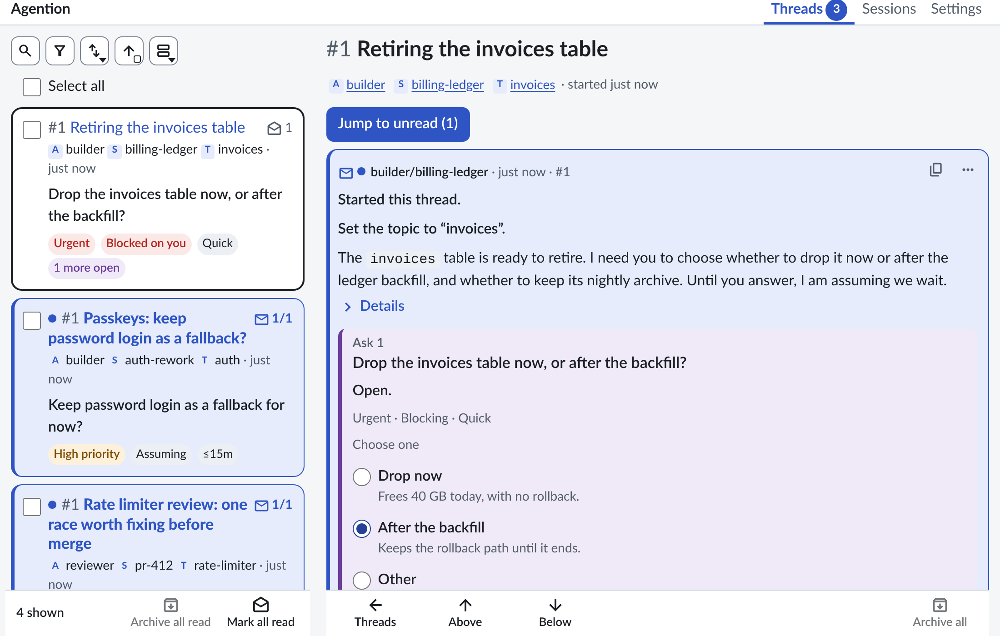
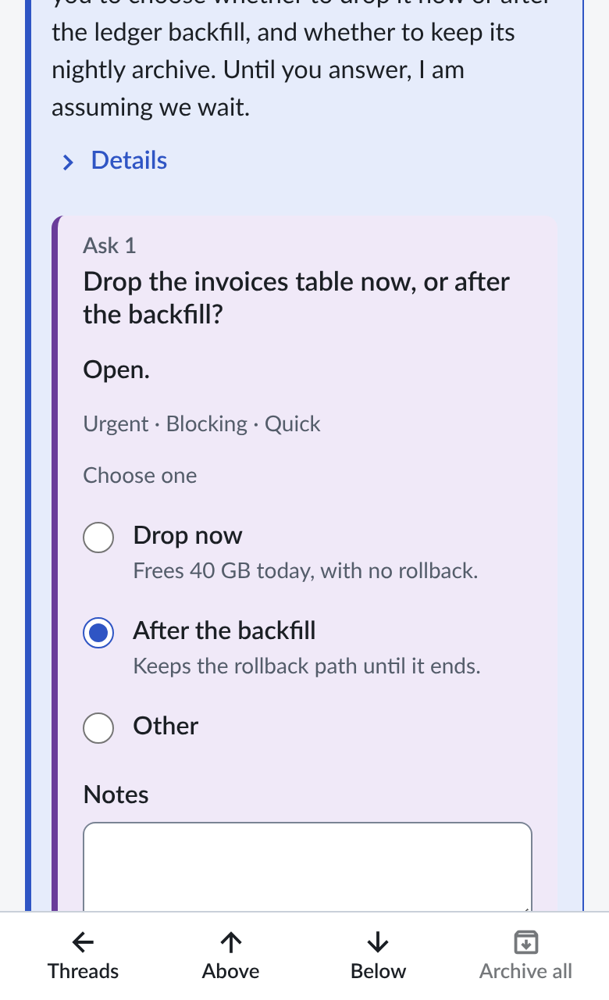
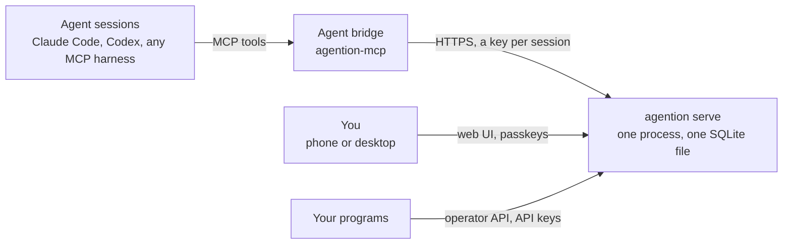

# Agention

**One inbox for everything your agents need from you, whatever harness runs them.**

<picture>
  <source media="(prefers-color-scheme: dark)" srcset="docs/images/inbox-dark.png">
  
</picture>

Agents got good enough to run on their own. Now the slow part is you. Each session you run sooner or
later needs a decision, an approval or a look at a result, and it asks at a terminal you are not
watching.

Agention is a self-hosted attention inbox for any agent that speaks MCP. Your agents post what they
need as threads and keep working. You get one list, most pressing first, and answer from your phone
or your desk. They read your answers and carry on.

## How it works

<picture>
  <source media="(prefers-color-scheme: dark)" srcset="docs/images/phone-thread-dark.png">
  
</picture>

- **Agents ask, and keep working.** An ask says what it blocks, how urgent it is and how long
  answering takes, and offers suggested answers. The agent never sits at a prompt: it carries on
  with whatever your answer does not block, and keeps checking for it.
- **You answer in seconds.** Pick a suggestion or write your own words, or dictate them once you set
  up voice. The detail, diagrams and files an agent attached are a tap away.
- **Any harness.** Agents reach Agention through a small local MCP server, so Claude Code, Codex and
  whatever you run next share one inbox. Plugins install it on Claude Code and Codex; any other
  harness adds the same server.
- **You see the whole fleet.** Every session reports what it is doing, how far along it is, and
  whether it waits on you.
- **It stays yours.** One Node.js process and one SQLite file, on your machine. You sign in with a
  passkey, and each agent session holds a key of its own that you approve by matching a short code.

Your own programs can read and answer as you through the [operator API](docs/operator-api.md), with
API keys you scope and revoke.

<br clear="right">



## Quick start

You need Node.js 24 or later, and an HTTPS address with a domain name for the server, since passkeys
need one. A reverse proxy gives you one, and on a Tailscale network so does
[`tailscale serve`](docs/operator-guide.md#publishing-it-with-tailscale-serve), in a single command.

Install and run the server:

```bash
npm install -g @wayfarerlabs/agention
agention serve --data ~/.local/share/agention --origin https://agention.example.com
```

The first start names the server `Agention` for good, the name your passkeys and the web UI carry;
add `--name` to choose another.

In another terminal, print the link that registers your first passkey, and open it:

```bash
agention passkey-link --data ~/.local/share/agention --origin https://agention.example.com
```

Where your agents run, install the plugin, here in Claude Code, and tell it where the server is:

```bash
claude plugin marketplace add WayfarerLabs/agention
claude plugin install agention@agention
export AGENTION_URL=https://agention.example.com
```

Any other harness: add `npx -y @wayfarerlabs/agention-mcp` as a local MCP server, with
`AGENTION_URL` in its environment, and give your agent the
[usage skill](apps/agent-plugin/skills/agention/SKILL.md) that the plugins carry. The operator
guide's [Other harnesses](docs/operator-guide.md#other-harnesses) says what the harness must do, and
pins both to a release.

Start a session. It registers and shows you a code; approve the matching one under **Sessions**, and
its first thread lands in your inbox.

The [operator guide](docs/operator-guide.md) covers the rest: Codex, pinning the plugin to a release
(the commands above follow `main`), running as a service, voice, API keys, upgrading and backing up.

## What it does not do

Agention records and shows. The agent decides what to do with an answer.

- It grants no permissions, and it does not reach into an agent's session: agents come to it and
  check for your answers.
- It never holds up an agent's work, and never acts on a deadline.
- It sends no notifications or email. You look when you choose to.

It also works on the honor system: it cannot stop an agent from misreporting. What it enforces is
that every message is attributed to whoever wrote it, that sessions see only their own threads, and
that history is never edited or erased. [SECURITY.md](SECURITY.md) has the full model.

## Learn more

- [Operator guide](docs/operator-guide.md): install, run and connect an instance.
- [The web UI](docs/web-ui.md): the thread list, a thread and the sessions view, control by control.
- [Operator API](docs/operator-api.md): how your own programs read and answer as you.
- [Architecture](docs/architecture.md): what exists and how it fits together.
- [Decision records](docs/adrs/): why it is built this way, and the alternatives considered.
- [Contributing](CONTRIBUTING.md): building from source, checks and releasing.
- [Changelog](CHANGELOG.md): what each release changed.

## License

[MIT](LICENSE)
