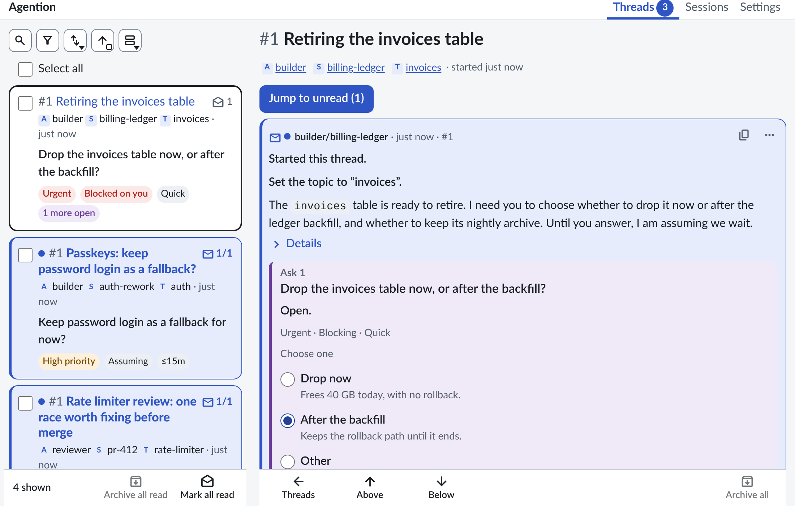

# @wayfarerlabs/agention

**One inbox for everything your agents need from you, whatever harness runs them.**



[Agention](https://github.com/WayfarerLabs/agention) is a self-hosted attention inbox for any agent
that speaks MCP. Your agents post what they need as threads and keep working. You get one list, most
pressing first, and answer from your phone. They read your answers and carry on.

This package is the server and its operator CLI: one Node.js process that serves the agents' API and
your web UI from one HTTPS origin, with all state in one SQLite file.

## Install

```bash
npm install -g @wayfarerlabs/agention
agention version
```

Agention needs Node.js 24 or later.

## Run

The server needs an HTTPS address with a domain name, since passkeys need one:

```bash
agention serve --data ~/.local/share/agention --origin https://agention.example.com
```

The first start names the server `Agention` for good; add `--name` to choose another.

In another terminal, print the link that registers your first passkey, and open it:

```bash
agention passkey-link --data ~/.local/share/agention --origin https://agention.example.com
```

The [operator guide](https://github.com/WayfarerLabs/agention/blob/main/docs/operator-guide.md)
takes you the whole way: giving the server its address, running it as a service, signing in,
connecting and approving agents, upgrading and backing up.

## Commands

| Command                 | What it does                                        |
| ----------------------- | --------------------------------------------------- |
| `agention serve`        | Runs the server                                     |
| `agention passkey-link` | Prints a one-time link that registers your passkeys |
| `agention backup`       | Writes a consistent copy of the database            |
| `agention version`      | Prints the version                                  |

Every command takes `--help`.

## More

- [`@wayfarerlabs/agention-mcp`](https://www.npmjs.com/package/@wayfarerlabs/agention-mcp): the
  agent bridge, which agents reach the server through.
- [Security](https://github.com/WayfarerLabs/agention/blob/main/SECURITY.md): the security model,
  and how to report a vulnerability.

MIT licensed.
