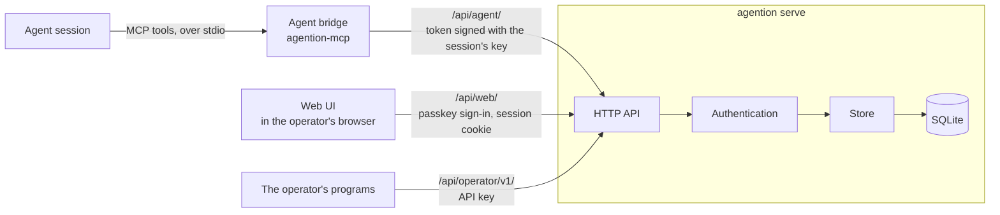

# Architecture

This document describes what exists in the repository today. Its design, and the alternatives
considered, are recorded in [ADR 0001](adrs/0001-agention-v1-architecture.md).

## Overview

Agention is one server process over one SQLite file. Three kinds of client reach it, each on a mount
of its own with a credential of its own, and all three mounts are adapters over the same store
operations, which enforce authorization themselves.

An ask travels like this:

1. The agent calls a bridge tool, such as `thread_create`. The bridge signs a short-lived token with
   the session's key and sends the request to the agent mount ([Agent bridge](#agent-bridge)).
2. The mount turns the token into an identity ([Authentication](#authentication)), then reads the
   request through its schema in `packages/api` ([API contract](#api-contract)), and a
   [store](#store) operation appends the message in one transaction. A message is never edited or
   deleted ([Database](#database)).
3. The web UI, which refreshes every 10 seconds while it is visible, shows the thread
   ([Web UI](#web-ui)). The operator answers, which appends a message of their own through the web
   mount.
4. That write wakes the long polls waiting on the session, so the agent's `message_wait` answers at
   once with the thread.

This document holds what binds two components, and what someone outside the code can observe. What
one file does and why is in that file's header comment, and this document names the file.

The rest of this document uses these terms:

| Term                   | Meaning                                                                                                                            |
| ---------------------- | ---------------------------------------------------------------------------------------------------------------------------------- |
| Requester and audience | A thread's two roles: the agent session it belongs to, which alone asks, and the operator, who alone answers                       |
| Live message           | A message no later one replaces ([Messages and asks](#messages-and-asks))                                                          |
| Open ask               | An ask still waiting for its answer ([Messages and asks](#messages-and-asks))                                                      |
| Thread status          | A thread's roll-up of its asks ([Derived state](#derived-state))                                                                   |
| Marks                  | Each party's own read and archive marks on a thread ([Marks](#marks))                                                              |
| Quiet                  | A session the server has not heard from lately ([Presence, quiet and stranded](#presence-quiet-and-stranded))                      |
| Stranded               | A thread whose session is not there to read what the operator wrote ([Presence, quiet and stranded](#presence-quiet-and-stranded)) |

## Components

Agention is TypeScript on Node, in npm workspaces with one lockfile.

| Component                | State                                                                                                                                                                                                                                               |
| ------------------------ | --------------------------------------------------------------------------------------------------------------------------------------------------------------------------------------------------------------------------------------------------- |
| `packages/api`           | The API contract: zod schemas for every route's requests and responses, which are also their bounds, the error codes and the scopes, and their JSON Schema for the API's documentation.                                                             |
| `packages/build`         | The bundle build the server and the bridge use, one esbuild file each, and the build of the web UI's diagram frame script, with the license notices of the npm packages each includes.                                                              |
| `packages/private-files` | The private-file rule the server's database and the bridge's key files obey, which both bundle.                                                                                                                                                     |
| `apps/server`            | The `agention` CLI: `serve` runs the HTTP API, with agent, passkey and API key authentication, over the database, identity and store, and delivers the audit log; `backup` copies the database; `audit forget-sink` removes an audit sink's cursor. |
| `apps/bridge`            | The `agention-mcp` agent bridge: a stdio MCP server whose tools make requests on the agent API, signed with the session's key.                                                                                                                      |
| `apps/web`               | The React web UI, built with Vite, which the server package ships and serves: passkey sign-in and the operator's views.                                                                                                                             |
| `apps/agent-plugin`      | The canonical plugin definition and usage skill, and the generator that renders the Claude Code and Codex plugins.                                                                                                                                  |
| `scripts/`               | The checks CI runs, file linting, plugin generation, the generation of the API's OpenAPI document, and the retaking of the README's screenshots.                                                                                                    |

## Source and packages

Node runs the TypeScript sources directly, by stripping their types, so development and the plugin
generator need no build step; Vitest compiles the sources for the tests. `packages/api` needs no
build either: its `exports` point at its source.

The server and the bridge each build into one esbuild bundle, which is what their npm packages
contain. The packages declare no dependencies, so installing either resolves nothing beyond what the
repository's lockfile built. Each bundle embeds its package's `package.json` at build time and
reports that version. Each package carries a copy of the repository's `LICENSE` and a `README.md` of
its own for its npm page.

The server's build first runs the web UI's build and copies it into the package's `web/` directory.
The web UI's build is Vite's, followed by a pass of its own that builds the diagram frame's script
with esbuild, through `packages/build`, as one classic script named for its content's hash, which
`web/diagram-frame.json` names for the server ([The diagram frame](#the-diagram-frame)). Beside each
file in `web/assets/` the server's build then writes a Brotli copy, which the server serves
([The web UI's files](#the-web-uis-files)), and it fails on a file there whose name does not have
the form of one ending in a content hash.

### License notices

Beside each bundle the build writes `THIRD-PARTY-NOTICES.txt`, the license of every npm package the
bundle includes and, for the server, of every package in the web build, which Vite and the frame's
pass report, and of the Material Symbols whose path data the web UI's icons copy, with the license
copied beside them.

- **Inlined packages.** An included package whose own build inlined other npm packages names them in
  its files' region or path comments. The notices include those too, read from copies the bundling
  package lists under `devDependencies` at the inlined versions, and the build fails if one is
  missing.
- **Missing license text.** The build fails for a package whose notice would carry no license text.
  `packages/build` supplies, per package version, text a package's own files do not give it, such as
  license terms that live only in a README.
- **The Eclipse Public License.** A package under the EPL, such as `elkjs`, which Mermaid lays out
  diagrams with, always needs that text: the copyright notices in its code, which minification
  strips, and a statement of where its source code is available. The frame's script opens with a
  comment that carries it and names the server package's notices, and the build fails for a package
  under the EPL without it.

### Package checks

The checks pack each package as npm would publish it, confirm it declares no dependencies and ships
both license files and a `README.md`, then install it from the tarball outside the repository and
run its command through `node_modules/.bin`, which must print the package's version. The installed
server is also started on loopback, and must serve the web UI its package ships and answer the API.

## API contract

`packages/api` defines, as zod schemas, the requests and responses of every route, and exports the
inferred types the server, the bridge and the web UI share:

- starting a thread, sending a message, reading a thread, a session's thread list and its long poll,
  and the operator's wait across sessions;
- read, unread and archive marks; the operator's thread list with its total and, grouped, its
  groups' roll-ups; the counts of what each filter value keeps; bulk read and archive; and the
  operator's actions on many threads, named or matching the list's filters;
- registration submit and state, the registrations list and approval;
- a session's status update and the status it answers with, and the status a session's writes report
  or infer; the sessions view's page of agents, each with its tags and its sessions; how many
  sessions have updates the operator has not read; a session's log and the operator's read mark on
  it; and the operator's start of a thread on a session;
- the operator's session groups and tags: the list of them, creating, renaming, recoloring, ordering
  and removing groups, creating, renaming, recoloring and removing a tag, and setting a session's
  group and an agent's or a session's tags, on their own or with an approval;
- the operator's saved views (`packages/api/src/saved-views.ts`): a view's id and name, the bound on
  how many an instance holds, a view as read, with its whole thread list, the list of them, and
  saving, renaming and replacing one;
- the agent API's version, the header that carries it and the oldest version the server serves;
- the browser session's state, the passkey ceremonies' inputs and the operator's passkey list;
- the operator's settings: voice's settings and their bounds, the base URL rule (`checkBaseUrl`),
  the hosted presets, the types a recording is sent as, a transcription's answer, and the space
  attachments take;
- files (`packages/api/src/files.ts`): the limits on files and pending uploads, a file's name and
  reference, an upload's query and result, a message's `attachments` as written and as read, a
  thread's file list and file totals, and the types: the type an upload declares (`declaredTypeOf`),
  the type a name's extension suggests (`typeOfName`), and the type a file is served as and its
  disposition (`servedTypeOf`, `dispositionOf`), which the server serves by and the web UI shows by;
- pull requests and branches (`packages/api/src/code-links.ts`): a GitHub repository as
  `owner/name`, a pull request's number, a branch's name under git's own rules
  (`git check-ref-format --branch`), at most 255 code points, and an entry's optional URL; a
  message's lists, each of at most 20 and naming an entry once; the short forms `owner/name#135` and
  `owner/name:branch`, their parsers, and the key, the short form with the owner and name folded to
  lower case, as GitHub compares them, the number and the branch never folded, as git compares
  branch names; and a thread's roll-up of each;
- the scopes, `<resource>:<access>`, and which each includes (`holdsScope`); an API key's secret,
  name, scopes and expiry, the key list, a new key with its secret, a revoked key, and the bound on
  the keys the operator holds ([API keys](#api-keys)); and the operator API's versions;
- the claims of an agent's token, and the error shape.

### Bounds

The schemas are the bounds:

- Text lengths count Unicode code points, and required text needs a character other than white
  space.
- Single-line plain fields refuse line breaks, control characters and invisible format characters.
- A URL is accepted only if `isLinkableUrl` would show it as a link.
- An optional list, such as a message's references, is omitted rather than empty.
- A message's text, a summary read first, holds at most 1,000 code points, and its detail, the
  Markdown long form beside it, at most 20,000. Every message's schema refuses detail without text,
  naming `detail`. The descriptions of both fields say what each carries, since the bridge's tools
  show them to agents.

Query parameters are read into the same schemas as body fields; a filter of several values repeats
its parameter, once for each, and a parameter repeated where one value is taken is refused.
`invalidInputBody` turns a schema failure into the error shape, naming the field at fault as a
dotted path.

Request schemas ignore fields they do not know, so a server still reads what an older bridge sends.
A newer bridge never relies on that ([Agent API version](#agent-api-version)).

### Entry points of their own

The registration code, which the bridge and the server both derive from a session key, has its own
entry point, `@wayfarerlabs/agention-api/registration-code`, because it uses `node:crypto` and must
stay out of the web bundle. It takes a key the `publicKey` schema has accepted.

The schemas' JSON Schema, for the API's documentation, has its own entry point too,
`@wayfarerlabs/agention-api/json-schemas`, which only the server imports, so the web bundle never
carries it. `JsonSchemas` describes a schema in one direction, what a client sends or what the
server answers, with zod's own `z.toJSONSchema`, which carries each field's description.

- **Components.** The named schemas it lists, such as `Message` and `ThreadSummary`, are described
  once each, as components that every description holding one references by `$ref`: each component
  is the body zod gives the named schema under the `$defs` of a description that holds it, and the
  descriptions name it by its plain id.
- **Directions.** A schema reads the same both ways unless it has defaults or reads text into
  values, or holds one that does, so such a named schema is described in one direction only, as
  `Ask` is only sent and `AskRead` only answered. A component its descriptions would give two
  bodies, or a cycle no named schema breaks, throws.
- **Answers.** An answer's description never forbids properties it does not list, since a version
  may add response fields.

### The origin

`canonicalOrigin` reads the HTTPS origin a person configures, the server's `--origin` and the
bridge's `AGENTION_URL` alike, into its one spelling, and refuses anything that is not exactly an
origin with a domain name, including an explicit default port and an IP address, for which browsers
refuse passkeys. A domain name is labels of 1 to 63 letters, digits and hyphens, at most 253
characters in all, once an internationalized name is converted to ASCII. A refusal quotes at most
the first 100 characters of the value. Passkeys, browser checks and agent tokens are bound to that
string, so both ends must spell it alike.

## Private files

[SECURITY.md](../SECURITY.md#private-files) states the private-file rule that the server's data
directory and database, the audit log's directory and files, and the bridge's key files obey.
`packages/private-files` holds the functions that apply it, private or shared with a reading group,
and the `PrivateFileError` they refuse with, which each caller words in its own error; the server
and the bridge bundle it.

## Database

The server opens one `node:sqlite` connection per process (`apps/server/src/database/`), at the
database's real path. Opening refuses, before SQLite reads the file, a data directory, database file
or file beside it that breaks the private-file rule, and a file whose SQLite header is not
Agention's. A refusal is a `DatabaseOpenError` whose `reason` says which rule failed.

Migrations are an ordered list of SQL scripts; `PRAGMA user_version` records how many have run, and
a database written by a newer release is refused. Every table is `STRICT`, and times are Unix
milliseconds. `transaction()` runs one synchronous function under `BEGIN IMMEDIATE`, so no write
interleaves with another in the process.

### Messages and asks

Messages are append-only, with their asks, answers and withdrawals, enforced by triggers that also
catch `REPLACE`. A message's asks, answers and withdrawals are rows of their own:

- **An ask** is numbered within its thread, from 1 in the order asks are written and a message's own
  in the order given, and is never renumbered.
- **An answer** belongs to its message and names the number of the ask it answers, and reads back
  with that ask's question, so a reader knows what it answers.
- **A withdrawal** belongs to its message and names the number of the ask it withdraws, with the
  requester's reason.

Two views define once, for every query, which messages are live (`live_messages`: no later message
replaces them) and which asks are open (`open_asks`: on a live message, and no live message answers
or withdraws them).

A thread changes only its latest sequence, which a trigger holds. A session records when it was last
seen, kept to the minute. Checks hold the rest of what the store keeps true: one operator, whose id
is 1; a registration's session set exactly when it is approved or revoked; and a message's detail
only beside its text.

`message_positions` gives every message a position among all messages, in the order they are
written, which the operator's wait across sessions counts from. A message has no stable integer key
of its own: it is keyed by its thread and sequence, and its table's rowid is no column's alias, so
`VACUUM` may renumber it. A position is an `INTEGER PRIMARY KEY AUTOINCREMENT`, which keeps its
value and is never reused, so positions never go backwards. A trigger gives each message its
position as it is written, triggers refuse every update and delete of a position, and the migration
that added the table numbered the messages already written in the order they were stored.

### Search indexes

Two full-text indexes serve search, both matching word prefixes with case and accents ignored:

- `thread_titles` holds every thread's title. A trigger fills it as a thread is created, and it
  relies on titles never changing.
- `message_texts` holds the text and detail of every message that has text. It keeps no copy of
  them, only each message's thread and sequence, since a message has no integer key of its own for
  an external-content index to rest on. A trigger fills it as a message is written, since messages
  are append-only, and a search joins its rows to `live_messages`, so a replaced message no longer
  matches.

### Session status, groups and tags

A session's status lives only in its log, `session_updates`, append-only by the same triggers as
messages. Each entry, numbered from 1 within its session, holds the session's whole status after it
(its state, the outcome it stopped with, its title, goal and percent), its own note, the credential
behind it and whether the server inferred it. The current status is therefore the entry with the
highest number, read through the primary key, and nothing about it is stored on the session. A check
holds an outcome exactly beside the stopped state, and an inferred entry only as working, without a
note. `session_marks` holds each actor's read cursor on a session's log, as `thread_marks` holds one
on a thread.

The operator's session groups are rows of their own, `session_groups`, each with a name unique
ignoring the case of ASCII letters, since a group can be empty and renamed, a color, and a position
in the operator's order, unique by an index. A group keeps its id when renamed, and ids never
repeat, so a filter or fold naming a removed group never reaches a later one.
`session_group_members` is keyed on the session, so a session sits in at most one group, and
removing a group takes its memberships with it by a cascade.

A tag is a row of its own too, `tags`, with a unique name and a color, and exists until it is
removed; an agent (`agent_tags`) or a session (`session_tags`) carries it by its name, a foreign key
whose cascades rename it everywhere it is carried and take it off everything when it is removed. A
check holds each color to the palette. Agents and sessions are never deleted, so no membership or
tag outlives what it is on.

### Saved views' table

The operator's saved views are rows of `saved_views`, each a name unique ignoring the case of ASCII
letters, as a group's is, and one thread list, `view`, the JSON object the list's view schema
(`threadsView`) parsed it into, every part included, those at their default when it was saved among
them. A check holds `view` to a JSON object. A view is the operator's configuration, not a log, so
it changes in place, and ids never repeat, so nothing naming a removed view reaches a later one.

### File tables

Files have three tables:

- `files` holds one row per upload: its random reference, the name and declared type it was uploaded
  with, its size, as its `Content-Length` declared it before any byte arrived, who uploaded it, in
  which session and with which registration, and, once every byte has arrived, its SHA-256 and when
  it completed. A file is pending until a message first names it, which `attached_at` records.
- `file_chunks` holds its bytes, in chunks of 1 MiB numbered from 0, all full but the last, in a
  rowid table, since rows of 1 MiB would leave a `WITHOUT ROWID` tree's pages one row each.
- `attachments` holds the files each message carries, in the order it gave them, each under a name
  unique within the message, append-only as messages are. A trigger marks a file attached as the
  first message names it, with that message's time, and a check refuses attaching a file that is not
  complete.

Triggers let a file's row change only by completing once and being attached once, keep a chunk's
bytes from ever changing, and refuse removing an attached file or any of its chunks. A file is
missing when its last chunk is gone, which is what a future purge, deleting all of a file's chunks,
would leave; a zero-byte file never is.

`message_links` holds the pull requests and branches each message names, a row for each, in the
order the message gave them: the kind, the entry's key, its repository, number or branch and URL as
written. A check holds a pull request's row to a number without a branch, and a branch's to a branch
without a number; a message names a key once; and triggers keep the rows append-only, as messages
are. An index on the key serves the filters, which read the thread and sequence from it alone.

### Settings and API keys

`voice_settings` holds at most one row, what the operator's Settings last saved for voice: the base
URL and model in effect when it was saved, the environment's included, so the row always records the
address its key was entered for, an optional prompt (Settings' additional context), and an optional
key. Turning voice off deletes the row. Which provider it means is worked out from its base URL,
never stored apart from it.

`api_keys` holds the operator's API keys: each one's name, its scopes as a JSON array, the SHA-256
of its secret, which is unique, and when it was created, when it expires (null for a key without an
expiry, and otherwise after its creation), when it was last used, kept to the hour, and when it was
revoked. A revoked or expired key keeps its row, so the operator's list can show it, until the
cleanup [Browser sessions, stored secrets and cleanup](#browser-sessions-stored-secrets-and-cleanup)
describes. Ids never repeat, so an id names one key for good.

### Audit tables

`audit_events` holds the [audit log](#audit-log), one row per event: `seq`, its place in the log's
one order, `AUTOINCREMENT`, so a sequence is never reused while the database lives, even once
retention empties the table; `uid`, a random UUID; `event`, the OCSF JSON as the builder wrote it;
copies of its time, class, action, outcome and credential for filtering; and `open_until`, the end
of a coalesced failure's minute. Its triggers hold the log to its rules:

- each insert takes the next sequence, and its JSON carries its own `seq` and `uid`;
- no update, except an open failure's, before any sink has it: its `count` rises and its `end_time`
  moves on within its minute, both staying integers, and nothing else changes; or it closes, its
  `open_until` becoming null and nothing else changing;
- a delete only of the oldest row, and only once every sink's cursor has passed it.

`audit_events_open`, a partial index on `open_until`, holds only the coalesced failures; the three
queries that look for open ones, coalescing's and delivery's two, name it with `INDEXED BY`, since
without `ANALYZE`, which the server never runs, SQLite would answer their `min(seq)` by walking the
primary key, the whole backlog. A failure is open while its minute's end is ahead and at most a
minute ahead: one further ahead was recorded before the clock stepped back, and counts as closed.

`audit_sinks` holds each sink's cursor, keyed by its kind, the last sequence it delivered, which a
trigger lets move only forward. `instance.uid` is the instance's random id, made once by the
migration and never changed, which every event carries. `browser_sessions.id` is each browser
session's random id, which names it where its cookie must not; the migration rebuilt the table to
add it as a unique, constrained column, giving every open session one.

### Incremental vacuuming

The database uses incremental vacuuming, so the pages that removing an upload frees return to the
disk a step at a time. `apps/server/src/database/vacuum-mode.ts` switches a database whose header
still says no vacuuming, after its migrations, with a `VACUUM` that rewrites the whole file; its
comments say why that cannot be a migration. Reading the header means a backup restored from an
older release switches too.

`VACUUM` builds its copy in SQLite's temporary directory (`SQLITE_TMPDIR`, else `TMPDIR`, else
`/var/tmp`, else `/tmp`), needing about the database's size free there, and as much again beside the
database. A switch of a database that held data before the open is logged once it is done, and one
of a new database is not. A switch that fails logs why and the space it needs, and the open carries
on without it: freed pages then stay in the file for reuse, the sweep skips its vacuum, and the next
open tries again.

Every open also sets `journal_size_limit` to 16 MiB, so a log that a backup's long read let grow is
truncated.

### Migration tests

A test freezes the text of every migration by its SHA-256. A migration a release has shipped is
never edited, so a schema change is always a new migration, which adds its hash; an edit to a
migration no release has shipped updates its hash. Others open databases that earlier migrations
wrote under every later one, and check that their rows are kept, that the messages already written
get positions in the order they were written, and that the full-text index finds them.

### Backup

`agention backup` (`apps/server/src/database/backup.ts`) copies the database without the `Database`
class, so it never migrates it. It checks the database file as opening does, refusing a missing one,
and opens it read-only; like any read-only connection to a database in WAL mode, that may leave
SQLite's empty `-wal` file and its `-shm` beside a database no server has open, which the next
server to open it uses as its own.

It creates the copy itself, with the private-file rule applied to the copy's directory and with mode
0600, refusing a file that exists, one beside which SQLite would find a journal or log of its own,
and, before creating anything, one at the database's own journal, log or shared-memory path. The
copy is the database as it stood at one moment, whatever a server writes meanwhile, and it must pass
`PRAGMA quick_check`; a backup that fails removes what it created. The file's comments say how each
step keeps that.

## Store

Every operation (`apps/server/src/store/`) takes the caller's identity, the target the request
names, and input its schema has already parsed.

### Authorization

An identity holds scopes, `<resource>:<access>` ([HTTP API](#http-api)): a browser session holds
every one, an API key those the operator gave it, and an agent's registration `threads:write` over
its own session.

Inside the operation's transaction, `authorizeScope` confirms the credential is still live (the
registration approved, the browser session unexpired, the API key neither revoked nor expired) and
that it holds the scope the operation requires. To an identity without it the operation does not
exist. An operation on one session uses `authorize`, which does the same and confirms the credential
grants the target session, an unknown session and someone else's both failing as `not_found`.

The mounts refuse a missing scope too, before reading any input, but every operation confirms its
own, so each adapter over the store is held to the same scopes.

### Writing a message

A write checks, in order:

1. request-id replay;
2. roles: only the requester asks, withdraws asks or sets a topic, and only the audience answers;
3. staleness;
4. the rules that depend on the thread's messages, below, with the message's `attachments` last
   ([Attachments on a message](#attachments-on-a-message)).

The rules that depend on the thread's messages:

- **A replacement** names a live message of the writer's own.
- **Answers.** Each answer names an open ask and fits it, and a message answers an ask at most once.
  A replacement answers again every ask the message it replaces answered that is still live, and
  none its requester since revised or retracted, an answer to such an ask going with the replaced
  message, and may answer open asks besides.
- **Withdrawals.** Each withdrawal names an open ask, the replaced message's own included, and a
  message withdraws an ask at most once. A replacement withdraws again every ask the message it
  replaces withdrew, with the same reason or a new one, whether or not the ask's own message is
  still live, so a withdrawal is never undone.
- **Open asks of a replaced message.** A replacement of a message holding open asks asks each again
  or withdraws it by name: its asks and its withdrawals of those asks number at least as many as it
  holds open, since a replacement's asks are numbered anew and the count is what can be checked.
- **A thread reference** names a thread in the same session.

Refusals name asks by their numbers.

An answer is a decline, or distinct picks among the ask's suggested answers and the answerer's own
words, at least one of them: an ask without suggested answers takes own words alone, and one that
allows a single answer takes one pick at most. The own words are part of the answer, notes beside
its picks or the whole answer without them, plain text apart from the message's Markdown text and
detail, which are any additional information.

A later message carries some part unless it replaces another, a rule the request's schema holds,
since no constraint on a message's row sees the rows of its own. A thread's first message may carry
nothing, since its title speaks for it. A replacement carrying nothing retracts the message it
replaces, which the rules above allow only while that message holds no open ask. A replacement is a
whole message: what it leaves out, its detail included, is gone with the message it replaces.

The write appends the message with its asks and answers and raises the writer's read mark through it
in the same transaction. A writer for whom the thread is archived keeps it archived, its archive
mark moving to its own message.

A write answers with the thread number and the message's sequence. A retry of the same request id
gets that same answer, while a retry with any part changed, its detail included, is a request-id
conflict. A stale write appends nothing, so its retry may reuse the id.

### Derived state

Everything a thread shows beyond its title, roles and latest sequence, such as its topic, open asks,
status, unread count and count of live messages, is derived in queries over the two views
([Messages and asks](#messages-and-asks)), never stored.

A thread's status rolls up the asks on its live messages and those a live message withdraws, so an
ask its own message's replacement withdrew counts and a revised ask does not. It is the first of
these that holds:

1. `none`, when there are none;
2. `open`, when any of those asks is open;
3. `withdrawn`, when every one is withdrawn, and the status carries the latest such withdrawal;
4. `answered`, for the rest.

It is the same whoever views it.

A thread's summary lists at most 50 of its open asks, the most pressing, beside their count and the
earliest.

### Presence, quiet and stranded

Every authenticated call on the agent mount, and `register` from an approved key, the first call of
every conversation, marks its session seen before its own work, in a transaction of its own, so a
call refused later still counts.

- It writes only while the registration is still approved, so a revocation that commits as a token
  is verified stamps nothing.
- It writes only when that moves the session's last seen a minute or more, or when the last seen is
  after now, so a clock stepped back never holds it still.
- A stamp that fails is logged and the call carries on, since presence is advisory.
- A pending registration has no session, so its calls mark nothing.

A session is quiet when it has not been seen within `agention serve --quiet-minutes`, 15 by default,
and the minute a stamp may lag, so a session that keeps calling never is, or when it was never seen.

A thread is stranded when it holds a live message of the operator's that the session has not read
while the session is quiet, has no active credential or has stopped: the agent is not there to read
it.

Both are derived in queries against the request's clock, and only the thread's audience, the
operator, sees them, with the state and outcome the session last reported, which say why it is
stranded; a grouped list's presence for a session or an agent carries neither.

### Session status

A session reports its status itself, on the agent mount's status route or beside a write. A thread
it starts or a message it sends may carry a state, with its outcome, and a note, which apply as an
update with them would, in the write's transaction once the write has passed its checks. A write
that fails therefore changes no status, and a retry of the same request id applies nothing again.

The server infers one change of its own. A write the session makes to one of its threads (starting
it, a message, a read or unread mark, archiving) while it is idle and reports nothing of its status
marks it `working`, since a session that writes is doing something. The server logs that change as
an inferred entry, keeping every field but the state, with no note. A write that reports a status
takes it exactly as an update would, so every change the server infers is marked inferred. Nothing
else is inferred:

- reads and waits change nothing, since an idle session checks for answers by design;
- a stopped session stays stopped, since one that writes was started again and says so itself;
- a session that never reported stays without a status;
- the operator's writes, whose mounts take no status, change nothing.

No other call changes the status.

Each update merges into the current status:

- **State.** A state replaces the state, `stopped` with the outcome the update must give, and
  `working` and `idle` with none, so a stopped session stays stopped until it reports one of them. A
  session that first reports without a state is `working`, since it is running.
- **Title, goal and percent.** Each sets its field, and a goal other than the current one clears the
  percent unless the update gives one. A field left out is unchanged, and nothing clears a field.
- **Note.** The note belongs to its entry alone.

An update whose merged status equals the current one and that carries no note appends nothing, so an
update carries no request id: repeating one changes nothing, unless it carries a note, which is
logged again. Updates are exempt from the stale rule and the latest wins, since only the session
writes its status.

The operator reads a session's log newest first, with their read mark on it, which marking read
raises up to the latest entry and never lowers; the entries above it are the session's unread
updates.

### The sessions view's page

The sessions view's page pages the agents in name order for the operator, each with its tags and at
most 500 of its sessions, saying when it leaves any out: those working or idle first, then those
that never reported, then stopped ones, each latest seen first. Each session carries:

- its presence, by the formula threads use;
- its group and tags;
- its approved registrations, with their ids and codes;
- its status with the latest entry's note, none after an inferred one, and as `updated_at` when that
  entry was written;
- its unread updates;
- how many of its threads the operator has not archived, with how many of those hold messages the
  operator has not read and how many are stranded, counted for every session of the page in one
  statement grouped over the threads as the operator sees them;
- how many asks are open in all its threads, with how many of those are blocking, which is what
  waits on the operator, counted in one statement grouped over the open asks.

The operator can never archive a thread holding an ask open to them, so their thread list shows
every thread counted. A separate read counts the sessions whose log holds entries the operator has
not read, which the web UI's navigation shows.

### Session groups and tags

The operator sorts sessions into groups and tags agents and sessions, and nothing else does: listing
them needs `sessions:read` and every change to them `sessions:write`, scopes no agent's registration
holds, so to an agent none exists.

- **Names.** A group's name is plain text on one line, trimmed, 1 to 100 code points, unique
  ignoring the case of ASCII letters; a tag's is a name, as a topic's is. A name another group or
  tag already has is refused as `conflict`, naming `name`, whether either is created or renamed.
- **Colors.** A color is one of a fixed palette of eight named tones, `gray`, `red`, `orange`,
  `yellow`, `green`, `teal`, `blue` and `purple`, which each client draws to suit its themes; any
  other is `invalid_input`. A group or a tag created without a color takes the palette's in turn,
  each kind its own: the color after as many as there are groups, or tags, already.
- **Bounds.** An instance holds at most 200 groups, and an agent or a session carries at most 20
  tags; past either bound a write is `invalid_input`. A tag is a row keyed by its name, which the
  tags agents and sessions carry name by a foreign key, and an instance keeps at most 500, so the
  list of them is whole unless an upgrade carried more tags in use than that, which it then says it
  left out; creating one past the cap, directly or by setting tags, is `invalid_input`.
- **Groups.** A group's rename changes its name only, so a filter by its id keeps working, and
  removing it leaves its sessions in no group. Setting a session's group names it by id, or none.
- **The order of groups.** A new group goes last in the operator's order, and ordering the groups
  gives every group's id once, in the order wanted: a list naming any other set, as when another
  client created or removed a group since, is `invalid_input` on `groups` and changes nothing, so
  two clients' orders never interleave, and the later whole order stands.
- **Tags.** Renaming a tag renames it on every agent and session carrying it, and removing one takes
  it off all of them. Setting an agent's or a session's tags gives the whole set, and creates, with
  its color in turn, any tag it names that does not exist.
- **With an approval.** Approving a registration may also give the session's group, by id or none,
  and its tags, which apply in the approval's transaction, so a new session never shows without
  them, and which need `sessions:write` beside `sessions:approve`: to an identity without it, they
  are `not_found`, naming the field, and nothing applies. A group is named by its id there as
  everywhere, so a client creates a new one first; a tag by its name, which creates it as setting
  tags does. Agents' tags are set on their own, since an agent's tags count for every session it
  has.
- **The list** gives every group in the operator's order, with its color and how many sessions it
  holds, and every tag, at most 500, in name order, with its color and how many agents and how many
  sessions carry it, none for a tag nothing carries, saying when it leaves any out.

### Saved views

A saved view (`apps/server/src/store/saved-views.ts`; [ADR 0007](adrs/0007-saved-views.md)) is a
name and one thread list: every filter, the order, its direction and the grouping, the value the web
UI's address names a list by. Listing them needs `saved-views:read` and every change
`saved-views:write`, scopes no agent's registration holds, so to an agent none exists.

- **Names.** A view's name is plain text on one line, trimmed, 1 to 100 code points, unique ignoring
  the case of ASCII letters. A name another view already has is refused as `conflict`, naming
  `name`, whether the view is saved or renamed. Views are listed by name, in the same collation.
- **Bound.** An instance holds at most 200, past which saving one is `invalid_input`; a bound that
  keeps the list's answer bounded, not one real use reaches.
- **Writing** parses the view with `threadsView`, so a list the thread list would refuse is
  `invalid_input`, naming the part, and stores the parsed value whole, its defaults included. A view
  so keeps the list as it was saved: should a release change a default, a view keeps its own, while
  the address, which leaves defaults out, follows the new one.
- **Reading** parses the stored text with `threadsView.strict()`: persisted state, checked rather
  than trusted, so a view the schema refuses, or holding a part it does not have, fails loudly as a
  server error, never a guess. A change to `threadsView` that would refuse a stored view ships with
  a migration rewriting the stored views, so the strict read never meets one.
- **What a view names.** Groups are named by id, which a rename keeps and a removal never gives to
  another, so a view naming a removed group keeps no threads. Tags are named by name, so `renameTag`
  rewrites the `tag` list of every view naming the tag in its own transaction, keeping a name the
  rename would give twice once, where it first stood; removing a tag rewrites nothing, so a view
  naming it keeps no threads, until a tag of that name exists again, which it then matches, as the
  list's address would. Agents and sessions are never renamed or removed, and a topic, pull request
  or branch no thread carries keeps no threads: every filter by name narrows, never widens.

### Threads the operator starts

The operator starts a thread on a session with a title and a first message of text, with its detail
and its files, uploads of theirs to that session, checked as any first message's are. The session
stays the thread's requester and the operator its audience, so the operator's request has no field
for asks or a topic, nor for references, which the web UI does not offer there; a request carrying
any of them starts a thread without them. The session reads the thread as the operator's words and
replies in it.

The thread starts whatever the session's state or credential, stranded from the start when the
session is not there to read it; the operator's read mark reaches their message, and the session's
long polls wake. A retry with the same request id is answered as the first was, and one with other
content is a request-id conflict, as for a session's own thread, which a session still starts only
in itself.

### Uploads

An upload (`apps/server/src/store/files.ts`) begins in one transaction, which authorizes the session
under `threads:write` and refuses it while its writer holds 20 pending uploads, or would hold more
than 1 GiB of them by their declared sizes with this one, counting those still arriving and not
those expired. It then inserts the file's row with a reference of 16 random bytes in base64url, and
adds the file to the process's set of uploads in flight. A writer may run several uploads at once.

Each chunk is written in a transaction of its own, which confirms the scope as every store call does
and re-checks the credential, so the upload of a revoked agent's registration or a revoked or
expired API key stops within one chunk. Completing checks that the bytes received number the
declared size, and records the hash and the time.

Any failure after the upload begins, a body cut off, a revoked credential or a length that does not
match among them, removes the file and its chunks in one transaction; a removal that itself fails is
logged and left to the sweep. A completed upload no message names expires 24 hours after it
completed, unless its writer removes it first, as the web UI does for a draft left unsent
([Web UI](#web-ui)).

### Attachments on a message

A message's `attachments` are checked last of the write's message rules (`checkAttachments` in
`store/attachments.ts`):

- Each `upload` must name a file of the writer's own, uploaded in the thread's session, complete,
  not yet attached and not expired. Anything else, another writer's or another session's upload
  included, is `invalid_input` at `attachments.N.upload` in the same words, so a reference learned
  elsewhere tells nothing.
- Each `keep` needs `replaces` and must name a file of the replaced message, under its name there,
  and the message carries it again.
- The names resolved, given, kept or an upload's own, must differ after NFC normalization.

Attachments are part of the digest a request id covers, and the replay runs before the check, so a
retry whose first attempt consumed its uploads answers as the first did. A message may carry files
alone; a replacement that keeps files does not retract the message it replaces, and one that does
not keep a file leaves it with the replaced message.

What reads back:

- **A message** carries its attachments, in order: each file's name, reference, size, declared type,
  and whether it is missing.
- **A thread's files** are those its live messages carry: a replaced message still reads back with
  its own, but they count toward the thread only while a live message, such as a replacement that
  kept them, carries them.
- **A thread's answer** carries `files`, the count and bytes of those distinct files.
- **A thread's file list** gives each file once, with the live message that carries it, newest
  first, paged by an opaque cursor; a file has at most one live carrier, since an upload is attached
  once and only a replacement keeps a file.
- **The settings' `storage`** counts every completed file, pending ones included, since that is the
  disk they take, and their bytes.

### Pull requests and branches on a message

A message's pull requests and branches (`store/code-links.ts`) are written with it, in the same
transaction, and read back with it as written, in its order; a message may carry them alone, and the
digest a request id covers includes them. A replaced message keeps its own lists, which play no part
in the roll-up; its replacement counts when it names an entry again.

- **A thread's answer** carries their roll-up, `pull_requests` and `branches`, derived in a query
  over `live_messages`, never stored: each key its live messages name, once, as its latest live
  mention wrote it, with the URL of the latest live mention that gave one, the most recently
  mentioned first and a message's own in its order, at most 500 of each with `truncated` saying the
  least recent were left out.
- **A thread's summary** carries `links`, by the roll-up's rules: how many distinct pull requests
  and branches its live messages name, and, while they name exactly one entry in all, that entry as
  the roll-up lists it, so a list row shows it without reading the thread.
- **The thread lists' filters** take one pull request and one branch by short form on a session's
  list, and up to 50 of each on the operator's. Each keeps the threads whose live messages name an
  entry's key, which are exactly those whose roll-up lists it; the filter, the roll-up and the
  summary all read the same live mentions (`liveLinks`).

### The sweep

The sweep (`store/sweep.ts`) removes what the server keeps no longer: the audit log's events past
their retention ([Retention](#retention)), then the uploads no message will name, those past their
expiry ([Uploads](#uploads)) and those left incomplete that are not in the set of uploads in flight.
`agention serve` runs it once before it listens, when nothing is in flight, so every incomplete
upload goes, and then every 10 minutes; a part that fails is logged and the next pass tries again.

When a pass freed pages on a database using incremental vacuuming, it returns them to the disk 2,048
pages, 8 MiB, at a time. The set of uploads in flight is in the process, so one server serves a
database, as the long poll's notifier already requires.

### Marks

Marking read, marking unread and archiving move only the caller's own marks on a thread; they write
no message and wake no one.

- **Marking read** raises the read mark and never lowers it.
- **Marking unread** names a message, at most the thread's latest, and lowers the read mark to just
  before it, never raising it, so it cannot claim a message the caller has not seen.
- **Archiving** raises the archive mark through a message, carried on over the caller's own messages
  that directly follow it, archiving all of a thread being archiving through its latest. It is
  refused while an ask open to the caller sits in a message at or before it.

A thread is archived for the caller exactly while its archive mark reaches its latest message, so
another party's new message brings it back, and the caller's own keeps it archived; no party ever
sees the other's archive mark.

Unread messages are the live ones by another actor after both the read and the archive mark: an
archived message is never unread, so an agent that archives a thread without reading it is not woken
for it again. Since an answer is never retracted and every new ask arrives after the mark, a thread
holding an ask open to the caller is never archived for it.

### Filters

A list holds the threads not archived for the caller, its own new threads included, and with
`include_archived` the archived ones too. Every other narrowing is a filter. Filters combine with
AND, and the values of one that takes several combine with OR. Both lists take these:

| Filter   | Keeps the threads                                                                                                                                                              |
| -------- | ------------------------------------------------------------------------------------------------------------------------------------------------------------------------------ |
| `search` | Whose title holds every word of its text as the start of a word; in the operator's list also those one of whose live messages holds every word in its text and detail together |
| `status` | Of one status                                                                                                                                                                  |
| `unread` | With unread messages                                                                                                                                                           |
| `topic`  | On a topic, a name as an agent's and a session's are: one bare topic name in a session's list, and up to 50 in the operator's, each written `agent/session/topic`              |

`search` quotes each word, so the text is never read as query syntax, and matches messages through
the index and the view that [Search indexes](#search-indexes) describes, so live keeps its one
definition.

The operator's list also takes these:

| Filter                      | Keeps the threads                                                                                                                                                  |
| --------------------------- | ------------------------------------------------------------------------------------------------------------------------------------------------------------------ |
| `priority`                  | With an open ask at that level or higher                                                                                                                           |
| `impact`                    | With an open ask blocking, or assuming                                                                                                                             |
| `overdue`                   | With an open ask past its answer-by                                                                                                                                |
| `effort`                    | With an open ask that states that effort or less, so an ask stating none meets no effort filter                                                                    |
| `agent_read`                | `unread`: with a live message of the operator's that the session has not read. `stranded`: stranded ([Presence, quiet and stranded](#presence-quiet-and-stranded)) |
| `agent` and `session`       | Of those agents or sessions, up to 50 of each, a session written `agent/session`                                                                                   |
| `session_group`             | Whose session is in one of up to 50 of the operator's groups, named by id, `none` naming no group. A group that was removed keeps nothing                          |
| `tag`                       | Whose session or agent carries one of up to 50 tags. A tag nothing carries or that was removed keeps nothing                                                       |
| `pull_request` and `branch` | Whose live messages name one of up to 50 short forms of each, the short forms naming each entry once by its key                                                    |

`priority`, `impact`, `overdue` and `effort` are the filters on the properties of open asks.
Together they keep the threads holding one open ask that meets them all, so any of them keeps only
open threads. One definition of each filter's condition serves the list, its total, its counts and
its roll-ups.

### Sort orders

A session's list has one order, which the operator's list calls `priority` and takes by default. The
operator's list takes four more with `sort`. Each order ranks some threads, which come first:

| Order      | Ranks                                       | In this order                                                                                                                        |
| ---------- | ------------------------------------------- | ------------------------------------------------------------------------------------------------------------------------------------ |
| `priority` | The threads leading with an open ask        | By their most pressing open ask, the first in the open-asks order: its priority, then blocking, then earliest answer-by, then oldest |
| `due`      | The threads whose lead ask has an answer-by | Soonest first                                                                                                                        |
| `effort`   | The threads whose lead ask states an effort | Quickest first, and those alike in priority order                                                                                    |
| `latest`   | Every thread                                | By its latest message, newest first                                                                                                  |
| `created`  | Every thread                                | By when it was created, newest first                                                                                                 |

The threads an order does not rank follow those it does: under `due` and `effort` the other threads
with open asks, in priority order, and then, as under `priority`, the rest by latest message.

- **Search** keeps the order rather than ranking.
- **`created`** orders by the thread's row id, which SQLite gives out one past the largest, so it
  keeps the order of creation whatever the clock did, and within a session it is the order of the
  threads' numbers, which are given out the same way.
- **The lead ask**, the one a thread's summary names as `lead`, is the first in the order's own
  among the open asks that meet the filters on asks: the most pressing in the priority, latest and
  created orders, the soonest answer-by in the due order, and the quickest stated effort in the
  effort order.
- **`reverse`**, on the operator's list, reverses the threads its order ranks, every key and tie
  among them, and leaves the others after them as they were; it never changes a thread's lead.
- **Ties** break on the thread's number, and across sessions first on the session, so the positions
  a session's own list gives out say nothing about other sessions.

Lists page by keyset cursors, each bound to its order, its direction and its grouping, so a cursor
another gave out is refused; a cursor is at most 1,024 characters, room for a grouped list's
position, three sets of keys. All of these keys change as threads do, so a thread that changes
between two pages can be skipped or repeated, and the next refresh shows it.

Beside a page, the operator's list says how many threads it holds, and where it stands among every
message (`as_of`). Bulk read and archive take each thread through the message the list showed; bulk
archive skips the threads holding an ask open to the operator and names them.

### Actions on many threads

The operator's actions on many threads (`store/thread-actions.ts`) do one action to each, through
one message:

- mark it read;
- mark it unread from the latest live message of the other party at or before that message, leaving
  out a thread with none;
- mark it read and archive it; or
- decline every ask open to the operator at or before that message first, then mark it read and
  archive it.

Archiving keeps out a thread holding an ask open to the operator at or before the message, as bulk
archive does, and the answer names it with those asks.

- **On threads named one by one**, at most `maxActionThreads` (500), each once, the message is the
  latest the list showed.
- **On the threads matching the list's filters**, it is each thread's latest message at or before
  the list's `as_of`, the position of the latest message in `message_positions` when the list was
  read, which the operator's list answers with; a thread with none is left out. Which threads match
  is decided as the action runs, since a thread can come to match with no new message, as when a
  deadline passes or a tag changes, so the request states how many it expects, the list's total as
  the operator saw it, and is refused as `stale` on `expected` when they number otherwise, and as
  `invalid_input` when more than `maxActionThreads` match.

Nothing newer than that message is acted on, so a retry reaches the same messages. Declining writes
messages from the operator in each thread holding such asks, answering each with a decline, at most
`maxAnswers` to a message in ask order, so each stays one the operator can replace, through the same
append as every message and with request ids the server makes, the exception ADR 0001 records. A
thread holding asks to decline and a newer message is left as it was, since the write would answer
and read what the operator has not seen. Declining wakes the session once the call commits. One call
is one transaction: when any thread is refused, nothing is done.

### Grouped lists

Each thread in the operator's list carries its session's group, which no agent's list shows. With
`group`, the operator's list orders its threads by their group, then by the sort, so a group's
threads arrive together. Each level is placed by its first thread under the sort, reversed or not:

- **By session group** (`group=session_group`): each session's group, no group being one of its own,
  and each session within it.
- **By session:** each session.
- **By topic:** each session, and each topic within it.
- **By agent:** each agent, and each session within it.

A group's place is its first thread's keys, which a cursor carries beside the thread's own. As a
moved thread does in the flat list, a change that moves a group ahead of a page's cursor skips that
group's remaining threads for the rest of that pass, and one that moves it behind repeats them, so a
group can come in two runs. The next load from the first page shows the list whole, and the web UI
reloads from the first page on every refresh. A change that moves a group's first thread moves the
whole group, so while every thread the list keeps is in one session group, it can skip or repeat the
rest of the pass.

Every page of a grouped list carries the roll-up of each session holding a thread the list keeps,
with its group, and, grouped by topic, of each of its topics:

- how many threads, and how many unread;
- whether any holds a blocking ask open to the caller, and the highest priority of an open ask;
- whether all are archived for the caller;
- each session's presence: when it was last seen and whether it is quiet.

`composeRollup` rolls up groups into the one holding them, as the web UI does for a session group's
sessions and an agent's, and `composePresence` sessions' presence into their agent's, quiet when all
are and last seen when the latest was.

### Counts

The operator's counts take the list's filters and say, for each value of each filter but search, how
many threads it keeps with every other filter as it is.

- **A filter taking one value.** Each value is counted by running the list's own total with that
  value chosen, so one rule says what the list keeps: any status, and every status but `open`, with
  the filters on asks off, as choosing it turns them off, and each value of a filter on asks with
  `open` chosen, as choosing it chooses `open`.
- **Agents, sessions and topics.** Each one holding a thread has its own count, whatever that
  filter's own choices are, each kind counted in one statement grouped by it with that filter's
  condition off.
- **Groups and tags.** So does each group holding a thread, in the operator's order, beside the
  count of threads in no group, and each tag that a session holding a thread, or its agent, carries,
  a thread counting once for a tag both carry.
- **Pull requests and branches.** Each has its count likewise, of the distinct threads whose live
  messages name it, as its latest mention wrote it. Keys gather without end, so each kind lists only
  the entries naming a thread the other filters keep, by their latest mention among those threads in
  `message_positions` order, newest first, and the oldest are the ones left out; an entry left out
  still filters by its short form.
- **`reset`** is the total with no filter on.

Counts and roll-ups list at most 500 agents, sessions, topics, tags, pull requests and branches
each, the first in name order, in the list's or by latest mention, and say when they leave any out.

### Waits

A session's long poll (`waitForThreads`, in `apps/server/src/store/wait.ts`) and the operator's wait
across sessions (`waitForEverySession`) share one loop: poll in a transaction that authorizes, wait
on the notifier, poll again.

An in-process notifier wakes them once a change commits:

- A write, or a registration's revocation, wakes the long polls waiting on the session, and with
  them the waits across every session.
- Revoking an API key and ending a browser session, by signing out, signing in again on that
  browser, removing the passkey that signed it in or replacing the passkeys through a link, wake the
  waits across every session alone, since no session's own changed.

A session's long poll counts from a position among the session's own messages. The operator's needs
`threads:read` and counts from a position in `message_positions`, in an opaque cursor of a kind no
session's wait gives out, so neither takes the other's.

The operator's wait answers the threads of every session the identity reaches that hold messages the
viewer has not read and whose latest message is past `since`, oldest activity first, each naming its
session, with the position its answer covers: the last thread's latest message when the page is
full, and otherwise the latest message's. Passing that back as `since` wakes the client for no
message it was already told of, and a full page continues with the threads it left out; a `since`
past the latest position counts as none, as a session's own does. It also polls again when its
credential expires, so an expiry ends the wait with the credential's refusal, as a revocation does.

Every message wakes every such wait to poll again, so one credential, an API key or a browser
session, holds at most 4 at once, which the store's `OperatorWaits`
(`apps/server/src/store/operator-waits.ts`) counts in the server process, as the notifier holds the
waits. The operation takes a place once the request is authenticated and its input read, for a wait
longer than 0, which answers at once and takes none, and gives it back however the wait ends:
answered, run out, left by its client, ended by its credential's end or failed. One past the limit
is refused at once as `rate_limited`, with a `Retry-After` of a second, and no held wait ends to
make room.

## HTTP API

`apps/server/src/http/` serves one Hono application on `@hono/node-server`, with three mounts:
`/api/agent/` for the agent bridge, `/api/web/` for the web UI, and `/api/operator/v1/` for a client
acting as the operator with an API key. Each mount authenticates its own credential and refuses the
others': the agent mount and the operator mount refuse any request carrying a cookie, so a browser's
sign-in never reaches them, and the web mount refuses any request carrying an `Authorization`
header, so no token or key rides a cookie's authority. The operator mount takes only an API key, as
`Authorization: Bearer`, and needs no CSRF token or `Origin`, since a browser never sends a bearer
key on its own.

### Operations

Most routes are operations (`operations.ts`), each declared once: its name, method and path, a
one-line summary, the scope it requires, its path, query and body schemas and its response schema
from `packages/api`, and its handler, which the compiler holds to those schemas. The API's
documentation is built from the same lists ([API documentation](#api-documentation)).

A mount builds its routes from a list of operations. Each route:

1. authenticates;
2. refuses an identity without the operation's scope as `not_found`, as if the operation did not
   exist, before reading any input;
3. reads the path, the query and a JSON body through their schemas;
4. answers what the handler returns, as JSON.

The store confirms the scope again inside the operation's transaction
([Authorization](#authorization)).

An operation whose body or answer is a file's bytes declares it as bytes (`BytesBody`,
`BytesAnswer`), with what the documentation says of it: the mount reads no such body, the handler
reads the bytes from the request, and it answers a response it built, its bytes streamed.

### Operator operations

Operator operations (`operator-operations.ts`) are every operation an API key may call, each with
the one scope it requires. Being in the list is what puts an operation on the operator mount, so one
left out is not there. The web mount serves the same list to the browser session, which holds every
scope, so both mounts run the same handlers.

| Scope               | Grants                                                                                                                                                                                                                                                                                                                                              |
| ------------------- | --------------------------------------------------------------------------------------------------------------------------------------------------------------------------------------------------------------------------------------------------------------------------------------------------------------------------------------------------- |
| `threads:read`      | The thread list (`GET /threads`), its counts (`GET /threads/counts`), the threads above and below one in it (`GET /s/:agent/:session/threads/:thread/neighbors`), the wait across sessions (`GET /wait`), a thread with its messages, a thread's files and the file a message carries                                                               |
| `threads:write`     | Starting a thread on a session, sending a message, marking a thread read or unread and archiving it, bulk read and archive (`POST /reads` and `POST /archives`), the actions on many threads, named (`POST /threads/actions`) or matching the list's filters (`POST /threads/actions/matching`), and uploading a file and removing a pending upload |
| `sessions:read`     | The sessions view (`GET /sessions`), a session's log (`GET /s/:agent/:session/updates`), the groups and tags (`GET /groups-and-tags`) and the registrations (`GET /registrations`)                                                                                                                                                                  |
| `sessions:write`    | The log's read mark and the groups' and tags' writes, each a POST naming its action (`/groups`, `/groups/order`, `/groups/:id/name`, `/groups/:id/color`, `/groups/:id/remove`, `/tags`, `/tags/:tag/name`, `/tags/:tag/color`, `/tags/:tag/remove`, `/s/:agent/:session/group`, `/s/:agent/:session/tags` and `/agents/:agent/tags`)               |
| `sessions:approve`  | Approving, rejecting and revoking a registration, with `sessions:write` too for an approval that gives the session's group or tags                                                                                                                                                                                                                  |
| `saved-views:read`  | The saved views (`GET /saved-views`)                                                                                                                                                                                                                                                                                                                |
| `saved-views:write` | Saving, renaming, replacing and removing a saved view (`POST /saved-views`, `/saved-views/:id/name`, `/saved-views/:id/view` and `/saved-views/:id/remove`)                                                                                                                                                                                         |

A write or approve scope includes its resource's read, and neither includes the other. One operation
reaches across resources, as intended: renaming a tag, under `sessions:write`, renames it in the
saved views naming it too, so they keep their meaning. A test over the list holds every operation a
read scope grants to a `GET` without a body whose store work writes nothing.

### Agent operations

Agent operations (`agent-operations.ts`) are the agent mount's: a session's status, starting a
thread in it, its thread list and its long poll, and the operations on one thread and on its
session's uploads (`thread-operations.ts`). Every mount shares those last under
`/s/:agent/:session`, so the role, message and file checks have one handler each:

- a thread (`/threads/:thread`);
- a message, whose schema each mount gives, since only the agent mount's carries the session's
  status;
- its read and unread marks and archiving;
- a thread's files, a file a message carries, an upload and removing one ([Files](#files)).

Each names its scope, and an agent's registration holds `threads:write` over its own session, which
covers every one.

One path can name different operations on different mounts: `POST /s/:agent/:session/threads` is an
agent's `createThread` on the agent mount and the operator's `startThread` on the others.
Registration, the one agent route a key not yet approved may call, authenticates against the key its
token carries, so its route is built by hand from its declaration.

The long poll answers at once while a thread in the session has unread messages newer than its
`since`, and otherwise ends when such a message commits, when its credential is revoked, when the
client disconnects, when the server shuts down, or when its wait runs out. The operator's wait
across sessions, `GET /wait`, answers and ends the same way across every session, and also when its
API key or browser session ends or expires ([Waits](#waits)).

### Web-only routes

Web-only routes are plain routes on the web mount, which no key can call:

- the browser session, the passkey ceremonies and signing out;
- the passkeys;
- the counts of what waits on the operator that the navigation's tabs show (`GET /attention`: the
  unread threads, the thread list's total with Unread the only filter on, and the registrations
  waiting for approval);
- the settings: `GET /settings`, which includes the space attachments take, `POST /settings/voice`
  and `POST /settings/voice/clear`;
- `POST /transcriptions`, whose body is a recording sent as `audio/webm`, `audio/mp4` or
  `audio/ogg`, at least 1,000 bytes, under the same body cap as every other ([Voice](#voice));
- the API keys: `GET /keys`, `POST /keys` and `POST /keys/:id/revoke`.

`provider_failed` comes only from the web mount, and transcriptions spend no rate budget.

### Input and errors

Every route reads its path, query and body through the shared schemas, so input outside a bound
fails as `invalid_input` before any operation runs, and maps failures to the shared error shape and
its statuses. Anything that is not an API error is logged and answered as `internal`, with no
details. Unknown API routes answer `not_found`.

A request body on an API route must declare its length, so its size is known before anything is read
or authenticated: a chunked body is answered with status 411, and one over its bound with
status 413. An upload's bound is 100 MiB, the largest file; every other body's is 2 MiB, which holds
a message with every field at its bound. The bound is chosen by `isUploadRequest`
(`apps/server/src/http/uploads.ts`), from the path Hono routes on any mount, with dot segments
resolved and the query ignored, which the listener's deadlines read too, so both always agree; with
a `Content-Length` the bound compares the header alone and reads nothing. A JSON body that is not
valid UTF-8 is refused, never repaired.

### Host and security headers

Every request's `Host` must be the origin's host, so a page on another name that resolves to the
server cannot reach it, and no forwarded header is read.

Every response carries the security headers: a content security policy that allows only the server's
own scripts, styles, images, media, web app manifest, workers, and connections, `blob:` images and
the diagram frame as its only frame, and no framing of its own pages, HSTS, `nosniff`, `DENY`
framing, no referrer, and `no-store`. `worker-src 'self'` states what `script-src 'self'` already
implies for workers, so a later change to scripts cannot widen them.

The security headers middleware sets every one of them after the route has run, replacing what the
route set, except those the route declared its own for its response with `ownHeaders`
(`apps/server/src/http/own-headers.ts`). Four kinds of response do:

- the diagram frame's page, its policy and framing ([The diagram frame](#the-diagram-frame));
- the files under `assets/` in the web UI's build, their caching
  ([The web UI's files](#the-web-uis-files));
- a file's response, its policy and caching ([Files](#files));
- the API documentation's page, its policy ([API documentation](#api-documentation)).

### Versions of the APIs

The agent mount speaks a version of the agent API, `agentApi` in `packages/api`, serving every
version from its `oldest`, which only a maintainer's decision moves. Every change to the agent
contract bumps it ([CONTRIBUTING.md](../CONTRIBUTING.md#the-agent-api)).

- **Answers.** Every answer on the agent mount, the refusals of the checks before it included,
  states the server's version in the `Agention-Agent-API` header, set by the first middleware for
  the mount's paths.
- **Requests.** A request states its own there, and a missing one means 1, which every bridge
  released before the header sends. A version is read whole, however many digits it has, and a
  header that is not a positive integer written without leading zeros is `invalid_input`, naming it.
- **Older versions.** An answer to a request stating an older version leaves out the fields added
  after it, so a bridge never has to fit a field it does not know within its answer cap. The next
  middleware keeps a list of what each version added and drops those fields: before
  `codeLinksAgentApiVersion`, a message's `pull_requests` and `branches`, and the thread's roll-up
  of them, from the thread's answer and a stale write's missed messages; before
  `summaryLinksAgentApiVersion`, the summaries' `links` from a thread's answer, a list and a wait.
- **Refusals.** The mount's first middleware refuses a request stating a version above the server's
  or below its oldest as `unsupported_version`, status 400, before authentication or any other work,
  worded for the agent as the bridge's own problems are: a newer bridge is told to have the operator
  upgrade the server or pin the plugin to a release that matches the server, an older one to have
  them update the plugin. Anyone who reaches the server can read the refusal, so it names the
  versions the server serves, never its release.

The web mount is not versioned: the server serves its own web UI, always in step.

The operator mount's version is in its path, `/api/operator/v1/`. A version changes only additively,
with new operations, new optional request fields and new response fields, so a client ignores
response fields it does not know; a change that would break a client is a new version beside the
old, by a maintainer's decision. Until 1.0, a change in what an existing field or value means may
land in place by a maintainer's decision, marked breaking
([ADR 0005](adrs/0005-operator-api-meaning-before-1-0.md)). `GET /api/operator`, which needs no
credential, answers the versions the server serves, `{"versions":[1]}`, and a version it does not
serve is unknown, as any unknown API route is.

### The web UI's files

Every path that is not an API route serves the web UI: a file of the Vite build, or the UI's index
page for any other path, whose router shows the route. The exceptions answer `not_found`: every path
under `/assets` that names no file of the build, since the UI has no route there, and every path
under `/docs/api` while the API's documentation is not served.

The server prepares the index page once, as it starts, writing its name, HTML-escaped, into the
page's title and its `application-name` and `apple-mobile-web-app-title` metadata, and never serves
the page's file as it is. A test holds that the web UI's source page carries each of those places
exactly once. A server built without the UI serves a placeholder page instead.

The build's files under `assets/`, which are named for their content, are cached for good
(`public, max-age=31536000, immutable`). Each is served as the Brotli copy the package's build wrote
beside it when the browser accepts Brotli, as browsers do over HTTPS, and otherwise as it is, with
`Vary: Accept-Encoding`. The index page, like every file outside `assets/`, is neither cached nor
encoded. The server compresses nothing as it runs, so the sizes of compressed answers tell nothing
about private content.

The index page links the web app manifest, `/manifest.webmanifest`, which makes the UI installable
as an app: on a phone's home screen or a desktop's, opening `standalone` at `/`, scoped to the whole
origin, with the app icons in `/icons/`. The server prepares it once, as it starts, from the build's
file, with its own name as the manifest's `name` and `short_name`, so two servers installed on one
device are told apart as their pages are, and serves it as `application/manifest+json`. Chromium
installs it from its menu without a service worker (Chrome 108 on Android, 112 on desktops);
Chrome's own install prompt, which the operator guide's install steps do not rely on, still needs a
service worker with a `fetch` handler
([Revisiting Chrome's installability criteria](https://developer.chrome.com/blog/update-install-criteria)).

### The diagram frame

`/diagram-frame` (`apps/server/src/http/diagram-frame.ts`) serves the page the web UI frames to draw
diagrams ([Diagrams](#diagrams)), which loads one script, the one `diagram-frame.json` in the build
names; a manifest that names no script of the build stops the server from starting.

The page's response carries its own content security policy, `sandbox allow-scripts`, nothing
allowed but that script, named by its full URL, and inline styles, and `frame-ancestors` naming the
server's origin, with `X-Frame-Options: SAMEORIGIN`. The script is served as the build's other files
under `assets/` are ([The web UI's files](#the-web-uis-files)).

### Files

The routes on files are among the operations every mount shares under `/s/:agent/:session`
([Agent operations](#agent-operations)), behind each mount's own authentication and the scopes in
the table under [Operator operations](#operator-operations). An API key's uploads are the
operator's, as its messages are, so they share the operator's pending limits ([Uploads](#uploads)),
and the web UI can name one in a message.

#### Uploading

`POST /s/:agent/:session/uploads?name=<name>` takes the file's bytes as the raw body, with its
`Content-Length` and a `Content-Type` read as its declared type: the type's essence, lowercased,
under its standard name where it has a common alias, or `application/octet-stream`. In order:

1. the app's checks of the host, the length and the bound;
2. the mount's checks and authentication, from headers alone;
3. the name, a file name of 1 to 200 code points on one line, with no `/` or `\`, not `.` or `..`,
   and no white space at either end;
4. the free-space floor;
5. the start of the upload, with its limits;
6. the bytes, a chunk at a time;
7. the completion.

The floor refuses an upload as `storage_full`, status 507, unless the disk holding the database, by
`statfs`'s blocks available to an unprivileged user, would keep 1 GiB free beyond this file and
every byte still to arrive across all incomplete uploads.

The answer is the upload's reference, name, size, declared type, the type it is served as, and when
it expires. An agent's upload spends one request of its key's budget, as any call does, and so does
an API key's; the browser session's spends none.

A refused upload leaves its body unread, and `@hono/node-server` then reads it for at most 500 ms or
64 MiB before closing the connection, so a refusal goes out first and no refused upload holds the
server longer.

#### Removing an upload

`POST /s/:agent/:session/uploads/:upload/remove` removes one of the writer's own completed uploads
that no message names, uploaded in that session, with its bytes, so it stops counting against the
writer's pending limits at once. Any other reference, another writer's, another session's, one
attached or one still arriving, is `not_found`, as for a reference that names nothing.

An upload still arriving has not yet answered with its reference; ending its request stops it, and
the server removes what arrived. The web UI's **Remove** calls it for an uploaded file; the bridge
has no tool for it.

#### Reading a file

`GET /threads/:thread/files?cursor=&limit=` lists the files a thread's live messages carry, each
once with the message that carries it, its author and its time, newest first, up to 50 a page by
default.

`GET` and `HEAD /threads/:thread/messages/:seq/files/:name?file=<reference>` read the file a message
carries under a name, percent-encoded in the path and compared after NFC normalization
(`apps/server/src/http/files.ts`).

- **What it names.** The thread must be the session's, the message the thread's and the name the
  message's, and `file`, when given, the reference of that file, or the read is `not_found`. The web
  UI always gives it, so a URL always names the same bytes, and a copy cached before a restore from
  an older backup never shows in place of a later file. A missing file is `not_found`, saying its
  contents are missing.
- **Ranges.** A single range, `bytes=a-b`, `bytes=a-` or `bytes=-n`, is answered 206 with
  `Content-Range`, reading only the chunks it covers. Several ranges, another unit or a malformed
  header are answered 200 with the whole file. A range starting at or beyond the end, any range of
  an empty file included, is 416 `invalid_input` with `Content-Range: bytes */<size>`.
  `If-None-Match` and `If-Range` are ignored, since the bytes at a URL never change. `HEAD` reads no
  chunk.
- **Streaming.** The body streams a chunk at a time, each read in its own transaction, which
  confirms the scope as every store call does and re-checks the credential, so a revoked or expired
  agent's registration, browser session or API key stops it within one chunk. The first chunk is
  read before the answer starts, so a credential revoked meanwhile or a chunk that is gone is
  answered as any refusal is.
- **Failures after the answer starts.** A read that fails later, at a refused credential, a missing
  chunk or anything else, is logged once through the server's log, naming the file, the chunk and
  why (an internal error with its stack, as every internal error is logged), and drops its
  connection, so the client sees the body cut short rather than ended.

#### A file's headers

`Content-Type` is the served type:

| Declared type                                                                     | Served as                   |
| --------------------------------------------------------------------------------- | --------------------------- |
| PNG, JPEG, GIF, WebP or SVG (`image/svg+xml`)                                     | The declared type           |
| PDF                                                                               | The declared type           |
| `video/mp4`, `video/webm` or `video/ogg`                                          | The declared type           |
| `audio/mpeg`, `audio/mp4`, `audio/ogg`, `audio/webm`, `audio/wav` or `audio/flac` | The declared type           |
| Every `text/` type, and JSON, XML, NDJSON, YAML and TOML                          | `text/plain; charset=utf-8` |
| Anything else                                                                     | `application/octet-stream`  |

No served type is a script or style type, so the app's own policy can never be pointed at a file.

`Content-Disposition` is `attachment` for SVG and `application/octet-stream`, `inline` for the rest,
with an ASCII fallback name and the name itself in RFC 5987's `filename*`.

Beside `Content-Length`, a file answers with `Accept-Ranges: bytes`, a strong `ETag` of its SHA-256
in hex, `Cross-Origin-Resource-Policy: same-origin`,
`Content-Security-Policy: sandbox; default-src 'none'; frame-ancestors 'none'` and
`Cache-Control: private, max-age=31536000, immutable`, the last two declared its own, and the other
security headers, the agent API version on the agent mount included.

#### Refusals on bodies and files

| Situation                                                     | Code            | Status |
| ------------------------------------------------------------- | --------------- | ------ |
| A body sent chunked                                           | `invalid_input` | 411    |
| A body over its bound, an upload's over 100 MiB               | `invalid_input` | 413    |
| A body that stopped arriving, or took over 30 seconds         | `invalid_input` | 408    |
| Pending uploads at their limit, by count or bytes             | `invalid_input` | 400    |
| An upload's bytes not numbering its `Content-Length`          | `invalid_input` | 400    |
| A message's `attachments` refused                             | `invalid_input` | 400    |
| The disk under the free-space floor                           | `storage_full`  | 507    |
| An unknown thread, message or name, or a file's missing bytes | `not_found`     | 404    |
| An upload to remove that is not the writer's pending one      | `not_found`     | 404    |
| A range outside the file                                      | `invalid_input` | 416    |

## API documentation

`apps/server/src/http/openapi.ts` builds one OpenAPI 3.1 document of the operator API and the agent
API from the operation lists the mounts build their routes from, so it cannot describe a route,
field or bound the server does not have.

- **Operations.** Each operation has its path, an `operationId` of its mount's name and its own,
  such as `operatorListThreads`, its summary, its parameters and body described as input and its
  answer as output, and its authentication: on the operator mount the `apiKey` bearer scheme with
  the scope the operation requires, and on the agent mount the `agentToken` scheme and the agent
  API's version header. `GET /api/operator` is in it too.
- **Files.** An upload's body is described as any media type, `*/*`, with what its `Content-Type`
  declares, and a file read's answer as its served types, with the `Range` header, 206 and 416.
- **Refusals.** Every refusal is one shared `error` response, whose description gives each error
  code's status.
- **Schemas.** The schemas come from `@wayfarerlabs/agention-api/json-schemas`
  ([API contract](#api-contract)), so each named schema is described once under `components.schemas`
  and referenced wherever it appears.

Rules a schema enforces only in code, zod refinements such as a key's scopes never repeating, are
absent from the JSON Schema, so the document may describe less than the server checks, never more; a
request breaking such a rule answers `invalid_input`, naming the field when the rule concerns one.

The document is committed at `docs/api/openapi.json`, written by `scripts/generate-api-docs.sh`, and
a test in the server's suite fails while the committed document differs from what the code
generates, so every change to the contract is reviewed as a change to that file.

### The served page

`agention serve --api-docs` serves the document at `/docs/api/openapi.json` and, at `/docs/api/`, a
page the server renders from it once, as it starts (`api-docs.ts`): the API's description, the
authentication schemes and the error response, each mount's operations with their method, path,
summary, authentication and scope, parameters, body and answer, and a section for each shared
schema, which every reference to it links to. `/docs/api` leads to the page with a permanent
redirect.

The page is static HTML with no script or style, and everything it shows from the document is
escaped. It is served under a content security policy of its own, `default-src 'none'` with no base,
form action or framing allowed, so it loads, runs and submits nothing, whatever it holds.

Both are served without sign-in, since they describe the contract and no data. Without the flag,
every path under `/docs/api` answers the JSON `not_found`, never the web UI's page.

## Authentication

`apps/server/src/auth/` turns credentials into the identities the store takes. Every operation's
transaction then confirms the credential is still live ([Authorization](#authorization)).

### Agent tokens

Each request carries a compact JWS signed with the session's Ed25519 key. Its header names the key
as `kid` and the algorithm as `EdDSA`, the only one accepted; its claims bind it to the canonical
origin (`aud`) and expire within 300 seconds of the server's clock (`exp`). The server finds the
registration by key, verifies the signature against the key, checks the claims, and admits only an
approved registration.

Every refusal of an agent's credential, including one inside the operation, such as a long poll a
revocation ends, tells the agent to call `register`, which reports what the operator still has to
do. A token for another audience is refused with a message naming the expected origin. The
registration route verifies the token against the key it names, which may be new.

### Passkeys

`@simplewebauthn/server` runs the ceremonies with user verification required and discoverable
credentials, so sign-in names no one. A new passkey's relying party carries the server's name, and
its user name and display name the server's and the operator's, as `Work · morgan`, the server's
first so that an authenticator shortening a long user name keeps it: a passkey belongs to a host
name, so servers sharing one under different ports tell theirs apart by it.

A ceremony's begin stores nothing: it seals the challenge, the ceremony's kind and a five-minute
expiry with the instance's challenge key, an HMAC key made with the database, into the
`__Host-agention-<port>-challenge` cookie. `<port>`, in this cookie's name and the session's, is the
port of the server's origin, 443 when it names none: a browser keeps one set of cookies for a host
whatever its port, so servers sharing a host under different ports each read only their own.

Finish accepts only a seal that key verifies, of its kind and unexpired, and a successful finish
records the challenge as used until it expires, so no flood can fill anything and no finished
ceremony can be replayed. The answer must come from the exact origin and not from another site's
frame, and a sign-in's user handle must be the one stored with its passkey.

### Several passkeys

The operator holds at most 20 passkeys, which share one WebAuthn user id and each carry a name. A
browser session records the passkey that signed it in, and goes with it when it is deleted.

Adding a passkey on the device in hand is a registration ceremony run by a signed-in browser, whose
options exclude the passkeys already held; a passkey already registered is refused, and so is a
21st, when its ceremony begins and again when it finishes, so ceremonies running side by side cannot
pass the limit. Adding one and removing one need a session opened within the last 10 minutes, and
the last passkey cannot be removed. Another device signs in with a passkey the operator holds,
through the browser's cross-device sign-in, and adds its own there.

### Passkey links

Links come only from `agention passkey-link`, on the server's machine, so holding a passkey never
yields one. A link is valid for 15 minutes, and issuing one revokes every unused link. Finishing it,
in one transaction that also consumes it, creates the operator the first time, and afterwards
replaces their passkeys, which ends every browser session and revokes every API key that has not
already ended, waking any wait they hold. A replacement keeps the WebAuthn user id, so an
authenticator overwrites the old passkey instead of keeping it.

### API keys

The operator creates a key on the web mount, with a name, one or more scopes and an expiry: 7, 30,
60 or 90 days, a time after now and at most 365 days away, or none. Its secret, `agention_` and 256
random bits in unpadded base64url, so people and secret scanners recognize one, is answered once, as
the key is created.

- **Recent sign-in.** Creating and revoking a key need a session opened within the last 10 minutes,
  as passkey changes do; listing them does not, and the list says whether the sign-in is recent, as
  the passkey list does.
- **Limit.** The operator holds at most 20 keys that are neither revoked nor expired, counted in the
  creating transaction.
- **The list** holds every key, newest first, with its scopes, its status and its times, a revoked
  or expired one included until it is deleted, as below.
- **On the operator mount,** the key must exist, unrevoked and unexpired, so a revoked key is
  refused from its next request, a wait it holds ends at once, and a file it is uploading or reading
  stops within a chunk ([Uploads](#uploads), [Reading a file](#reading-a-file)).
- **Refusals.** Every refusal of a key is the same `unauthenticated`, telling the client to check
  the key or create a new one in Settings, so it never says whether a key existed.
- **Use.** A key's use is recorded at most hourly, and its first use in the audit log too, in the
  same transaction.
- **Reach.** A key acts as the operator over every session, within its scopes; the API keys,
  passkeys, settings and transcription are [web-only routes](#web-only-routes), so no key reaches
  them.

### Browser sessions, stored secrets and cleanup

A finished sign-in or link opens a session in the `__Host-agention-<port>-session` cookie (`Secure`,
`HttpOnly`, `SameSite=Strict`), closing the one the browser held before. The session ends after
seven days without use or thirty days after it opened. Every web mutation also needs the session's
CSRF token in `X-CSRF-Token` and an `Origin` equal to the origin.

Each browser session also has an id of its own, 128 random bits in hexadecimal, which is not a
secret and names it in the audit log, where its cookie and the cookie's hash must not appear.

Browser sessions, links and API keys are 256 random bits, stored only as their SHA-256. Expired
sessions, links and used challenges are deleted whenever their table is next written, and so are
registrations that expired while pending, and revoked and expired API keys are deleted when a key is
next created or revoked, so no timer runs.

## An external issuer

An issuer of agent credentials other than Agention's own registrations, such as an organization's
identity provider, would change Agention in these places:

- **The credential.** `Credential` in `apps/server/src/identity.ts` is a closed union of a
  registration, a browser session and an API key; an issuer's credential would be a fourth kind, and
  every check that branches on the kind, such as `checkCredential`, would take it.
- **The status call.** A session's status update accepts only a registration's credential, and so do
  a write's report and the inference from a write (`updateSession` and `statusOnWrite` in
  `apps/server/src/store/sessions.ts`).
- **The session log.** Each entry in `session_updates` names the registration that wrote it, in a
  column that is never null.
- **The signals.** Whether a session holds a working credential (`credential_active`, in the thread
  list and the registrations' queries) and its last-seen stamp (`markSeen`, which the agent mount
  calls for a registration) are both keyed on registrations.

Everything else keys on agents and sessions themselves, not on the credential that let them in.

## Voice

`apps/server/src/store/voice-settings.ts` reads and writes the voice settings, and
`apps/server/src/transcription/` reaches the provider.

### Voice settings in effect

The environment may supply the base URL, the model and the key (`AGENTION_TRANSCRIPTION_URL`,
`_MODEL` and `_KEY`), which `agention serve` reads once at start, each under the bounds and base URL
rule a save is held to, refusing to start, naming the variable but never its value, on one that
breaks them or on a key without a base URL.

- **What is in effect** is the environment's base URL and model, else the row's, and voice is on
  while both exist.
- **The key in effect** is the environment's, else the row's only while the base URL in effect is
  the row's.
- **A save,** which needs a recent sign-in, refuses a field the environment supplies, writes the
  base URL and model then in effect, and keeps the stored key only when none is given and the base
  URL written is the stored one, so a changed address, from the request or the environment, never
  receives a saved key. A hosted preset's base URL needs a key in effect.
- **Answers.** No answer carries more of a key than its last four characters: `GET /settings` says
  whether a saved one is set, saved for another address, or missing, gives the key in effect's last
  four as `key_ending`, none of a key shorter than 16, and says which fields the environment
  supplies.
- **A row the rules refuse.** The row is checked against the rules a save is held to on every read,
  each transcription's included; one they refuse, as a later release's stricter rule can, is
  reported as invalid and never used, and a clear or a save replaces it.

### The base URL rule

The base URL rule has two halves. `normalizeBaseUrl`, in `packages/api`, reads a URL into its stored
form, which the web UI and the server both use. `checkBaseUrl`
(`apps/server/src/transcription/base-url.ts`) judges the host that form holds: link-local addresses,
the cloud metadata addresses outside them, the unspecified address and multicast are never reached,
and plain http only `localhost` and the operator's own network. An address in the NAT64 well-known
prefix is refused as the IPv4 address it embeds would be, and is never the operator's own network;
one in the local-use prefix is refused outright. The file's comments name the ranges and give the
reasons. A host name other than `localhost` is not resolved; over https, the provider's certificate
binds it.

### The transcription provider

`TranscriptionProvider` is the one interface a transcription goes through, and `openAiCompatible`
its one implementation: `POST {base URL}/audio/transcriptions`, `multipart/form-data` with the
recording under a file name for its type, the model, `response_format=json` and the prompt, and a
bearer key when one is set. It follows no redirect, never retries, and reads at most 1 MiB of the
answer, whose `text` must be a string. It gives up after 60 seconds, and the browser abandoning its
request aborts it, through the request's signal, which `@hono/node-server` aborts when the client
disconnects.

A failure, `fetch`'s own included, becomes a `ProviderFailure` of one kind:

- unreachable;
- redirected (a 3xx answer, which is never followed);
- timed out;
- cancelled;
- the key refused (401 or 403);
- rate limited (429);
- the request refused (400 or 404);
- another status;
- an answer that is not a transcript.

`POST /transcriptions` answers it as `provider_failed`, status 502, with a message naming the kind
and never the provider's body, and logs only the kind and status. An upload the browser abandons
before it arrives whole is logged as cancelled too.

A transcript that is the prompt sent, ignoring case, punctuation and the spacing between words, is
answered as empty, since Whisper sometimes answers silence with its prompt.

## Rate budgets

Token buckets in `apps/server/src/http/rates.ts` keep one kind of traffic from starving another, and
none is keyed on the source address.

- **A key's own budget.** A request signed by a key the server has a registration for spends that
  key's own budget, whether it is a pending agent checking its registration or an approved agent's
  session call, and a request on the operator mount carrying a live API key spends that key's own
  (`apiKey`). A key's bucket that has refilled is dropped when another key's is added, so the server
  holds buckets only for keys that spent recently, however many it has ever seen.
- **One budget per class.** Everything else spends one budget per class: registrations of new keys,
  failed agent authentication, failed API key authentication (`failedKeyAuth`), failed passkey
  sign-ins and failed passkey links. Every class but new registrations is charged only for a request
  that failed, after it was checked, so draining one never refuses a valid key, passkey or link, and
  beginning a ceremony costs nothing.

An exhausted budget answers `rate_limited`, with a `Retry-After` header, as does a wait across
sessions past its credential's limit ([Waits](#waits)). The
[operator guide](operator-guide.md#rate-budgets) lists the rates.

## Audit log

Every write, sign-in and credential change records an event, an OCSF 1.9.0 JSON object, in
`audit_events` ([Audit tables](#audit-tables)), which is both the log's system of record and every
sink's outbox. The operator guide's "Audit log" says what is recorded, and SECURITY.md "Audit log"
what never is.

### Recording

- **An identity carries its request.** `Identity` (`apps/server/src/identity.ts`) carries the
  request it arrived as, `RequestOrigin`, which `requestOrigin` (`http/origin.ts`) reads where each
  mount authenticates: the connection's peer address, the user agent cut to 256 code units, the
  method, the routed path, the matched route's pattern, the mount, and the server's origin, which a
  sign-in's event names as its service with the server's stored name. A browser session's credential
  carries its id and passkey beside its hash, which only the store's lookups use. The writes with no
  identity yet, a sign-in, a link and an agent's registration, take an origin of their own.
- **In the change's transaction.** Every store function that writes calls `recordAudit`
  (`audit/record.ts`) inside its transaction, after its change, with the action and its typed input,
  so neither the change nor its event exists without the other, and a failed insert fails the write.
  It reads the actor's names, the instance's id and name, and the next sequence, builds the event
  (`audit/events.ts`), inserts it, and wakes the dispatcher with `queueMicrotask`, which runs once
  the synchronous transaction has committed or rolled back.
- **Typed inputs only.** The action table (`audit/actions.ts`) holds one entry per action: its
  class, its activity, and its `build`, whose parameter types the action's input: ids, numbers,
  flags, and the names the operator and agents chose, read from rows the store holds. No input has a
  field for a request body, message or answer text, a title, a file name, a saved view's list, or a
  secret. The builder (`audit/events.ts`) adds what every event shares, and writes each event as one
  line, escaping the characters some readers take for a line's end.
- **Failures in a transaction of their own.** A failed sign-in or link, and a refusal of an API key
  the server found, are recorded by `recordFailure` once the refusal has spent its rate budget:
  `spendOnFailure` passes it to a recorder once its token is spent, and `addOperations` catches the
  refusals of a known key after authentication, a scope refused at the mount or in the store, or a
  key revoked or expired since it authenticated, as `ApiError`s that name the key and why beside
  their code, which no answer shows. A key refused partway through a download, once its answer has
  started, is recorded through the operation's `refused`, with no `http_response`, since its client
  was answered 200 or 206 and then cut off. The first failure of a kind in a UTC minute, its kind
  being its action, credential, code, and the status its caller was answered with, inserts an event
  with a count of 1, open until the minute ends; a later one raises that event's count and moves its
  `end_time` on, unless delivery has taken that event, which starts a new one. A failure that cannot
  be recorded is logged at most once a minute, and the answer is unchanged.
- **Every write is covered.** `audit/coverage.test.ts` drives every `POST` declaration on the three
  mounts and every `POST` route of the web mount's own, fails on one without a driver, holds the one
  list of those that record nothing, the read marks, and finds exactly the events each records, each
  valid against the pinned OCSF class schemas in `audit/fixtures/`.

### Delivery

The dispatcher (`audit/dispatcher.ts`) runs in `agention serve` only, one loop per configured sink.
A sink is the small `Sink` interface: it delivers a batch, in sequence order, resolving once the
whole batch is delivered and throwing when it failed, which sends the batch again.

- **From its cursor.** Each sink's batch is the events after its cursor (`audit/cursors.ts`), at
  most 100 or 1 MiB, stopping before the first coalesced failure still open; the loop wakes when
  that minute ends. The transaction that reads a batch closes each coalesced failure in it, so a
  count is final when it leaves, even once a clock stepped back. A delivered batch moves the cursor
  in a short transaction of its own, so a restart resumes where the sink stopped, and a sink
  receives every event at least once, in order. A sink new to the database starts from the oldest
  retained event; `agention serve` gives each configured sink its cursor before the first prune. A
  cursor removed while the server runs, by `agention audit forget-sink`, stops its sink, saying so
  on stderr, until the next start gives it a new one.
- **Waking.** A transaction that recorded events wakes every loop; a loop with nothing to deliver
  also reads again every 30 seconds, which is how it finds what the command line records.
- **Failing.** A failed delivery is tried again after 5 seconds. The dispatcher keeps each sink's
  state in memory, and says on stderr, naming the sink by its kind, when it starts failing, every 15
  minutes while it goes on failing, with how far behind it is and its oldest undelivered event, and
  when it recovers. A delivery still under way after 60 seconds is named on stderr as stalled, every
  15 minutes while it stays so, without being ended, and again once it completes. Nothing waits for
  a sink: a write only inserts its row.
- **A cursor no sink is configured for** stays, so retention waits for it, and is named on stderr at
  start and every 15 minutes. `agention audit forget-sink` removes it, in one transaction with the
  event that records it.

The two sinks (`audit/sinks/`):

- **stdout** writes each event's JSON as a line to standard output, which `agention serve` writes
  nothing else to, and delivers a batch once the write has drained to the stream.
- **file** appends the lines to `audit.jsonl` in `--audit-dir` and `fsync`s it before delivering,
  and `fsync`s the directory whenever a file in it is made or renamed. At the first write of a later
  UTC day it renames the file for the day it held, `audit-YYYY-MM-DD.jsonl`, or with `.1`, `.2` and
  so on when that name is taken, starts a new one, and removes the renamed files beyond
  `--audit-keep-days`. Every line is whole: a file left ending partway through a line is ended
  before the next write, and a write that fails is cut back off. A file moved or removed from under
  it, as by logrotate, is let go, and the next write starts a new one. Closing waits for the write
  under way. The directory and files follow the private-file rule, or its variant shared with
  `--audit-group`'s group, which `agention serve` resolves at start through `getent`, run without a
  shell and given 10 seconds, refusing a group its user is not in. `agention serve` opens the sinks
  before the database, so a directory the rule refuses stops it before anything else.

### Retention

The sweep removes events older than `--audit-retention-days` ([The sweep](#the-sweep)), oldest
first, once every cursor has passed them, in transactions of at most 1,000 deletions, yielding
between them. Each deletion removes the oldest row alone, as the delete trigger checks every row a
statement deletes, and pruning stops at the first row too new to remove, so removal follows the
sequence even where a clock stepped back. A retention of 0 removes nothing.

## Serving

### Starting

`agention serve` canonicalizes `--origin`, checks `--name` and reads the voice settings the
environment supplies ([Voice settings in effect](#voice-settings-in-effect)), then reads the
server's name from the database's `instance` row and refuses a `--name` that names another.

Without a stored name it takes `--name`, `Agention` without one, and stores it there once it is
listening, so a start that fails before serving leaves the name unset. Of first starts racing on a
new database, the first to store its name keeps it; a racer with the same name serves too, and one
with another closes its listener and exits refused. After that the name never changes. The name
feeds the index page, the relying party and new passkeys' user names.

The server listens on `--listen`, an IP address and port. With `--tls-cert` and `--tls-key` it
terminates TLS 1.3 itself; without them it serves plain HTTP, which it refuses on a non-loopback
address unless `--allow-plain-http` is given. Before it listens, it runs the first sweep of uploads
([The sweep](#the-sweep)), once the [audit log's dispatcher](#delivery) has started with the sinks
its options configure. A client gets 10 seconds to send its request headers, checked every second,
and an idle keep-alive connection closes after 120 seconds.

### Request deadlines

The listener keeps its own deadlines on request bodies in place of Node's `requestTimeout`, which it
sets to 0 (`apps/server/src/http/deadlines.ts`, whose comments say why, and how a request is
tracked). It checks every request whose body is still arriving once a second.

- **A body that goes quiet.** A request whose body sends nothing for 30 seconds is cut off, an
  upload's included.
- **A body that takes too long.** Every request but an upload is cut off once it is still arriving
  30 seconds after its headers. An upload has no total deadline, so a slow link finishes.
- **Long polls.** A long poll's request is complete once its headers arrive, so no deadline touches
  its wait.

A request cut off before its answer started is answered 408 `invalid_input` with
`Connection: close`, carrying the security headers and, on agent paths, the agent API version,
without which a bridge would take the answer for an older server's
([Agent API version](#agent-api-version)). An upload cut off removes what arrived. A request cut off
after its answer started, or after it finished, has its connection destroyed.

### Stopping

On `SIGINT` or `SIGTERM` the server ends its long polls, answers every request still open with
`Connection: close`, closes idle connections, and exits once the open requests finish. Three seconds
after it starts stopping it closes every connection still open, whatever its state, a TLS handshake
that never finished included. The audit log's sinks then have 5 seconds to deliver what is pending;
what is still undelivered waits in the database for the next start. The dispatcher's loops stop,
then the sweep and the database close, and the sinks close last. A file sink's close waits for its
write under way, so a write a stalled disk holds keeps the process from exiting until the service
manager kills it; the database is closed by then, and since that write's cursor never moved, no
event is lost.

## Agent bridge

`apps/bridge/` is a stdio MCP server on `@modelcontextprotocol/server`, connected straight to the
SDK's stdio transport, so it serves the protocol revisions hosts open with `initialize` and answers
`server/discover` as a method it does not have. Its entry point checks for Node 24 or later before
loading anything else. Without options `agention-mcp` serves; `--version` and `--help` print and
exit. It exits once the host closes its standard input.

Its answer to `initialize` carries instructions that state the usage skill's first rule, to ask
through Agention and never wait at the terminal for an answer, and tell the agent to load the skill,
so the agent has the rule before the skill loads. Claude Code adds them to the agent's system
prompt. Codex describes the bridge's tools with them and shows only their first 250 characters until
the agent loads the tools, so they stay within that.

[SECURITY.md](../SECURITY.md#the-agent-bridge) states what the bridge holds and sends: its key file,
its tokens and where its requests may go.

### Configuration

`AGENTION_URL` is read through `canonicalOrigin`, and `AGENTION_CONNECT`, when set and not empty, as
a host and port: a host name or address, IPv6 in brackets, and a port from 1 to 65535. The bridge
still serves, and every tool answers with what the operator must change, when:

- `AGENTION_URL` is missing or not an HTTPS origin;
- `AGENTION_CONNECT` is not a host and port;
- the home directory is not an absolute path of at most 4,096 bytes;
- `NODE_TLS_REJECT_UNAUTHORIZED` turns certificate checks off.

The session's names come from the first `register` call that gives them, else from `AGENTION_AGENT`
and `AGENTION_SESSION`, a name `register` leaves out falling back to its variable. For a name whose
variable is unset or empty, the bridge reads `AGENTWORKS_AGENT` or `AGENTWORKS_SESSION` instead,
which hosts on Agentworks set; a variable that is set but not a name is an error, never a reason to
read the other. Whichever the bridge uses first fixes the session for the life of the process;
naming another afterwards is `invalid_input`.

### Key file

`apps/bridge/src/key-file.ts` keeps one key per server, agent and session, selected by the proposed
names, and is the bridge's only state; its comments say how a key is written and replaced safely
between bridges that share it. Every request reads the file, so bridges sharing a session sign with
the key now on disk, and every operation applies the private-file rule. The home directory must
exist: the bridge creates only the directories below it.

Only `register` creates a key, and bridges starting together share the first. Only `register`
replaces one, once the server answers that its registration was rejected, revoked or expired, and
only while the file still holds the refused key; it then reports the registration of whatever key is
now on disk. A registration left behind when another bridge's key is found there was never relayed,
and expires unapproved. Only two replacements interleaving within one round trip can relay a code
whose key was overwritten; if the operator approves it, the session's next `register` shows the key
on disk still pending, and the operator revokes the stray registration.

### Tokens and bodies

`jose` mints a token for each request, signed with the session's key.

A JSON body is sent whole, as a string, so it declares its length. A file's bytes stream from the
open file with its `Content-Length`, the size the file had when it was opened, so Node never sends
it chunked: a file that grows sends only that much, and one that shrinks while it is read fails the
upload, saying the file changed. A download streams into its file, and an answer that does not state
a length of at most 100 MiB is refused before any of it is written; Node then holds the body to that
length.

### Agent API version

Every request states the version the bridge speaks in the `Agention-Agent-API` header
([Versions of the APIs](#versions-of-the-apis)). An answer in Agention's JSON that states an older
version, or none, as every server before the header does, is refused before anything uses it, as a
problem only the operator can fix: they upgrade the server to the bridge's release or pin the plugin
to the server's. Such a server ignores what it does not know of a request, so a field the bridge
sent could otherwise go missing without a word.

Every session calls `register` first, so a bridge meets an older server there: for a key the server
knows, on a call that changes nothing; for a new key, the server records a pending registration
before the bridge refuses its answer, so the agent never relays its code, and the registration
expires unapproved.

A newer server's answers are used: it serves the bridge's version, or refuses it in words of its
own. An answer that is not Agention's JSON, such as a proxy's, keeps its own problem.

### Connections

Requests go out through `node:https`, on one keep-alive agent per bridge with the settings of Node's
global agent. The agent opens every connection at the origin's host and port, or at the address in
`AGENTION_CONNECT`, and either way gives TLS the origin's host name as the server name the
certificate is checked against, while each request's `Host` header names the origin too. A
connection that has not opened within 10 seconds, its TLS handshake included, fails as unreachable.
A connection that fails is reported naming `AGENTION_CONNECT` and its address when that is set,
since the tunnel or forward there is the operator's. A request whose call was cancelled before it
started, as when the host closes the bridge's input, is never made.

### Time limits

- **An answer.** A request has 30 seconds to be answered, beyond any wait it asks for.
- **A transfer** has no total deadline: it fails once its bytes, sent or received, stop moving for
  30 seconds, telling the agent the transfer stalled. Once an upload's body is written its answer
  has 30 seconds and the file's size at 64 KiB a second.
- **A whole `message_wait` call,** its credential lookup and every request included, has the same 30
  seconds beyond its `wait_seconds`, so it ends within 55 seconds, under Codex's 60-second tool
  timeout, and answers that the server did not answer in time if it runs out.
- **The host's limit.** A host also limits how long one tool call may take: the Codex plugin sets
  Codex's `tool_timeout_sec` for every tool ([Generated plugins](#generated-plugins)), and Claude
  Code's default limit, which `MCP_TOOL_TIMEOUT` changes, is long enough.

The answer and transfer limits share one timer per request, which never keeps the process alive, so
a bridge whose host has gone exits even while a call waits.

### Registration and granted names

`register` submits the key to `POST /api/agent/registrations`, which for a key the server knows
creates nothing and reports its state. It answers with that state, keeping its `expires_at` only
while the registration is pending, so an agent never reads it as the credential's; `replaced` when
it replaced the key; and a `message` saying what to do next: the code to relay, to carry on
meanwhile with work that does not need Agention, and the names to pass when the agent calls again.
Once the server has pruned a key's expired pending registration, the same key is registered afresh
and keeps its code.

The bridge keeps the names the operator granted, with the key they were granted to. A thread tool
that does not know them for the key on disk first makes the request `register` makes, and answers
`unauthenticated` with what the operator still has to do unless the key is approved. Thread requests
go to `/api/agent/s/<agent>/<session>/` under the granted names.

### Tools

There are eleven tools, each annotated neither read-only nor destructive and as acting on a closed
world: `register`; the seven thread tools, `thread_create`, `message_send`, `thread_get`,
`thread_list`, `thread_read`, `thread_archive` and `message_wait`; `session_update`, which reports
the session's status; and the two file tools, `file_upload` and `file_get`
([File tools](#file-tools)).

- **Writes.** `thread_create` and `message_send` take a message's detail beside its text, refusing
  detail without text as the server does, its `pull_requests` and `branches`, and its `attachments`,
  each of which may be all a message carries, and the session's `state`, with its `outcome`, and a
  `note`, which report its status with the write, refusing an outcome apart from `stopped` as
  `session_update` does. A session never answers an ask, so `message_send` takes no answers; it
  takes the withdrawals of the session's own open asks.
- **Waiting.** `message_wait` waits for nothing by default and answers at once, which is how an
  agent checks for answers as it works; a longer wait is for an agent with no other work and open
  asks or unread messages, or for a waiter of its own. `register`'s answer, once approved, says how
  answers reach the agent: when it checks.
- **Marking unread.** No tool marks a thread unread, which agents have no use for, though the agent
  API offers it as the web API does.
- **Arguments.** The SDK advertises each tool's JSON Schema, generated from the shared schemas, but
  the bridge parses the arguments itself, so input outside a bound is `invalid_input` naming the
  field, as the server would answer it. A tool also refuses a field it does not know, at any depth,
  as `invalid_input` naming it, so a misspelled field never drops silently, while the server's
  request schemas ignore unknown fields ([Agent API version](#agent-api-version) keeps a newer
  bridge from relying on that against an older server).
- **Answers.** An answer is the API's JSON as text, followed by the status reminder when one is due,
  and a call the server refuses is an error result holding the API's error JSON.
- **The bridge's own problems.** A problem the bridge finds itself, such as its configuration, an
  unreachable server, missing names or a cancelled call, is an error result in plain text, worded
  for the agent: what to do, or, for what only the operator can fix, to tell them at the terminal
  what to change and whether the session must restart. `apps/bridge/src/errors.ts` words those.
- **Errors of a wait.** `message_wait` gives every error but `invalid_input` no sooner than its
  `wait_seconds` would have ended, counted from the call's start, so an agent that waits again at
  once does not call a server it cannot use in a tight loop.

### Status reminder

The bridge keeps, within its process, when it last sent a status update the server logged, and
reminds an agent that has gone too long without one. `apps/bridge/src/status-reminder.ts` keeps the
count, and its comments say what each call records; `tools.ts` adds the reminder to an answer and
sends the calls that carry a status one at a time.

- **When it reminds.** While the status the bridge last knew is `working`, or it knows none, and its
  last logged update is more than 20 minutes ago, the next successful answer of any tool but
  `register` and `session_update` ends with one more text block after the API's JSON, saying how
  many minutes this bridge has gone without sending a status update and to report what the agent is
  doing with `session_update` and a note. Another comes each further 20 minutes until the bridge
  sends an update the server logs.
- **When it does not.** An idle or stopped status gets none, and no reminder comes on an error
  result.
- **What it shares with the server.** The count restarts on an update the server logs
  ([Session status](#session-status)): one with a note, one whose status differs from the last the
  bridge knew, or its first. A write's answer carries no status, so for a write the bridge applies
  the server's rule to the status it last knew, and the two must agree: a write that reports neither
  a state nor a note restarts the count only when it ends an idle status.
- **Its limits.** The bridge knows only its own updates, since the agent API offers no reading of
  the status: a bridge started anew counts from its own first answer, one sharing a session with
  another bridge does not see that bridge's updates, and a key revoked and approved again keeps the
  count it had.

### File tools

The file tools are in `apps/bridge/src/file-tools.ts`, whose comments say how a file is opened,
checked and written. Their answers are text, with an image block alone beside it where one is due,
as below, and the status reminder after both when one is due: no `resource_link` or
`structuredContent`.

`file_upload` takes an absolute path and an optional name, by default the path's last segment, and
declares the type `typeOfName` gives the name, reading nothing of the file to choose it.

- It refuses, before a byte is sent, anything but a regular file, anything whose real path is at or
  under the real path of `~/.config/agention`, which is skipped when that directory does not exist,
  and a file over 100 MiB. The key directory check is a guard against a mistake, not a boundary
  against the agent ([SECURITY.md](../SECURITY.md#the-agent-bridge)).
- It answers with the server's upload result and a line saying to name it in `attachments` before it
  expires.

`file_get` takes a thread, a message's sequence and a file's name.

- It reads that message first, for the file's reference and declared type, then the file by its URL
  with the reference, into `~/.cache/agention/files/`, a directory under the private-file rule
  outside the key directory, which every server and session shares.
- The file is named by its reference and the extension of its served type, `bin` for one without,
  never by the sender's name. Until it is whole it is a `.<random>.part` file of mode 0600, which
  any failure removes.
- Each call that finds its file removes every file of the directory last written more than seven
  days ago, partial files included.
- It answers with the path, name, size, declared type and served type, and when the file is a PNG,
  JPEG, GIF or WebP of at most 3.5 MiB whose leading bytes carry that type's signature, an `image`
  block of it after the text, which both hosts show the model; a larger image's answer says to read
  the file at its path.

### Answer cap

`apps/bridge/src/fit.ts` keeps a result within 40,000 bytes of UTF-8 JSON, and separately an error's
text within 10,000, sizes both hosts pass to the model whole; its comments give the order it works
in and every field it may leave out. Each tool also declares the result size to Claude Code in its
`_meta`: the cap, and 500 bytes more for the status reminder.

- **Smaller pages.** An answer over the limit first leaves out the thread's roll-up, `pull_requests`
  and `branches`, each that lists any entry, naming them in `omitted`. A page of messages or threads
  still over it is asked for again with half as many elements, down to one, so the server sees the
  request again with a smaller `limit`; `message_wait` asks for those smaller pages with no wait. A
  smaller page brings the roll-up back unless the roll-up alone is over the limit, and the web UI
  shows it whole either way.
- **Fields left out.** An answer still over it at one element leaves out its largest text-bearing
  fields, largest first, until it fits, each named in `omitted` as a dotted path, such as
  `messages.0.asks.2.fallback`.
- **Details.** A detail of one-byte characters that JSON need not escape always comes back whole
  beside its text, unless the message's other fields are large too; one in other scripts can be left
  out and named in `omitted`, from roughly 19,000 code points in a two-byte script down to about
  9,500 in emoji, and the web UI always shows it in full.
- **Errors.** A `stale` error lists only the leading missed messages that fit and says from which
  sequence to read the rest, or that none fits; every other error stays within its limit by
  construction, quoting at most 100 characters of any configured value.

### Bridge tests

The bridge's tests run the server from `apps/server` in process, over TLS with a certificate made at
test time, and drive bridges through the MCP SDK's client, in memory or as a process over stdio
(`apps/bridge/src/test-harness.ts`). The agent compatibility gate runs each released bridge's
published bundle the same way against the server at HEAD
([CONTRIBUTING.md](../CONTRIBUTING.md#the-agent-api) "The agent API").

## Web UI

`apps/web/` is a React application with no framework beyond React, which Vite builds into the server
package's `web/` directory. This section holds what binds the UI to the server and the API, what
binds its files to each other, and the security and accessibility rules a reviewer checks.
[The web UI](web-ui.md) describes what each view shows and does, control by control, the
[operator guide](operator-guide.md) the settings each feature needs, and each file's comments what
that file does and why.

| Path                 | Contents                                                                                                                                                                                                                                                                                                                                                                                                                                                                                                                                                                                                                                                                                                                                                                |
| -------------------- | ----------------------------------------------------------------------------------------------------------------------------------------------------------------------------------------------------------------------------------------------------------------------------------------------------------------------------------------------------------------------------------------------------------------------------------------------------------------------------------------------------------------------------------------------------------------------------------------------------------------------------------------------------------------------------------------------------------------------------------------------------------------------- |
| `src/router.tsx`     | The routes, over the History API                                                                                                                                                                                                                                                                                                                                                                                                                                                                                                                                                                                                                                                                                                                                        |
| `src/session.tsx`    | The browser's sign-in, as `GET /session` reports it                                                                                                                                                                                                                                                                                                                                                                                                                                                                                                                                                                                                                                                                                                                     |
| `src/data.ts`        | The data hooks: loading, live refresh, answers out of order, an ended sign-in, and marking read what a view shows                                                                                                                                                                                                                                                                                                                                                                                                                                                                                                                                                                                                                                                       |
| `src/api.ts`         | The web API's client                                                                                                                                                                                                                                                                                                                                                                                                                                                                                                                                                                                                                                                                                                                                                    |
| `src/keyboard.tsx`   | The keyboard shortcuts: their declarations, the document's key handler and the help overlay                                                                                                                                                                                                                                                                                                                                                                                                                                                                                                                                                                                                                                                                             |
| `src/action-bar.tsx` | The bars at the foot of a pane, which the thread list, the thread page and a session share                                                                                                                                                                                                                                                                                                                                                                                                                                                                                                                                                                                                                                                                              |
| `src/passkeys.ts`    | The passkey ceremonies, through the browser's WebAuthn JSON helpers                                                                                                                                                                                                                                                                                                                                                                                                                                                                                                                                                                                                                                                                                                     |
| `src/voice/`         | Dictation, which records, has the server transcribe and puts the text in a message's boxes, and reading aloud through the browser's speech synthesis                                                                                                                                                                                                                                                                                                                                                                                                                                                                                                                                                                                                                    |
| `src/attach/`        | Attaching files to a message as the operator writes it: Attach, the files' list and their uploads, which a thread's composer and the new-thread sheet share                                                                                                                                                                                                                                                                                                                                                                                                                                                                                                                                                                                                             |
| `src/markdown/`      | The inert Markdown renderer, and diagrams: the page's diagram frame, the image it makes from the frame's answer, and the viewer                                                                                                                                                                                                                                                                                                                                                                                                                                                                                                                                                                                                                                         |
| `src/diagram-frame/` | The diagram frame's script, which only the frame runs, and the messages it exchanges with the page                                                                                                                                                                                                                                                                                                                                                                                                                                                                                                                                                                                                                                                                      |
| `src/views/`         | One view per route, but for the thread list and a thread, which share the Threads tab's (`Threads.tsx`), and the sessions' rows and a session, which share the Sessions tab's (`Sessions.tsx`), each over the two panes of `side-by-side.tsx`; `views/list/` holds the thread list's head, search, sheet, chips, rows, groups, and selection, `views/thread/` the thread page and its writes, with `views/thread/files/` its attachments, `views/sessions/` the sessions view's arrangement, folds, rows, log, registrations, groups and tags, and new-thread sheet, `views/settings/` the Settings sections, declared in `sections.ts`, with passkeys, API keys, groups and tags, saved views, voice, storage, keyboard, signing out and the recent sign-in they share |
| `src/icons.tsx`      | The icons, Material Symbols copied as path data, as its header describes; filled in the text's color, they follow forced colors as text does                                                                                                                                                                                                                                                                                                                                                                                                                                                                                                                                                                                                                            |
| `src/styles.css`     | The design tokens and styles                                                                                                                                                                                                                                                                                                                                                                                                                                                                                                                                                                                                                                                                                                                                            |
| `e2e/`               | The browser tests                                                                                                                                                                                                                                                                                                                                                                                                                                                                                                                                                                                                                                                                                                                                                       |
| `public/`            | The files the build copies as they are: the favicon, the web app manifest, and the app icons in `public/icons/`, which `generate-icons.ts` draws from the favicon and `icons/maskable.svg` ([CONTRIBUTING.md](../CONTRIBUTING.md#app-icons))                                                                                                                                                                                                                                                                                                                                                                                                                                                                                                                            |

The UI reads the server's name from the `application-name` metadata the server writes into its page
([The web UI's files](#the-web-uis-files)), in `src/server-name.ts`, and shows it as the banner's
brand and after each page's own name in its title.

A tab opened before the server is upgraded keeps running the UI it loaded, so it may need a reload
to work with the new server.

### The thread list

The thread list's page address is the API's own list query without its page, read part by part with
the API's schemas (`listViewOf` in `src/router.tsx`), and the web UI and the server share one rule,
from `packages/api`, for the filters on open asks and the status they keep.
[The thread list](web-ui.md#the-thread-list) describes its head, filters, rows, selection and bar,
which the files of `src/views/list/` implement.

- **Groups and tags.** A session group is named in the address by its id, so the list loads the
  operator's groups and tags while the sheet is open, a group or tag filter is on or the list is
  grouped by session group, to name the groups chosen, to say which group or tag was removed, and to
  color them. A tag the operator's groups and tags do not list was removed, since they list every
  tag, those nothing carries among them.
- **Header links.** A grouped header's links and the sessions view's are one component
  (`src/views/filter-links.tsx`): the sessions view's start from no filters, and the list's add to
  the list on screen. A plain click on one of the list's chooses that view in place, as the filters
  do, replacing the address and, when the view changes, moving focus to **Filters**, or to the
  search field while it stands in the head's row.
- **The head** (`ListHead.tsx`) is built from the buttons the sessions view's head shares
  (`src/views/list-head.tsx`) and the compact controls the composer's After sending shares too
  (`src/icon-controls.tsx`), whose header comment gives the one convention that tells a pick list, a
  checkbox and a button apart wherever they appear. The search text is one filter, which the head's
  field and the filter sheet's both edit (`search.tsx`).
- **Pull requests and branches**, wherever they show (`src/views/code-links.tsx`), link to the list
  filtered by their short form: on a thread page to the list with that filter alone
  (`narrowedHref`), as the thread's agent, session and topic link, and on a row through the header
  links' `FilterLink`, which adds it to the list on screen. A row's one entry sits beside the row's
  thread link, never in it, so no link holds another. The filter sheet's options come from the
  counts, each by its short form as last written; one the address names in another case is checked
  as the counted one it matches by key.
- **Saved views** (`src/saved-views.ts`, with the sheet in `SavedViews.tsx`) keep the address as the
  list's source of truth: opening a view follows a link to its list's address, a new history entry
  as any link to a list makes, and the head's button and the sheet work out which views are current,
  never storing it, by comparing the list on screen, as `listViewOf` reads it, with each view's,
  part by part, a part taking several values compared as a set, and pull requests and branches by
  their keys, as the filter matches them. The list loads the views as it loads its threads,
  refreshing them alike, so its button can name the current views. `g v` opens the sheet through the
  list while it is mounted, on its page and beside a thread, and otherwise goes to the list first,
  the one a thread page returns to, which opens it as it mounts.
- **Selection and the bar.** The list selects threads to act on together (`selection.tsx`, whose
  header comment says what the selection holds and how long it lasts), and its body ends, while it
  has rows, in one bar (`ListBar.tsx`), whose element stays as its two states give way to each
  other: the actions on every thread shown, and the selection's (`SelectionControls.tsx`). Both
  states run one action, which `ListBar` holds, so neither starts another while one is under way,
  and `ListBar` sends focus on once it is done.

The list's actions act through the [actions on many threads](#actions-on-many-threads), in one
request (`actions.ts`): on the threads loaded, at most `maxActionThreads`, each through the latest
message the list showed; or, once every thread that matches is selected, through the matching action
with the list's filters, its `as_of` and its total as `expected`. What a confirmed action sends is
taken as it asks, so it is what was on screen; refused as stale, the list loads again and asks again
with what it then shows.

### The list and a thread side by side

At a desktop's width, `64rem` and up, the Threads tab shows the list and the thread open side by
side, on `/` and on each thread's address alike; below it, one at a time, as on a phone. The shell
mounts both routes as one view, `src/views/Threads.tsx`, over the two panes the Sessions tab shares
(`Panes` in `src/views/side-by-side.tsx`, whose comments, with `src/styles.css`, give the sizes and
the reasons for them; [The sessions view](#the-sessions-view) says what that tab does with them):
the list's pane, then the thread's, the thread's in the same place at every width, so crossing the
breakpoint keeps the thread mounted, with its draft files, staged answers, folds and focus.

The width is read in the script, with a media query, since it decides what is mounted: one at a
time, the list is not mounted while a thread is open. Side by side, the list stays mounted with its
filters, folds, loaded pages and scroll, and loads again on each return to it from a thread and as
each change the page makes lands, besides its refresh; each thread mounts afresh in its pane; and
each pane has its own error boundary.

The list beside a thread is the list its history entry returns to (`currentListView` in
`src/router.tsx`), and choosing another order or filter there replaces that entry's state
(`showList`), so the thread stays open. The list on screen is the layout's own: going back or
forward, between threads or onto the list's own entry, keeps it as set and rewrites the entry gone
to, a thread's list to return to or the list's address, so the entry, a reload, `u` and the list
agree. The router has the one listener to `popstate`, and runs the corrections views register
(`correctPoppedEntry`) within it, with telling the page: a listener of its own would run only once
the page had rendered the entry uncorrected.

A row's link records the list on screen as it is followed. The open thread's row is
`aria-current="page"`, and opening it again moves focus into the thread's pane. The page keeps one
title and one level-one heading, the thread's while one is open, and a change that leaves a thread,
such as Archive all or a send that goes back to the list, returns to the list as it stands once the
change lands.

Both bars at the foot of a pane, the list's and the thread page's
(`src/views/thread/ThreadBar.tsx`), are one component (`src/action-bar.tsx`, whose header comment
describes it). Each gives the root its height (`useScrollClearOf`, as the composer's Send row does),
which the page's and the list pane's `scroll-padding-bottom` keep clear, and where a bar rests
instead of floating is the stylesheet's to decide (`:has(:focus)`), with no script. A button that
waits on something the operator must do first, as Archive all does while an ask is open to the
operator, is `aria-disabled` rather than disabled, so it keeps focus and a press, or `e`, shows why.

### Leaving a thread

A thread page's ways on are Thread above and Thread below, Archive all as Auto-advance says, and a
send as After sending says. They are in `src/views/thread/leaving.ts`, whose comments follow each
step by step and give the one rule that keeps them from crossing; [A thread](web-ui.md#a-thread)
describes them for the operator.

- **The neighbor** is the row just above or below the thread in the list it returns to, as that list
  stands when the operator asks: the list its history entry names, or the list with no filters for a
  thread opened from a link. Side by side it is the list on screen, and a phone, showing no list,
  gets the same answer.
- **The server answers it** (`GET /s/:agent/:session/threads/:thread/neighbors`,
  `findThreadNeighbors` in `src/store/thread-lists.ts`), ranking the list once, as the list's pages
  rank it, grouping included, with the thread kept at its own place though the filters would leave
  it out, as they do a thread just archived or read out of a list kept to the unread, and answering
  the rows on either side. A kept thread stands within its own group, and the groups stay where the
  list shows them, so it never moves one; only a group it alone would hold takes its place from it.
  The request costs about what one page of the list does.
- **Asking.** The page asks on each press, and Archive all asks once the archive has landed, so
  archiving never waits on the list. Should the operator change the list while the server answers,
  the page asks again in the list as it then stands; should the list change three times running, it
  stays and says so.
- **History.** The buttons push the thread found as a new history entry, carrying on the list it was
  found in; Archive all replaces the archived thread's entry, so Back does not return to it.
- **A send that archives** goes by Archive all's own path first, without the page's check for asks
  open to the operator, since the message may have answered them, so the server's refusal, naming
  the ask, shows instead and the page stays.

### Folds and focus

Every fold, the thread list's headers and the sessions view's, is a disclosure button holding the
chevron, with a plain label inside it and a linked one beside it, so no link sits in a button; a
header's heading takes the button's name alone, so a linked label does not repeat it. The button's
box stretches under the whole header, beneath its links and controls, so a pointer anywhere else on
it folds or unfolds it while keyboards and assistive technology use the button. A session's or a
registration's row is built the same way around the link that opens it.

After a navigation the shell moves focus to where it lands (`focusLanding` in `src/components.tsx`),
the place a view marks with `data-landing`, its heading or else the place itself: side by side the
thread's pane, on a phone the page's content, or on returning to the list, the row of the thread
just left (`src/views/list/beside.ts`). A landing with no heading yet, as a thread's while it loads,
is pending: the first heading to show in it (`PageHeading`) takes focus as it shows, while focus is
still on the landing itself or on nothing, as when the control that had it went, never from where
the operator has put it meanwhile. Crossing the breakpoint, if it took away what held focus, moves
focus to where a navigation lands.

A row that goes while it holds focus passes it to the page's heading, unless the list's bar owes the
rows focus (`RowFocusOwed`, `src/views/list/focus-owed.ts`, whose comment says when).

A component that moves focus does it in a layout effect, never a passive one. A passive effect runs
after the browser paints, so when the change that calls for the move came from an awaited request,
the control that had focus is already gone and focus rests on the page's body until the effect runs.
Tests judge focus the first time the change shows, inside `waitFor`, since a late move has already
run by the time `waitFor` resolves.

### The sessions view

The sessions view answers `/sessions`, and `/registrations`, the path released bridges send the
operator to, each session's own address, `/sessions/<agent>/<session>`, and each registration
waiting's, `/registrations/<id>`, which the shell mounts with them as one view
(`src/views/Sessions.tsx`). [The sessions view](web-ui.md#the-sessions-view) describes its rows,
headers and links, and [Groups and tags](web-ui.md#groups-and-tags) its pickers and Settings' lists;
the files of `src/views/sessions/` implement the pickers, and those of `src/views/settings/`
Settings' lists.

- **Side by side.** The view uses the Threads tab's panes
  ([The list and a thread side by side](#the-list-and-a-thread-side-by-side)): the rows' pane stays
  mounted while sessions open and close beside it. Every row's chevron is a link to its address,
  carrying the arrangement's query, so each session or registration opened is a history entry; the
  open one's row is `aria-current="page"`, opening it again moves focus into its pane, and returning
  to the rows lands on the row left. The arrangement on screen is the layout's own, as the thread
  list is: going back or forward corrects the query of the entry gone to (`correctPoppedEntry`). The
  session's pane (`SessionPane.tsx`) shows the session from the view's one reading of the sessions,
  under the page's one level-one heading, and says so when that reading does not list it. One pane
  at a time, as on a phone, what a row opens shows alone, as a thread does.
- **Registrations waiting.** The view reads them whole, at most 500 in pages of 100, as it reads the
  agents (`readWhole` in `src/api.ts`), and shows no rows until both have loaded, so nothing moves
  as they arrive. They fold together above the agents in every arrangement (`WaitingFold`, the one
  place that places them), each a row named by the agent and the session it proposes, with whether
  approving it makes a new agent, a new session, or approves onto a session there is (`proposalOf`),
  which that session's own row links to (`WaitingRegistrations`). The rows wait for the sessions, or
  their failure, since what each proposes is told from them. A registration's page
  (`RegistrationPane.tsx`) holds its approval (`ApproveForm.tsx`), the choice of another agent or
  session folded until asked for or a name in it is refused. When the agent has the proposed
  session, the form never chooses it for the operator: two buttons grant it, warning of its history,
  or a new session under a name the agent has not, and the group and tags picked apply to whichever
  is approved, starting from a session's own once one is chosen. Approve and Reject are the form's
  own actions, both unavailable while either is under way; Reject needs no agents, so it stands
  while they load or after they fail. Each decision, or its refusal, reloads the view, and once the
  registrations waiting and the sessions have reloaded, approving replaces the page's address with
  the granted session's, and rejecting with the rows', unless the address is no longer the
  registration's.
- **Links to a session.** Where the UI names a session and that name leads elsewhere, a small link
  beside it leads to the session's address (`src/views/session-page-link.tsx`): beside the session
  in a thread's head, whose name opens the list narrowed to it, on the thread list's chip naming one
  session, whose button removes the filter, and on a session's header in the grouped list, after its
  label and beside the fold's button, the link always standing beside the other control so neither
  holds the other; the thread page's notice of a session without a credential links the session's
  name. These carry no arrangement, since another view's query is not the tab's, and the rows open
  as by default. Within the view, a registration's existing session and a past request's granted
  session link by name, carrying the arrangement as every link in the view does (`useArranged` in
  `arrangement.ts`).
- **Loading.** It loads the agents whole, at most 500 in pages of 100, since the approval form
  chooses among them, and a session's log only while the session is open, one entry more than it
  shows, so what the oldest entry shown changed can be read against the one before it.
- **The log.** While the page is visible, an open session's log marks the operator's read through
  its newest entry whenever that is beyond their mark, with the read marking the thread page uses
  for its messages (`useReading` in `src/data.ts`).
- **Arrangement.** The view arranges what it loaded in the browser (`arrangement.ts`, whose header
  comment gives the groupings and the sorts). The arrangement lives in the address, as
  `/sessions?group=agent&sort=registered&reverse=true`, each part left out at its default, and a
  part the view cannot take, such as manual grouped by agent, reads as its default. Choosing
  replaces the address, as the thread list's head does, sharing its controls
  (`src/views/list-head.tsx`).
- **Sources.** A row's last seen comes from the session's presence, how long ago its status was
  updated from the status's `updated_at`, and its threads' roll-up from its summary; an agent's
  header and a group's head compose theirs from the sessions they show, none when the view or the
  agent left sessions out. Each session's group and tags, and each agent's tags, come from the
  sessions view's page.
- **Groups and tags.** The view loads `GET /groups-and-tags` beside its sessions, for the groups'
  order and the colors, which views that show groups and tags pass down through a palette
  (`src/organizing.tsx`); the stylesheet draws each of the API's named colors as a tone and a
  background for each color scheme, at AA contrast. Sorted manually, a group the order does not list
  yet goes after those it lists, in name order, so until they load the groups show by name and then
  move into the operator's order.
- **Moving groups.** Sorted manually, each group's head moves it as Settings' list of groups does,
  sharing its order (`src/views/group-order.tsx`): each move sends the whole order, groups holding
  no session among it, to `POST /groups/order`, which refuses one that does not name every group, so
  a stale order reloads the list. Once a move is taken, the order sent shows until the reload it
  then starts has brought the groups, so a refresh that started before the move cannot undo it
  meanwhile. When that reload fails, the view says its groups and tags could not load, with a retry,
  as Settings does, and the file's comments give what shows until a later load succeeds. A move or a
  color under way marks its controls `aria-disabled` rather than disabling them, so keyboard focus
  stays where it was.
- **Pickers** (`Picker.tsx`) are modal dialogs whose search box is a combobox owning a listbox of
  the groups or tags, the item the arrow keys are on its active descendant. A picker takes one pick
  at a time, its items unavailable until the change settles, so tags picked fast never land out of
  order. In a registration's approval (`Organize.tsx`) the same pickers keep their picks for the
  approval request, and create a group picked new at once, since the approval names its group by id.

Wherever a thread shows as stranded, the UI says why from the session's presence in the thread's
summary: the stop the session reported, with its outcome; otherwise quiet, with when it was last
seen; otherwise no active credential.

### Navigation counts

While the operator is signed in, the navigation reads what waits on the operator, from
`GET /attention`, and shows it as a badge on each tab while there is any: the unread threads on
Threads and the registrations waiting for approval on Sessions. The counts refresh on an interval,
on returning to the page, on going to another view, and at once after any change the page makes
lands, which the web API client announces for every request but a read and signing in or out.

From the moment the operator starts ending the session, by signing out or by removing the passkey
that signed this browser in, the page asks nothing more that needs the session on its own: no view
refreshes, no count is read and a load under way stops before it asks again, since the server may
sign the browser out before anything sent meanwhile arrives and would refuse it.

### Diagrams

A fenced `mermaid` block renders as a diagram. Mermaid never runs in the page and is not in its
bundle: the page creates one frame, for its first diagram, at `/diagram-frame`
([The diagram frame](#the-diagram-frame)), sandboxed with scripts only and laid out, though out of
sight, so Mermaid can measure text, and draws its diagrams there one at a time, in order.

- **The exchange.** The page posts the frame each diagram's text with an id and the Mermaid theme
  that matches the color scheme, and accepts an answer only from that frame's window, for the
  diagram it is drawing, read through the shapes in `src/diagram-frame/protocol.ts`. The frame runs
  Mermaid at its strict security level and answers with the SVG, as standalone XML with the
  dimensions of its view box, and the title and description the diagram declares, or with an error.
- **The image.** The page shows the SVG as an `` of a `blob:` URL, which it revokes as soon as
  the image has loaded, or failed to, so no URL remains that would open the SVG on its own, outside
  the page's policy. It keeps the SVG, to draw again and for the viewer, which makes its own URL
  from it the same way (`src/markdown/SvgImage.tsx`).
- **Limits.** The page never sends a diagram over 10,000 characters (`maxDiagramSource` in
  `src/diagram-frame/protocol.ts`), and gives a loaded frame 10 seconds to answer one it was posted
  and a frame 60 seconds to load, its script's download included (`drawTimeout` and `loadTimeout` in
  `src/markdown/diagrams.ts`); [Markdown and diagrams](web-ui.md#markdown-and-diagrams) says what
  shows instead; a diagram whose frame does not load in time shows its source with the same note as
  one that could not be drawn. A frame that did not answer or load is removed, and the next diagram
  gets a new one.
- **The viewer** is a modal dialog holding the image, zoomed and panned by `@panzoom/panzoom`; only
  its stage sets `touch-action: none`.

Diagrams are drawn again when the color scheme changes. The Markdown renderer's output itself holds
no frame or image, and no SVG but the icon of the copy button each code block carries
(`src/markdown/CodeBlock.tsx`): the frame belongs to the page.

### Keyboard shortcuts

The keyboard shortcuts are declared once, each with where it acts, its keys and what it does, in
`shortcuts` in `src/keyboard.tsx`, and the help overlay, a `Sheet` that `?` opens, lists that
declaration whole, so it cannot drift from the keys.
[Keyboard shortcuts](web-ui.md#keyboard-shortcuts) lists them and says when they act, and the file's
comments give the document's handler and its rules, among them `modified`, for AltGr, and
`composing`, for an input method.

- **Binding.** While it is mounted, each place's view gives every shortcut of its place its action,
  through a hook typed by the place (`useShortcuts` for the thread list, a thread, the sessions'
  rows and a session, `useFieldShortcuts` for the composer, whose keys act within its fields from
  its form's key handler, and the provider for those that act anywhere), so a place binds exactly
  its declared shortcuts, and no shortcut listed goes without an action. Only one component holds a
  shortcut's action at a time; a second registering one throws. Each action does what a control on
  the page does, only while that control could, and otherwise nothing.
- **The browser's keys.** A matching key is always taken from the browser: no key bound does
  anything of the browser's own where it acts, apart from `/` on the thread list, which takes
  Firefox's Quick Find, deliberately; `Enter` on a row is left out, since the row is a link the
  browser follows.
- **Side by side.** The list's shortcuts and the thread's act together, each pane naming the area of
  its view's (`ShortcutArea`), which clicking within a pane gives focus. The list's keys reach
  across from the thread beside it, and the thread's do not (`reachesAcross`). A key both bind, `n`
  or `U`, acts in the place whose area holds focus, or else in the later place declared, the thread.
  The sessions' rows and a session are two places the same way: `j` and `k` reach across from the
  session's pane, `o` acts only on the row that holds focus, and `u` and `Escape` do not act from
  the rows.
- **The list's keys** act through what a pointer would use (`src/views/list/shortcuts.ts`, over
  `src/views/row-keys.ts`, which the sessions' rows share): the current row is the row holding
  focus, or, side by side with focus on no row, the open thread's, though `o` opens only the row
  holding focus, so from the thread it takes no focus away; `I` and `U` act through the bar at the
  list's foot, whose state gives them its action (`useMarkKeys` in `ListBar.tsx`); and `s` and `b`
  open the head's pick lists with `showPicker` where the browser allows it (`openPicker` in
  `src/icon-controls.tsx`).
- **A thread's `U`** marks unread only once every read mark the page started has settled
  (`useReading` counts them), so no read can undo it.

### The composer

A change of answers or an edit sends a whole message, so it carries again, unchanged, the
references, pull requests and branches of the message it replaces, which the composer has no box for
(`src/views/thread/writer.ts`).

The composer checks its boxes against the API's bounds of a message's text and detail, counted with
the API's `codePointLength` as the server counts them, and never cuts what is typed into them.

The page's viewport asks a phone to shrink the layout for its keyboard
(`interactive-widget=resizes-content`, in `index.html`), so the keyboard does not hide the
composer's Send row, which sticks just above the thread's bar.

[A thread](web-ui.md#a-thread) describes the rest of the page, the composer and After sending, and
the comments of the files in `src/views/thread/` how each part does it.

### What the browser keeps

What the operator keeps on one device is in the browser's local storage, through `src/device.ts`,
the origin separating servers.

- **Choices:** whether the shortcuts are on and whether Enter sends (`src/keyboard.tsx`);
  Auto-advance (`useAutoAdvance` in `src/views/thread/neighbor-thread.ts`); and After sending's two
  choices (`useAfterSending` in `src/views/thread/Composer.tsx`), where, without a destination kept,
  the choice an earlier release kept, going back or staying, stands in its place.
- **Folds:** the thread list's headers and the sessions view's groups and agents, and whether it
  shows the past requests. A group's fold is kept by the group's id, and an agent's under a group by
  the group's id and the agent's name, and by its name alone otherwise. Every part of a page that
  folds under one key shares one set of names (`useFolds`), so the folds of one group never
  overwrite another's.
- **Drafts:** a thread's draft (`src/views/thread/kept-draft.ts`), under the thread's agent, session
  and number: its text and details, and the message the draft was started from, which the
  stale-write check counts from. The thread list marks a thread with a kept draft from the same
  storage. A draft is kept for 30 days, and the latest 50, which caps the storage drafts take.
  Signing out, from Settings or by removing the passkey this browser signed in with, forgets every
  draft, then writes a fresh random mark, which a page reads as it opens: a page whose mark has
  changed since keeps none again. [A thread](web-ui.md#a-thread) says what the operator sees of a
  draft, and the comments of the two files give each case.

### Settings

Settings is a list of sections, declared once in `src/views/settings/sections.ts`, each with a slug,
a title, the group it is listed under and its component; [Settings](web-ui.md#settings) lists them.
The navigation and `/settings/<slug>` are built from that list, so a new section is one entry and
one component, and a slug no section has is Not found. `/passkeys`, where passkeys had a page of
their own, redirects to `/settings/passkeys`, replacing the history entry. The layout is decided in
CSS alone, so `/settings` mounts the first section, and so loads it, on every width.

Each section loads only its own data, and a section that changes a secret, Passkeys, API keys and
Voice, offers to sign in again while the sign-in is not recent (`RecentSignIn.tsx`): API keys reads
`recent` from the key list, and Passkeys and Voice from the passkey list. Signing in again moves
focus to the open section's heading.

- **Voice.** The voice form starts afresh from what the server holds whenever that changes, and
  normalizes a base URL with the API's own reader; which hosts it may reach is the server's to
  judge, when it is saved. After a save or a clear, focus waits for the settings the server then
  holds before moving to the control that shows them, and moves only from the control pressed.
- **API keys** (`ApiKeys.tsx`, with its form in `ApiKeyForm.tsx`) lists the keys as the server does
  and takes what [API keys](operator-guide.md#api-keys) describes. A scope that a chosen one
  includes, by the API's own `holdsScope`, shows chosen with it and unavailable, and is not sent. A
  new key's secret lives only in the page's memory, never in storage, the address or a log, until
  Done dismisses it. Create an API key is unavailable while the keys are at their limit
  (Authentication's [API keys](#api-keys)), and creating and revoking while the sign-in is not
  recent, each saying why.
- **Saved views** (`SavedViews.tsx`) lists the views as the server does and renames and removes
  them, with the name form Groups and tags uses (`Organizer.tsx`); saving a view and replacing its
  list are the thread list's.
- **Storage** (`Storage.tsx`) reads the settings' `storage` and changes nothing;
  [Attachments](operator-guide.md#attachments) says what it shows.

### Attaching files

A message's files come in two halves: attaching them, in `src/attach/`, which a thread's composer
and the new-thread sheet share, and showing them, in `src/views/thread/files/`.
[Attachments](operator-guide.md#attachments) describes both for the operator, and the comments of
`src/attach/attach.ts` and `AttachButton.tsx` give Attach's pickers, pasting and each case of a
file's upload.

- **Send waits**, wherever it is, until the message's files have uploaded and while a recording for
  it opens the microphone, records, transcribes or awaits Retry, saying why on Send's
  `aria-describedby` (`sendWait` in `src/attach/attach.ts`); a recording on an ask's card counts for
  the composer's Send, which sends that answer, and the composer's Ctrl or Cmd+Enter, and its Enter
  while Enter sends, wait as its Send does.
- **Refusals.** A file whose name cannot be a file's (`fileName`), one over 100 MiB, or an eleventh,
  is refused in the list, saying why, without uploading.
- **Uploading.** The others upload one at a time, in the order added. `uploadFile` in `src/api.ts`
  sends each with `XMLHttpRequest`, which reports upload progress, as the `File` itself, so the
  browser states its length, declaring `File.type`, else `typeOfName`. No progress for 60 seconds
  aborts it, longer than the server's own idle limit so the server's answer comes first, and there
  is no total deadline. `request` announces each change that lands, but an upload alone changes none
  of the navigation's counts, so it announces none.
- **Remove** stops an upload under way while bytes remain, lets one whose every byte has gone answer
  and then removes it from the server, and removes a finished one from the server, so it stops
  counting against the operator's pending uploads at once. It decides by the bytes the upload last
  reported and the answer as it arrives, not by what the list shows, so only a Remove in the instant
  after the last bytes leave and before the browser reports them, or a removal the connection loses,
  leaves the upload counting until it expires.
- **Sending.** A message sends kept files as `{keep}`, then uploads as `{upload, name}`; a refusal
  naming an upload marks that file expired. Editing a message, or changing its answers, loads its
  files as kept, which **Remove** drops from the replacement. A stale write keeps the files with the
  draft, except the kept files of a replacement its missed messages drop.
- **The new-thread sheet.** Its files upload to the session before the thread exists, since an
  upload belongs to a session and not to a thread, and go with the start; a refusal naming an upload
  marks that file expired there too. While a start is on its way the sheet holds still, so nothing
  added meanwhile is left behind.
- **Leaving without sending.** A writer that goes without sending, the thread page left or the sheet
  closed, removes its uploads from the server as it unmounts, in `useDraftFiles`
  (`src/attach/attach.ts`, whose comments give each case), so they stop counting against the
  operator's pending uploads. A write or start carries its files from when it is sent, since the
  server may yet attach them. A tab closed or reloaded unmounts nothing, so its uploads expire, as
  does an upload whose removal fails or the connection loses.

### Showing files

Every element and link that shows a file loads the file's own URL, with its reference, so the
server's headers always apply: no file becomes a `blob:` or `data:` URL, and none shows in a frame
(`src/views/thread/files/FileView.tsx`). A file shows by its served type, `servedTypeOf`, as
[Attachments](operator-guide.md#attachments) describes: **Download** is an `<a download>`, while the
file's bytes are present; an image is a lazily loaded ``; video and audio players have
`preload="none"`; **Show text** reads at most the first 256 KiB with a `Range` request and decodes
it as UTF-8 with replacement, saying when there is more; and a PDF's **Open** is a link to a new
tab, since Chromium shows no PDF in a frame.

A Markdown link whose destination is `attachment:` and a name, percent-encoded or in angle brackets,
is live when the name, decoded and NFC-normalized, is one of that message's own files, and opens it
as its entry in the list does; any other is its text, and an image written with one still never
loads.

The **Files** fold in the thread's head reads the thread's file list a page at a time while it is
open.

### Dictation

Dictation (`src/voice/Dictation.tsx`) shows in the composer, the new-thread sheet and an ask's card,
and in Settings' Try it, while the settings the page read when it opened say voice is on and the
browser has a `MediaRecorder` for `audio/webm;codecs=opus`, `audio/mp4` or `audio/ogg;codecs=opus`,
tried in that order. [A thread](web-ui.md#a-thread) describes it for the operator, and the file's
comments its controls and where focus goes, and its callers' what each shows of them.

- **Recording.** It records at 32 kbit/s with a one-second timeslice, so it can count the data, and
  stops at five minutes by the clock or 1.9 MiB of data, which keeps a recording within the API's
  body cap.
- **Sending.** A recording under the API's 1,000 bytes is not sent, and reads as nothing heard. The
  upload declares the type the recorder was asked for and waits up to two minutes.
- **The draft.** A recording counts from the moment the microphone is asked for until it is done
  with, refused or failed: one opening, recording, or awaiting a transcription or a retry, in the
  composer or on an ask's card, holds the composer's draft open, so its stale-write check counts
  from when the recording started.
- **The text.** `useDictationInto` puts the text in at the caret of the caller's box that last had
  focus, unless the draft was discarded meanwhile: the thread page counts the drafts its composer
  ends, which the composer's and the cards' dictation check a transcript against. Dictate waits
  while a message is on its way, since the draft a recording would be for may be the one sent.

### Read aloud

Read aloud (`src/voice/speech.ts`) speaks one message at a time through `speechSynthesis`, as
[A thread](web-ui.md#a-thread) describes. Its comments say how a message becomes the sentences it
speaks: its text and detail block by block, as the Markdown renderer parses them, naming code blocks
and diagrams instead of reading them, then its asks and answers. An utterance that fails other than
by being cut off says once, under the message, that the device could not read it, until anything is
read or stopped.

### Browser tests

The browser tests, in `e2e/`, start the built server, serving its built web UI over TLS, and drive
it in Chromium with virtual passkey authenticators and Chromium's fake microphone.
[CONTRIBUTING.md](../CONTRIBUTING.md#working-on-one-component) "Working on one component" says how
they reach the server, and its "Checks" what the Browser gate covers.

## Generated plugins

`apps/agent-plugin/plugin.json` and `apps/agent-plugin/skills/` are the only plugin sources.
`scripts/generate-plugins.sh` renders them into `out/claude-plugin/`, `out/codex-plugin/`,
`.claude-plugin/marketplace.json` and `.agents/plugins/marketplace.json`. The outputs are committed,
and CI fails if they drift from their sources. Installing the plugins from the repository's
marketplace is in daily use on Claude Code; on Codex, the live tests' basic plugin-integration
prompts exercise it.

Each plugin carries the usage skill and declares one MCP server, the bridge, in `.mcp.json` at the
plugin root. The definition names the bridge's package, and the generator pins it to the plugin's
version: `npx -y @wayfarerlabs/agention-mcp@<version>`. Claude Code passes the server its whole
environment. Codex passes a server only a few common variables, such as `HOME` and `PATH`, and those
the server lists, so the Codex declaration lists the bridge's configuration variables:
`AGENTION_AGENT`, `AGENTION_CONNECT`, `AGENTION_SESSION`, `AGENTION_URL`, `AGENTWORKS_AGENT`,
`AGENTWORKS_SESSION` and `NODE_EXTRA_CA_CERTS`. The definition's `toolTimeoutSeconds`, 600, becomes
the Codex declaration's `tool_timeout_sec`, since Codex ends a tool call after 60 seconds by default
and a file's transfer can take longer; Claude Code's plugin format has no such setting.

The generator owns those output paths and replaces them wholesale, never writing through a symlink.
For development it also renders plugins that run the bridge from a packed tarball instead, into a
new directory that it creates, so they cannot overwrite the committed plugins or anything else.

## Versions

One version covers the server, the bridge and the plugins. A release sets it, in the same pull
request, in the root and published `package.json` files, the lockfile, the plugin definition and
both generated manifests, and in the bridge's package spec in both generated MCP declarations, so
the generated outputs stay current without regeneration. A `v*` tag runs
`.github/workflows/release.yml`, which publishes both packages through npm's trusted publishing, as
[CONTRIBUTING.md](../CONTRIBUTING.md#releasing) describes.

The agent API has a version of its own, which a release bumps only when it changes the agent
contract, as [Versions of the APIs](#versions-of-the-apis) describes.
