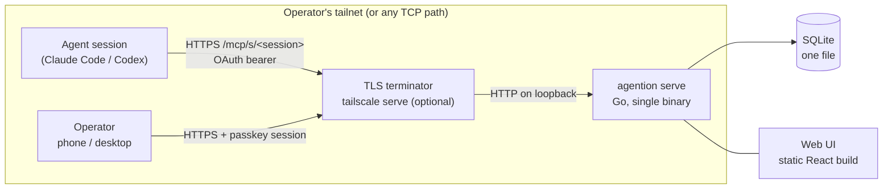
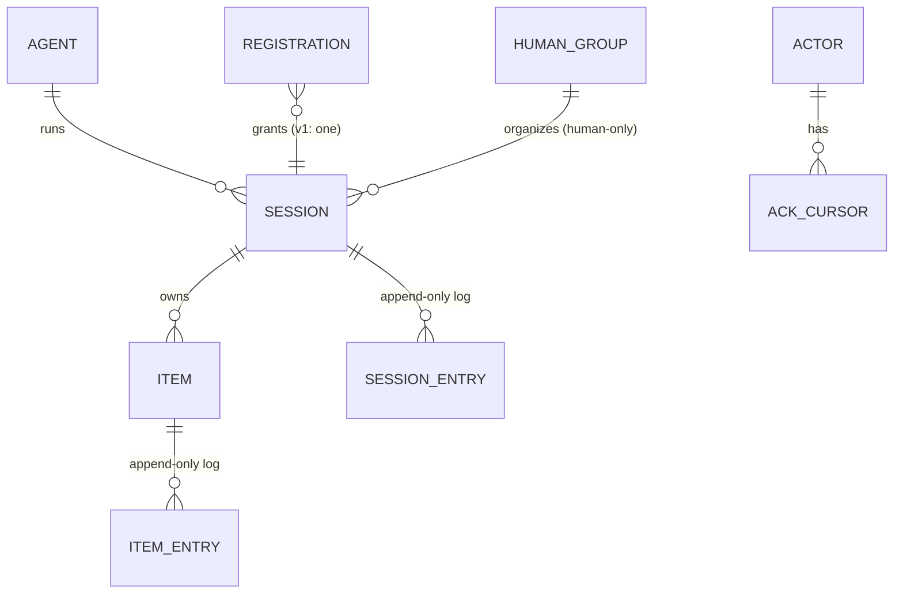

# Agention v1: High-Level Architecture

- Status: Draft for operator review
- Date: 2026-10-25
- Governing requirements: [FRD](frd.md)
- Predecessor reference: branch `build/initial-agention` at `d66d827` (unmerged). Paths of the form
  `predecessor:<path>` refer to that revision.

## Architecture in one view



One Go process serves the agent MCP endpoint, the OAuth authorization server, the human JSON API and
the static web UI from one HTTPS origin. Authentication produces an identity; authorization checks
that identity's grants against the target each request names; the store appends to logs under one
serialized writer.

## Components and what carries forward

| Component | v1 role | From the predecessor |
| --- | --- | --- |
| `cmd/agention` | `serve`, `passkey-link`, `setup`, `backup`, `version` | Command shell and private-profile handling from `predecessor:apps/server/cmd/agention/`. Listener, TLS and origin flags split (R30). Bootstrap and recovery merge into `passkey-link`: a one-time link that creates the human on first use and replaces the human's passkeys afterwards. `setup` registers an agent and session (R5, R36) and prints the MCP server entry. |
| `internal/auth` (human) | Passkeys, human sessions, CSRF | `predecessor:.../auth/{auth,webauthn,recovery}.go`, kept with per-kind challenge caps. |
| `internal/auth` (agent) | OAuth authorization server (fosite), registration with fingerprint approval, refresh rotation, revocation | Remodeled, not merely kept. The predecessor tied one principal to one registration and scoped everything by a `workspace`; v1 has agents, sessions and grants, and drops `workspace`. Presence and session groups move to the store. Agent and OAuth tables move to the database package. Hardening findings from the predecessor review are carried in (auth LLD). |
| `internal/identity` (new) | `authenticate` and `authorize` | See [Identity and authorization](#identity-and-authorization). |
| `internal/database` | Open, private-file checks, all DDL, ordered migrations | Private-file handling and header checks from `predecessor:.../database/`. Pragmas in the DSN, `_txlock=immediate`, migrations keyed on `user_version`, umask-independent tests. |
| `internal/store` | Items, entries, sessions, cursors, topics, groups | Rewritten. Real columns, projections updated in the same transaction as the log. |
| `internal/mcpserver` | Agent tools | Transport wiring and limits from `predecessor:.../mcpserver/` and `.../server/mcp.go`; new tools. |
| `internal/server` | Routing, security headers, CSRF and exact-origin checks, `Host` must equal the origin host, human API | From `predecessor:.../server/`. New human API, per-class rate budgets (R31), long polls woken on commit. |
| `apps/web` | Mobile-first UI | API client patterns, `safeReference`, WebAuthn and consent flows. Rebuilt views, router, design tokens with dark mode, live refresh, accessible list semantics. |
| `apps/agent-plugin` | Canonical plugin definition and generator | Packaging research. See [Distribution](#distribution). |

## Data model

Logical model; physical details belong in the store LLD.



- **Agent**: name.
- **Session**: agent, name, title, last seen. State, outcome, goal and percent are a projection of
  the session log.
- **Registration**: proposed agent and session names, fingerprint, status (pending, approved,
  rejected, expired, revoked), the granted session once approved, and the OAuth client and token
  state behind it.
- **Item**: session, requester, responder, title, body, and a projection of its log: open or closed, request, impact, form
  and options, respond-by and fallback text, references, topics, related item, see-instead item,
  last sequence. Projected fields are real columns so lists and signals are plain queries.
- **Item entry**: item, sequence, actor, credential (agent side), time, request id and content
  digest, optional message text, optional response (text-as-response flag, option, confirm or object,
  done, decline), optional field changes, optional close (outcome, detail, see-instead)
  or reopen. A unique index on actor and request id provides retry deduplication.
- **Session entry**: session, sequence, time, and any of state, outcome, goal, percent, note.
- **Ack cursor**: actor, item or session log, acknowledged sequence, time of last advance.
- **Human group**: name, member sessions. Exposed only on the human surface.

Append-only triggers protect every log table.

## Identity and authorization

```text
authenticate(request) -> Identity { actor, kind (human|agent), credential, grants }
authorize(identity, target) -> ok | not_found
```

- **Actor**: the authenticated session for agents (the credential is recorded alongside), the human
  for the human (R1). Request content never names the actor.
- **Target**: always from the request. A session for create, list and wait; an item for everything
  else. Authorization checks the target's session against the identity's grants, for every
  operation including acknowledgement, and returns `not_found` otherwise (R6).
- **v1 authenticators**: the human passkey session (grants every session plus human operations) and
  the agent OAuth access token (grants the session bound at approval).
- **Issuer seam (R4)**: a later authenticator verifies a configured issuer's token and maps claims to
  agent, session and grants by configuration. The seam is the `Identity` shape; no v1 code depends on
  an issuer.
- **Roles (enforced)**: requester-only fields (request, impact, form, options, respond-by, fallback
  text) require the actor to be the item's requester; response values require the responder and must
  fit the item's current form (R9, R12). In v1 the requester is the item's session and the responder
  is the human, so this is also the human-voice guarantee.

### How the agent states its session

Proposed: the session is a path segment of the MCP URL, `/mcp/s/<session>`, written into the
per-session MCP server entry that `agention setup` prints. The token is validated against that
stated session on every call.

- Claude Code stores OAuth sign-ins per endpoint, so a distinct URL per session keeps each session's
  token separate even when several sessions run under one OS user ([prior art](prior-art-research.md)).
- A static URL needs no environment expansion, which Codex does not document for URLs.
- `AGENTWORKS_SESSION` only supplies setup's default session name.

Real installs on both hosts confirm per-endpoint token storage before this is final. Fallbacks: a
custom header, or a `session` argument on session-scoped tools.

## Item log semantics

- **Satisfaction**: as R10 defines. An entry that changes the request, form or options starts a new
  request, so a later response is needed for act.
- **Who sets what**: request, impact, form, options, respond-by and fallback text belong to the
  requester (R9-R11). Topics are agent-set and human-editable (R16). Either party closes, reopens
  and replies (R17).
- **Relationships** stay within one session in v1 (R15), so an identifier never reveals an item the
  reader cannot access.

## Writes, acknowledgement and concurrency

```text
write(identity, item, seen_through, request_id, payload):
  BEGIN IMMEDIATE
  authorize(identity, item.session)                      # not_found otherwise
  apply envelope if present                              # R23, independent of the outcome below
  prior = entry(item, actor=identity.actor, request_id)
  if prior: return prior.result if digest(payload) == prior.digest else REQUEST_ID_CONFLICT
  validate payload against current item state            # forms, who sets what, bounds
  if item.last_seq != seen_through:
      return STALE { missed: entries(item, seen_through+1 .. last_seq) }
  seq = item.last_seq + 1
  append entry(item, seq, actor, credential, now, request_id, digest(payload), payload)
  update item projection from payload
  cursor(actor, item) = seq
  COMMIT; wake waiters on item.session

ack(identity, item, through):
  authorize(identity, item.session)
  require 0 <= through <= item.last_seq
  cursor(actor, item) = max(cursor, through)
```

- Every return path commits, so an envelope persists even when the write itself is stale or rejected.
- `item_create` has no `seen_through`; its request id deduplicates it.
- Acknowledging never changes the item or its sequence, so it never conflicts with a write.
- Session envelopes are last-writer-wins (R23).
- The human UI keeps the draft on `STALE`, shows the missed entries, and resubmits with one action.
  With one human and occasional agent writes, starvation is not a practical risk.

## Agent tool surface

| Tool | Target | Purpose |
| --- | --- | --- |
| `item_create` | session | New item: title, body, request, impact, optional form and options, respond-by and fallback text, references, topics, related item. |
| `item_update` | item | Append a message, field changes, or a close (outcome, detail, see-instead) or reopen. |
| `item_ack` | item | Advance the ack cursor without writing. |
| `item_get` | item | The item, paged entries, both parties' cursors, derived signals. |
| `item_list` | session | Paged items filtered by open or closed, request and topic (R18). |
| `inbox_wait` | session | Long-poll for items with entries beyond this actor's cursors. Returns a paged result and an opaque `since` value; passing it back waits only for newer entries, so an agent that leaves something unread does not loop hot. A zero wait with an envelope is the quiet-stretch check-in. Authorization is rechecked on every wake. |

- Every write carries a request id; `item_update` also carries `seen_through`.
- Every tool accepts the optional session envelope (state, outcome, goal, percent, note).
- Tool names use lowercase letters, digits and underscores, because hosts and the Anthropic API do
  not accept dots uniformly.
- `inbox_wait` caps its wait well below the 60-second Codex default tool timeout.
- Tool schemas are the payload reference. The skill carries the loop and the rules.

## Human surface

A JSON API under `/api/` provides exactly the human operations in R26:

- respond, note, acknowledge (single and bulk), close and reopen;
- topic edits;
- session groups;
- registration approval, rejection and revocation.

It also serves these views:

- needs-you and updates (R25);
- browsing by group or agent, then session, then item, with roll-up counts (R28);
- topic filtering across sessions (R16).

All mutations require the CSRF token and exact origin.

The web UI is organized by route: needs-you, updates, browse, item, session, agents, settings. Data
hooks own loading, stale-response and retry-key logic in one place. Views refresh on an interval
while visible and on focus (R27). A 401 anywhere returns to sign-in.

## Sessions and presence

- Session entries are appended only when an envelope changes something; identical envelopes are
  no-ops.
- Last seen is stamped on every authenticated agent call. Quiet uses a configurable threshold
  (default 15 minutes).
- A stopped session resumes with any later envelope carrying a working or waiting state.
- Revoking a session's credential leaves the session and items in place, marked as having no active
  credential (R5).

## Derived signals

Computed from projections and cursors in queries, never stored (R21). The needs-you view orders
blocked on you, then overdue, then other unsatisfied act and dismiss requests, then unacknowledged
see requests. Closed-while-waiting-on-you appears in the updates view, flagged.

## Operation

```text
agention serve --data DIR --origin https://agention.<tailnet>.ts.net \
  --listen 127.0.0.1:8080                                         # behind a TLS terminator
agention serve ... --listen 0.0.0.0:8443 --tls-cert C --tls-key K  # Agention terminates TLS
```

- Plain HTTP on a non-loopback address is refused unless an explicit flag allows it (R30).
- No `X-Forwarded-*` or Tailscale identity headers are read. Scheme and host come from `--origin`.
- Rate budgets per endpoint class (registration, passkey ceremonies, token endpoint keyed by client)
  so no class can starve another (R31).
- `agention backup` writes a consistent copy of the database from a running instance using SQLite's
  online backup; restore is stop, replace, start (R34).
- The primary guide: run on loopback, publish with `tailscale serve`, set `--origin` to the `ts.net`
  URL, then recommended ACL and tagging follow-ups (R32).

## Distribution

Following nerftools, `apps/agent-plugin` holds one canonical plugin definition: shared metadata, the
usage skill, and any hooks, commands or MCP declarations. A generator renders self-contained
per-host plugin directories (Claude Code and Codex) plus each host's repository catalog. Outputs are
committed so a fresh clone installs without a build, and a non-mutating check fails CI on drift.
Metadata exists once, and host-specific features such as hooks have a place to live. Detailed shape
follows the nerftools generator review (plan item). Real installs on both hosts are the acceptance
evidence.

## Repository and tooling

- Keep: exact pins with integrity checks, SHA-pinned actions, locked `govulncheck`, `--ignore-scripts`,
  the aggregate CI success job, the SDD history guard.
- Adopt from agentworks and nerftools: Conventional Commits, release-please with one version for the
  server and plugin, Dependabot (Go modules, both npm roots, actions), markdownlint and Prettier with
  version files, PR-plus-main CI triggers, a PR template.
- Task runner: any runner that covers backend, frontend and plugin generation (ruling 20); the plan
  selects the simplest that fits, aligned with sibling conventions.
- Developer guidance: the shared `wf-agentic-dev` set (rulings 19, 22) is vendored at a pinned commit
  into `vendor/wf-agentic-dev/` and layered with the local `.rulesync/` overlay through Rulesync
  `inputRoots` (shared first, local last). A check verifies the vendored copy against its pinned
  commit and that the overlay only adds files. Rulesync generates the committed Claude Code and Codex
  outputs. Rulesync `sources` is not used because it carries only skills and rules.

## Validation and requirement coverage

| Requirements | Primary evidence |
| --- | --- |
| R1-R7 | Store and HTTP tests: cross-session access returns not_found for every operation, ack included; actor stamped from authentication; registration lifecycle including expiry, revocation and re-grant; revocation during long polls. |
| R8-R18 | Store tests over the log: projection equals replay; satisfaction per request and form; agent-only fields; response values human-only and form-checked; topics, close and reopen attribution; list filters. |
| R19-R21 | Concurrency tests: one of two racing writes lands, the other gets STALE with missed entries; ack never conflicts; request-id replay and conflict; each derived signal. |
| R22-R24 | Envelope no-op and change cases, envelope applied when the call fails, resume after stop, quiet threshold. |
| R25-R29 | Component tests for views, human operations and stale-draft handling; real-phone acceptance for passkeys and refresh. |
| R30-R34 | Listener mode matrix; per-class rate budgets; bounds and error types; backup taken while serving restores cleanly; live run behind `tailscale serve` from a separate VM. |
| R35-R38 | Real Claude Code and Codex installs; CI checks; release dry run. |

## Focus for review

1. The request and impact split, and the satisfaction rules.
2. Ack-on-write with `inbox_wait` and its optional `since` value.
3. The session stated as a URL path segment.
