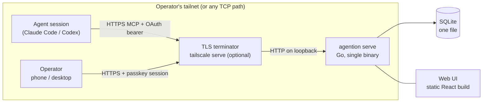
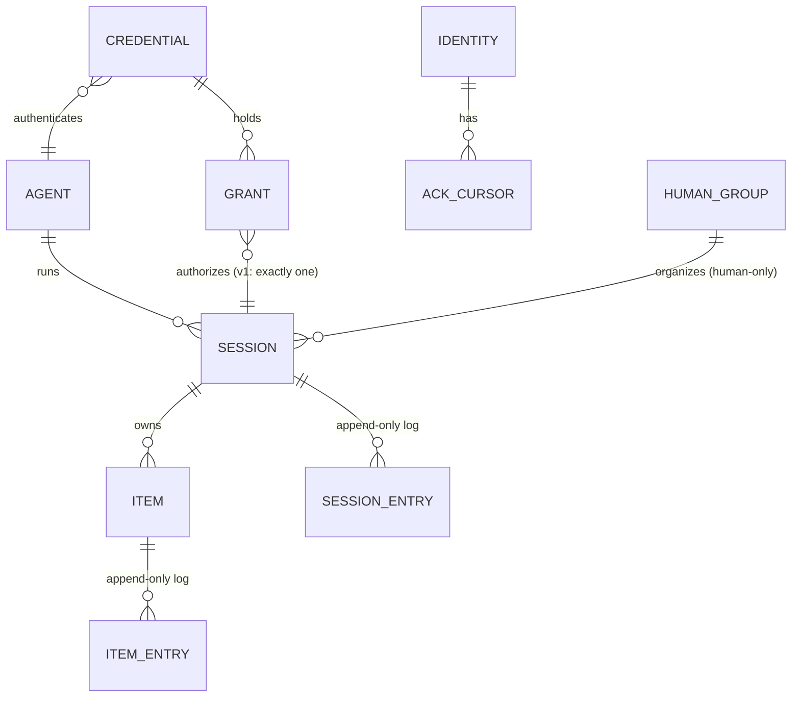

# Agention v1: High-Level Architecture

- Status: Draft for operator review
- Date: 2026-10-25
- Governing requirements: [FRD](frd.md)
- Predecessor reference: branch `build/initial-agention` at `d66d827` (unmerged). Paths below of the
  form `predecessor:<path>` refer to that revision.

## Architecture in one view



One Go process serves the agent MCP endpoint, the OAuth authorization server, the human JSON API and
the static web UI from one HTTPS origin. Authentication produces an identity; authorization checks
that identity's grants against the target each request names; the store applies writes to
append-only logs under one serialized writer.

## Components and what carries forward

| Component | v1 role | From the predecessor | Changes |
| --- | --- | --- | --- |
| `cmd/agention` | `serve`, `bootstrap`, `recover-human`, `setup`, `version` | `predecessor:apps/server/cmd/agention/` | Listener/TLS/origin flags split (R26). `setup` registers an agent + session pair, defaulting names from Agentworks variables (R30). Version stamped at build time. |
| `internal/auth` human | Passkeys, bootstrap, recovery, human sessions, CSRF | `predecessor:.../auth/{auth,webauthn,recovery}.go` | Kept largely as is. Per-kind challenge caps; re-running bootstrap supersedes earlier links. |
| `internal/auth` agent | OAuth authorization server (fosite), registration with fingerprint approval, refresh rotation, revocation | `predecessor:.../auth/{agents,oauth*,control}.go` | Registration carries agent and session names; grants bind one session (R3). Pending registrations expire; bulk reject. Revoke a grant family without destroying the identity. Rotation also revokes the previous access token. Client authentication before opening a transaction. Expired rows pruned. |
| `internal/identity` (new) | The seam between authentication and authorization (R2, R4) | none | See [Identity and authorization](#identity-and-authorization). |
| `internal/database` | Open, private-file checks, schema ownership, migrations | `predecessor:.../database/` | Keep private-file handling and header checks. Pragmas move to the DSN; `_txlock=immediate`. All DDL in this package, applied by ordered migrations keyed on `user_version`. Umask-independent tests. |
| `internal/store` | Items, entries, sessions, cursors, groups | rewritten | Real columns instead of an opaque JSON document; projections updated in the same transaction as the log. |
| `internal/mcpserver` | Agent tool surface | transport wiring and limits from `predecessor:.../mcpserver/`, `.../server/mcp.go` | New tools (below). Strip-and-verify transport behavior kept. |
| `internal/server` | HTTP routing, security headers, CSRF and origin checks, host allowlist, human API | `predecessor:.../server/` | New human API. Rate limits keyed by credential or by fixed global budgets, never source address (R27). Long polls wake on commit instead of re-querying. |
| `apps/web` | Mobile-first UI | API client patterns, `safeReference`, WebAuthn and consent flows | Rebuilt views, router, design tokens with dark mode, live refresh, accessible list semantics. |
| `apps/agent-plugin` | Usage skill and host plugins | packaging research | One concise skill (R29). Simplest layout both hosts accept (see [Distribution](#distribution)). |

## Data model

Logical model; physical details belong in the store LLD.



- **Agent**: name, identity source (registered, or a configured issuer).
- **Session**: agent, name, optional title and free-form display metadata, identity assurance
  (asserted or verified, plus issuer), last seen. Current state, outcome, goal and percent are a
  projection of the session log.
- **Item**: session, title, body, and a projection of its log: open or closed, request, impact,
  response form and options, respond-by, intended fallback text, references, topics, related item,
  see-instead item, last sequence. Projected fields are real columns so lists and signals are plain
  queries.
- **Item entry**: item, sequence, actor identity, time, client request id, optional message text,
  optional human response (selected option, confirm or object, or "done" for outside), optional field
  changes, optional close (outcome and detail) or reopen.
- **Session entry**: session, sequence, actor, time, and any of state, outcome, goal, percent, note.
- **Ack cursor**: identity, log (item or session), acknowledged sequence. Advances are also appended
  to an ack log.
- **Human group**: name, member sessions. Visible only to the human surface.
- **Request ids**: identity, client request id, stored result, for retry deduplication.

Append-only protection uses triggers on every log table, as the predecessor did, plus checks that
projections only change together with a new entry.

## Identity and authorization

Every request passes through one function:

```text
authenticate(request) -> Identity { actor, kind (human|agent), agent, grants, assurance }
authorize(identity, target) -> ok | not_found
```

- **Actor** always comes from authentication and is stamped on every entry. Request content never
  names the actor.
- **Target** always comes from the request: a session for create, poll and session updates; an item
  for everything else (each item belongs to one session). Authorization checks the target's session
  against the identity's grants.
- **Unauthorized and nonexistent** targets both return `not_found` (R5).
- **v1 authenticators**: the human passkey session (grants: every session, plus human-only
  operations) and the agent OAuth access token (grants: the one session bound at registration).
- **Issuer seam (R4)**: a future authenticator verifies a configured issuer's token and maps claims
  to agent, session and grants through configuration (for example agent from `sub`, session from a
  custom claim, or agent from an actor chain). No v1 code path depends on it; the seam is the
  `Identity` shape and the assurance field.
- **Human voice (enforced)**: a response value (option, confirm or object, done) on an entry
  requires a human identity.

### How the agent states its session

Proposed: an `Agention-Session` header in the agent's MCP server entry, which `agention setup`
prints after registration. Hosts store OAuth tokens per server entry, so each session already needs
its own entry ([prior art](prior-art-research.md), open question 1). That makes the header a literal
value in that entry, with no environment expansion at call time and nothing for the model to
remember. `AGENTWORKS_SESSION` only supplies setup's default session name. Codex sets it through
`http_headers`; Claude Code through `headers`. The server treats it as a stated target and validates
it against the grant. A missing or mismatched header returns `not_found`.

A real install on both hosts verifies that the custom header coexists with native OAuth before this
is final. The fallback is an explicit `session` argument on session-scoped tools.

## Item log semantics

- **Request satisfaction**, derived from the log:
  - act: a human response entry after the latest entry that set the request (for a text form, a
    human message sent as a response; a human may also send a plain note that does not satisfy);
  - see: the human's ack cursor is at or past the entry that set the request;
  - dismiss: the item is closed;
  - none: always satisfied.
- **Impact, request and form** change only through entries, normally from the agent. The human may
  also change topics and close or reopen.
- **Close** records outcome (complete or withdrawn) and detail. **Reopen** clears closed state.
  Replies on a closed item are ordinary entries and do not reopen it.

## Writes, acknowledgement and concurrency

```text
write(identity, item, seen_through, request_id, payload):
  BEGIN IMMEDIATE
  if request_ids has (identity, request_id): return stored result
  authorize(identity, item.session)
  if item.last_seq != seen_through:
      return STALE { missed: entries(item, seen_through+1 .. last_seq) }
  seq = item.last_seq + 1
  append entry(item, seq, identity.actor, now, request_id, payload)
  update item projection from payload
  advance ack cursor(identity, item) to seq; append ack log
  store request_ids result
  COMMIT; notify waiters on item.session

ack(identity, log, through):
  require 0 <= through <= log.last_seq; cursor = max(cursor, through); append ack log if advanced
```

- Acknowledging never changes the item or its sequence, so it never conflicts with a write.
- `create` needs no `seen_through`; it is deduplicated by request id.
- The human UI keeps the draft on `STALE`, shows the missed entries, and resubmits with one action.
- Starvation is not a practical risk with one human and occasional agent writes; the stale response
  carrying the missed entries means a retry needs no extra read.

## Agent tool surface

| Tool | Target | Purpose |
| --- | --- | --- |
| `item_create` | session | New item with title, body, request, impact, optional form and options, respond-by and fallback text, references, topics, related item. Request id required. |
| `item_update` | item | Append a message and/or field changes. Requires `seen_through` and request id. |
| `item_close` | item | Close with outcome and detail, optional see-instead item. Requires `seen_through`. |
| `item_reopen` | item | Reopen. Requires `seen_through`. |
| `item_ack` | item | Advance the ack cursor without writing. |
| `item_get` | item | Item, paged entries, both parties' cursors, derived signals. |
| `inbox_wait` | session | Long-poll until any item or the session log has entries beyond this identity's cursors; return those items with their unread entries. No separate poll cursor: acknowledging or writing is what clears an item. |
| `session_update` | session | Carry only the session envelope (quiet stretches). |

Every tool accepts the optional session envelope (state, outcome, goal, percent, note); omission
means unchanged. Tool names use lowercase letters, digits and underscores, because hosts and the
Anthropic API do not accept dots uniformly. `inbox_wait` caps its wait well below the 60-second Codex
default tool timeout. Tool schemas are the payload reference; the skill carries the loop and the
rules.

## Human surface

A JSON API under `/api/` mirrors the agent operations for the human identity plus: needs-you and
updates views (R22), browsing by group or agent, session and item (R24), topic filtering across
sessions (R14), human group management, registration approval and grant revocation. All mutations
require the CSRF token and exact origin, as in the predecessor.

The web UI is organized by route (needs-you, updates, browse, item, session, agents, settings) with
data hooks that own loading, stale-response and retry-key logic in one place. Views refresh on a
modest interval while visible and on focus (R23). A 401 anywhere returns to sign-in.

## Sessions and presence

- Session entries are appended only when the envelope changes something; identical envelopes are
  no-ops, so carrying it on every call costs nothing in the log.
- Last seen is stamped on every authenticated agent call. Quiet is derived from a configurable
  threshold (default 15 minutes).
- Stopped sessions may resume by any later envelope with a working or waiting state.

## Derived signals

Computed in queries from projections and cursors, never stored: blocked on you, overdue, closed while
waiting on you, quiet, stranded (definitions in R18). The needs-you view orders blocked on you, then
overdue, then other unsatisfied act and dismiss requests, then unacknowledged see requests.

## Deployment

```text
agention serve --data DIR --origin https://agention.<tailnet>.ts.net \
  --listen 127.0.0.1:8080                 # plain HTTP behind a TLS terminator
agention serve ... --listen 0.0.0.0:8443 --tls-cert C --tls-key K   # Agention terminates TLS
```

- Plain HTTP on a non-loopback listen address is refused unless an explicit flag allows it.
- No `X-Forwarded-*` or Tailscale identity headers are read. Scheme and host come from `--origin`.
- Documentation's primary guide: run on loopback, publish with `tailscale serve`, set `--origin` to
  the `ts.net` URL, then recommended ACL and tagging follow-ups.

## Distribution

One canonical skill source. If both hosts accept a single plugin directory containing both host
manifests, ship that directory plus the two repository catalogs with a small consistency test and no
renderer; otherwise generate the minimal per-host differences. Registration setup instructions live
with the plugin. Host acceptance is verified by real installs, not inferred from schema files.

## Repository and tooling

- Keep: exact pins with integrity checks (`check-pins`), SHA-pinned actions, locked `govulncheck`,
  `--ignore-scripts`, the aggregate CI success job, the SDD history guard.
- Adopt from agentworks and nerftools: Conventional Commits, release-please (server binary and
  plugin), Dependabot (Go modules, both npm roots, actions), markdownlint and Prettier with version
  files, PR-plus-main CI triggers, a PR template.
- Nx stays as the approved thin task runner, with backend caching removed.
- Developer guidance: open question (FRD open question 1).

## Validation and requirement coverage

| Requirements | Primary evidence |
| --- | --- |
| R1-R6 | Store and HTTP tests: cross-session access returns not_found; actor stamped from authentication; human-only response values; revocation during long polls. |
| R7-R15 | Store tests over the log: projection equals replay; request satisfaction per form; topics, close and reopen attribution. |
| R16-R18 | Concurrency tests: one of two racing writes lands, the other gets STALE with missed entries; ack never conflicts; retry by request id; each derived signal. |
| R19-R21 | Envelope no-op and change cases; resume after stop; quiet threshold. |
| R22-R25 | Component tests for views and stale-draft handling; real-phone acceptance for passkeys and refresh. |
| R26-R28 | Listener mode matrix tests; live run behind `tailscale serve` from a separate VM. |
| R29-R32 | Real Claude Code and Codex installs; CI checks; release dry run. |

## Focus for review

1. The request and impact split, and the satisfaction rules above. Proposed addition from prior art:
   the human may explicitly decline an act request, which satisfies it with a refusal (MCP
   elicitation distinguishes decline from cancel).
2. Ack-on-write plus `inbox_wait` without a separate poll cursor.
3. Topics as free-form tags rather than a group entity.
4. What carries forward from the predecessor and what is rewritten.
