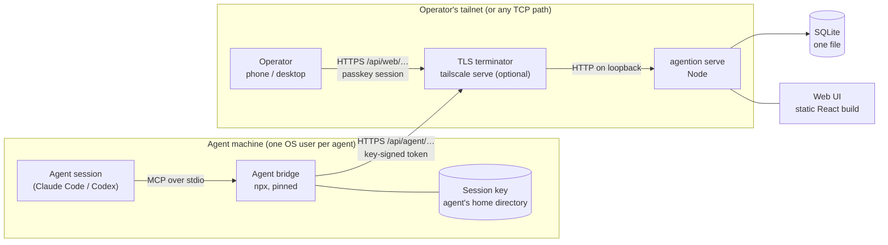
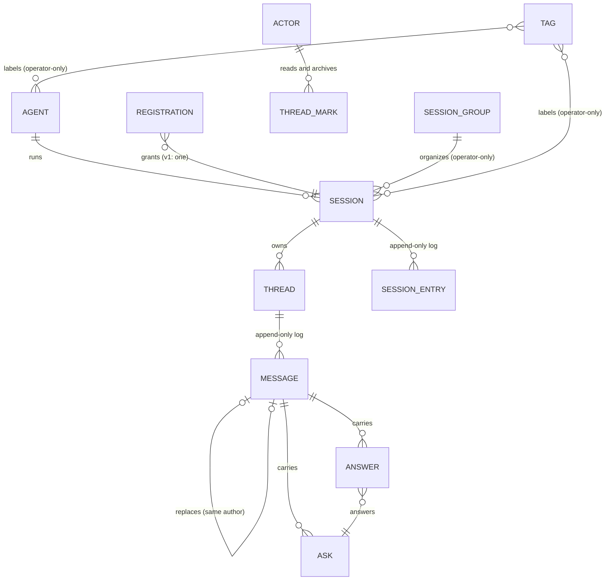

# Agention v1: High-Level Architecture

- Status: Approved by the operator 2026-10-25; amended through FRD ruling 48 (2026-11-05), by ruling
  61 (2026-11-19) and by the [Working inbox LLD](working-inbox-lld.md) (validation order,
  references)
- Date: 2026-10-25
- Repository: `WayfarerLabs/agention`, which holds this SDD (FRD ruling 59); paths below are
  relative to its root
- Governing requirements: [FRD](frd.md)
- Predecessor reference: branch `build/initial-agention` at `d66d827` (unmerged, Go). Paths of the
  form `predecessor:<path>` refer to that revision. Its designs and lessons carry forward; its code
  does not, because v1 is TypeScript (ruling 28).

## Architecture in one view



One Node process serves the HTTP API and the static web UI from one HTTPS origin. The API has two
mounts with the same thread routes and schemas: `/api/agent/` authenticates a short-lived token
signed with a session's approved key, and `/api/web/` authenticates the operator's passkey session
with CSRF protection. Neither accepts the other's credential (R7).

Agents never call the API directly. The agent bridge is a small stdio MCP server that the plugin
declares as a pinned `npx` command. It presents the tools to the host, holds the session's key, and
turns each tool call into one API request (ruling 26).

Authentication produces an identity; authorization checks that identity's grants against the target
each request names; the store appends to logs in synchronous transactions, so the one Node process
is the serialized writer.

## Components and what carries forward

| Component                | v1 role                                                                                                                    | Carries forward                                                                                                                                                                                                                                                                                                                                                                      |
| ------------------------ | -------------------------------------------------------------------------------------------------------------------------- | ------------------------------------------------------------------------------------------------------------------------------------------------------------------------------------------------------------------------------------------------------------------------------------------------------------------------------------------------------------------------------------ |
| `packages/api`           | Request and response schemas, bounds and error codes, shared by the server, the bridge and the web UI                      | New. One definition of the contract, so the compiler checks both ends.                                                                                                                                                                                                                                                                                                               |
| `packages/private-files` | The one private-file rule, for the data directory, the database and session keys                                           | New. The rule is stated once, in the Working inbox LLD's [Opening](working-inbox-lld.md#opening).                                                                                                                                                                                                                                                                                    |
| `apps/server` CLI        | `serve`, `passkey-link`, `backup`, `version`                                                                               | The command set from `predecessor:apps/server/cmd/agention/`, minus `setup`, which the bridge's `register` tool replaces. Listener, TLS and origin flags split (R30). Bootstrap and recovery merge into `passkey-link`, a one-time link that creates or replaces the operator's passkeys.                                                                                            |
| `apps/server` database   | Open, header checks, all DDL, ordered migrations                                                                           | Private files through `packages/private-files`; header checks from `predecessor:.../database/`. Migrations keyed on `user_version`.                                                                                                                                                                                                                                                  |
| `apps/server` identity   | `authenticate` and `authorize`                                                                                             | See [Identity and authorization](#identity-and-authorization).                                                                                                                                                                                                                                                                                                                       |
| `apps/server` auth       | Passkeys, browser sessions, CSRF; agent registration with code approval, key-signed token verification, revocation         | Passkey design from `predecessor:.../auth/{auth,webauthn,recovery}.go`, with stateless sealed challenges and failure-only budgets (Working inbox LLD). Registration with operator approval, remodeled for agents, sessions and grants. The predecessor's OAuth server is not carried (ruling 27). Hardening findings from the predecessor review are carried in (Working inbox LLD). |
| `apps/server` store      | Threads, messages, sessions, read and archive marks, groups, tags                                                          | Rewritten. Real columns; what derives from later messages is computed in queries, never stored.                                                                                                                                                                                                                                                                                      |
| `apps/server` HTTP       | Routing, security headers, CSRF and exact-origin checks, `Host` must equal the origin host, both API mounts, the static UI | Header and origin rules from `predecessor:.../server/`. Per-class rate budgets (R31), long polls woken on commit.                                                                                                                                                                                                                                                                    |
| `apps/bridge`            | The agent tools, `register`, the session key and the API client                                                            | New (ruling 26).                                                                                                                                                                                                                                                                                                                                                                     |
| `apps/web`               | Mobile-first UI                                                                                                            | API client patterns, `safeReference` and WebAuthn flows. Rebuilt views, router, design tokens with dark mode, live refresh, accessible list semantics.                                                                                                                                                                                                                               |
| `apps/agent-plugin`      | Canonical plugin definition and generator                                                                                  | Packaging research. See [Distribution](#distribution).                                                                                                                                                                                                                                                                                                                               |

## Data model

Logical model; physical details belong in the LLDs.



- **Agent**: name.
- **Session**: agent, name, last seen. Its state, outcome, title, goal and percent are read from the
  latest entry of the session log, never stored on the session.
- **Registration**: one agent credential. Proposed agent and session names, the session key's public
  half and the code derived from it, status (pending, approved, rejected, revoked; a pending
  registration past its expiry counts as expired), and the granted session once approved.
- **Thread**: session, number, requester, audience, title, creation time, and its latest sequence.
  Nothing else about a thread is stored: its topic, open asks and roll-ups derive from its messages.
- **Message**: thread, sequence, actor, credential (session actors), time, request id and content
  digest, and any of: Markdown text, a summary, and its Markdown detail; references; asks; answers;
  a topic; the earlier message it replaces. References may name another thread in the session. A
  unique index on actor and request id provides retry deduplication.
- **Ask**: thread, number, the message carrying it, question, suggested answers with optional
  descriptions, whether several may be picked, impact, priority, effort, answer-by and fallback
  text. Numbers count from 1 within the thread in the order asks are written and never change; a
  message may carry several asks.
- **Answer**: the message carrying it, the number of the ask it answers, and either a decline or the
  picked suggestions and the answerer's own words, at least one of them. A message may answer
  several asks, each once.
- **Session entry**: session, sequence, time, the credential that wrote it, the session's state,
  outcome, title, goal and percent after it, and the entry's own note.
- **Thread mark**: actor, thread, the sequence read through and the sequence archived through. The
  session log has a read cursor of the same kind.
- **Session group**: name, member sessions, one level deep. Operator-only (R28).
- **Tag**: name, the agents and sessions it labels; a tag on an agent applies to all its sessions.
  Operator-only (R28).

Append-only triggers protect every log table.

## Identity and authorization

```text
authenticate(request) -> Identity { actor, credential, grants }
authorize(identity, target) -> ok | not_found
```

- **Actor**: the authenticated session for agents (the credential is recorded alongside), the person
  for a passkey sign-in (R1). Request content never names the actor.
- **Target**: always from the request. A session for create, list and wait; a thread for everything
  else. Authorization checks the target's session against the identity's grants, for every operation
  including reading and archiving, and returns `not_found` otherwise (R6).
- **v1 authenticators**: the passkey sign-in on `/api/web/` (grants every session plus
  administration) and, on `/api/agent/`, a token signed by an approved registration's key (grants
  the session bound at approval).
- **Issuer seam (R4)**: a later authenticator verifies a configured issuer's signed token the same
  way, against the issuer's published keys instead of a registration's key, and maps claims to
  agent, session and grants by configuration. The seam is the `Identity` shape; no v1 code depends
  on an issuer.
- **Roles (enforced)**: an ask or a topic requires the actor to be the thread's requester; an answer
  requires the audience; a replacement requires the replaced message's author (R9, R15). No check
  consults how the actor authenticated. `thread_create` stores the calling session as requester and
  the operator as audience, the only pairing v1 creates (ruling 11), so these checks also keep an
  agent from speaking as the operator.

### Registration and how the agent states its session

Each session has its own Ed25519 key, generated by the bridge and kept in the agent's home directory
under the server and session it belongs to. The private half never leaves that file.

```text
register(agent, session):                          # bridge, when the agent calls the tool
  key = key file for (server, agent, session), else generate one
  state = submit {agent, session}, signed with key # creates a pending registration for a new key
  pending           -> "ask the operator to approve <code>"
  approved          -> "registered as <granted agent>/<granted session>"
  rejected, expired
  or revoked        -> replace the key, submit again, and say which of the three happened
```

- Names default from `AGENTWORKS_AGENT` and `AGENTWORKS_SESSION` (R36); the server comes from
  `AGENTION_URL`.
- The code is a short digest of the public key. The bridge computes it itself and the server derives
  the same code from the stored key. The operator approves after matching the code the agent
  relayed, choosing an existing or new agent and session (R5). A registration submitted with any
  other key shows a different code.
- Every agent request other than registration names its session in the path,
  `/api/agent/s/<agent>/<session>/…`, using the granted names. The key authorizes that session; it
  never selects it (R2, ruling 16).
- A token is minted per request, short-lived and bound to the server's origin. No secret or token
  state lives on the server, and two host processes in one session sign independently, so there is
  nothing to rotate or race.
- Sessions under one OS user hold separate keys, but same-user files are not protected from each
  other, as the trust model says.

## Thread semantics

Everything about a thread derives from its messages; two definitions carry it:

```text
live(m):     no later message in the thread replaces m
open(ask a): live(a.message) and no live message answers or withdraws a
status(t):   over t's asks on a live message or withdrawn by one: open if any is open; otherwise
             withdrawn if a live message withdraws every one; answered if there are any; none if not
```

- **Replaced messages are ignored** in everything derived: open asks, answers, the topic, unread
  counts and whether a thread is archived (R15). The history still shows them, marked, with a link
  to the replacement. A message is replaced at most once; a replacement may itself be replaced.
- **Asks never change** (R11). Revising one is replacing its message, whose asks are then new asks
  with new numbers. Withdrawing one is a later message naming it with a reason, and is never undone:
  a replacement of a withdrawing message withdraws again what it withdrew, and a replacement of a
  message holding open asks asks again or withdraws each of them, so none is dropped unexplained.
  Changing an answer is replacing its message. An answer names an open ask, and a replacement
  answers again every ask the message it replaces answered that is still live, so an answer is
  changed, never retracted; an answer to an ask its requester since revised or retracted is dropped
  with the message it rode in. A replacement is a whole message.
- **Topic**: the one set by the latest live message that sets one (R16).
- **Who writes what**: asks, withdrawals and topics belong to the requester, answers to the
  audience, and either party writes text and references and replaces its own messages (R9).
- **Text**: a message's text, a short summary, and its detail, the long form beneath it, are
  Markdown, stored and returned verbatim (R14, ruling 53).
- **References to threads** stay within one session in v1 (R15), so a number never reveals a thread
  the reader cannot access.

## Writes, reading and concurrency

```text
write(identity, thread, seen_through, request_id, message):
  validate bounds                                        # before taking the write lock
  BEGIN IMMEDIATE
  authorize(identity, thread.session)                    # not_found otherwise
  prior = message(actor=identity.actor, request_id)
  if prior: return prior.result if digest(op, thread, message) == prior.digest
            else REQUEST_ID_CONFLICT
  validate roles                                         # ask, topic, answer
  if thread.last_seq != seen_through:
      return STALE { missed: messages(thread, seen_through+1 .. last_seq) }
  validate against the thread's messages                 # replaced message live and the actor's;
                                                         # answered asks open, or answered again
  seq = thread.last_seq + 1
  append message(thread, seq, actor, credential, now, request_id, digest, message)
  append its asks, numbered on from the thread's latest ask, and its answers
  thread.last_seq = seq
  mark(actor, thread).read = seq
  if the thread was archived for the actor: mark(actor, thread).archived = seq   # stays archived
  COMMIT; wake waiters on thread.session

mark_read(identity, thread, through):
  authorize(identity, thread.session)
  require 0 <= through <= thread.last_seq
  mark.read = max(mark.read, through)

mark_unread(identity, thread, from):
  authorize(identity, thread.session)
  require 1 <= from <= thread.last_seq
  mark.read = min(mark.read, from - 1)

archive(identity, thread, through):
  authorize(identity, thread.session)
  require 0 <= through <= thread.last_seq
  refuse if an ask open to the actor is at or before through   # answer or decline it first
  through = the last of the actor's own messages directly following through, if any
  mark.archived = max(mark.archived, through)

archived(actor, thread):
  mark.archived > 0 and mark.archived = thread.last_seq     # every message archived

unread(actor, thread):
  live messages by another actor after max(mark.read, mark.archived)   # archived is never unread
```

- A transaction is one synchronous function: nothing awaits between `BEGIN` and `COMMIT`, so writes
  never interleave in the server process.
- `thread_create` has no `seen_through`; its request id deduplicates it.
- Reading, marking unread and archiving never change the thread or its sequence, so none conflicts
  with a write; marking unread only lowers the caller's own cursor, so it never claims a message the
  caller has not seen. Archive marks are never shown to the other party (R17).
- Archiving is refused over an open ask, an answer is never retracted, and every new ask arrives
  after the mark, so an archived message never carries an ask open to its archiver.
- Session updates are last-writer-wins and exempt from the stale rule (R23).
- The web UI keeps the draft on `STALE`, shows the missed messages, and resubmits with one action.
  With one operator and occasional agent writes, starvation is not a practical risk.

## Agent tool surface

The bridge defines the tools from the shared schemas; each tool is one request on `/api/agent/`.

| Tool             | Target  | Purpose                                                                                                                                                                                                                                                                                                                                                                                                                                                                       |
| ---------------- | ------- | ----------------------------------------------------------------------------------------------------------------------------------------------------------------------------------------------------------------------------------------------------------------------------------------------------------------------------------------------------------------------------------------------------------------------------------------------------------------------------- |
| `register`       | session | Submit or check this session's registration; answers with the code to relay until the operator approves.                                                                                                                                                                                                                                                                                                                                                                      |
| `thread_create`  | session | New thread: title and a first message with optional Markdown text and detail, asks, topic and references.                                                                                                                                                                                                                                                                                                                                                                     |
| `message_send`   | thread  | Append a message: any of text and detail, references, asks, withdrawals of its own open asks, a topic, and the earlier message it replaces.                                                                                                                                                                                                                                                                                                                                   |
| `thread_get`     | thread  | The thread with its topic, roll-ups and open asks, a page of messages with replacements and answers resolved, both parties' read cursors, and the caller's archive mark.                                                                                                                                                                                                                                                                                                      |
| `thread_list`    | session | Paged threads the agent has not archived, or with archived ones included, filtered by title search, status, unread and topic (R18).                                                                                                                                                                                                                                                                                                                                           |
| `thread_read`    | thread  | Mark read through a message without writing.                                                                                                                                                                                                                                                                                                                                                                                                                                  |
| `thread_archive` | thread  | Archive through a message, so the agent's own list shows what is still live.                                                                                                                                                                                                                                                                                                                                                                                                  |
| `session_update` | session | Report the session's state (working, idle, or stopped with an outcome), title, goal, percent and a note; a field left out is unchanged (R22, R23, ruling 65).                                                                                                                                                                                                                                                                                                                 |
| `message_wait`   | session | Long-poll for threads with unread messages. Returns a paged result and an opaque `since` value; passing it back waits only for newer messages, so an agent that leaves something unread does not loop hot. A zero wait answers at once, which is how an agent checks for answers as it works (ruling 48); a longer one is for an agent with no other work and open asks or unread messages, or for a waiter of its own (ruling 61). Authorization is rechecked on every wake. |

- Every write to a thread carries a request id; `message_send` also carries `seen_through`.
- Tool names use lowercase letters, digits and underscores, because hosts and the Anthropic API do
  not accept dots uniformly.
- `message_wait` caps its wait well below the 60-second Codex default tool timeout.
- An ask's shape follows the question tools agents already use in Claude Code, Codex and Gemini CLI:
  a question and suggested answers, each a short label with a description, and whether several may
  be picked.
- Tool schemas are the payload reference, including what each priority level means (R11) and which
  fields are Markdown (R14). The skill carries the loop and the rules.

## HTTP API

The operator's routes under `/api/web/` provide exactly the operations in R26:

- send a message, answering asks or not, and replace one's own message; mark read (single and bulk)
  and unread from a message; archive through a message (single) and whole threads (bulk);
- passkeys: list, add on this device, rename, remove;
- session groups and tags;
- registration approval, rejection and revocation.

They also serve one thread list (R25): the threads the operator has not archived, narrowed by
filters that combine with AND (title search, extended to messages' text and detail in Delivery 4;
status and the properties of one open ask; unread, and unread by the agent or stranded; agents,
sessions and topics, several of each combined with OR; later group and tag (R28)), with archived
threads included on request, in the sort the operator chooses, viewed flat or grouped by session or
agent. For each filter value, they count the threads it keeps with every other filter as it is.

All web mutations require the CSRF token and exact origin, and web routes refuse an `Authorization`
header. Agent routes under `/api/agent/` refuse cookies. The thread routes are the same handlers on
both mounts, so role and message checks are shared. Agent routes only grow once released, because
agent machines run whatever bridge version their plugin pins. Every agent request and answer states
the agent API version it speaks, a missing one meaning 1; a bridge refuses a server older than
itself and the server a bridge outside its versions, so a mismatch fails loudly (R33, ruling 67).

The web UI renders Markdown as R14 requires; the Working inbox LLD chooses and configures the
renderer.

The web UI is organized by route: the thread list, a thread, registrations, and later sessions,
agents and settings. Data hooks own loading, stale-response and retry-key logic in one place. Views
refresh on an interval while visible and on focus (R27). A 401 anywhere returns to sign-in.

## Sessions and presence

- A `session_update` appends a log entry only when it changes something; an identical update is a
  no-op.
- Last seen is stamped on every authenticated agent call. Quiet uses a configurable threshold
  (default 15 minutes). Delivery 2 carries last seen, quiet, and stranded from quiet or a missing
  credential (ruling 48); session states, and stopped's part in stranded, come with the sessions
  delivery.
- Stopped means the session is not likely to see new messages until something starts it again
  (ruling 65). A stopped session resumes with any later update carrying a working or idle state.
- Revoking a session's credential leaves the session and threads in place, marked as having no
  active credential (R5).

## Derived signals

Computed from messages and marks in queries, never stored (R21). The status filter keeps threads of
one status; open keeps those with open asks, which the viewer asked or is asked. Filters on an ask's
properties (priority at least a level, impact, overdue, effort at most a level) keep threads holding
one open ask that meets them all. The default order, priority, puts threads with open asks first,
each ranked by its most pressing open ask: by that ask's priority, then blocked, then earliest
answer-by (none last), then oldest; the rest follow by latest live message (R25). The operator's
list can also be ordered by due and by effort, each placing a thread by the ask that ranks first
under it, by latest message and by creation, and any order reversed, which reverses the threads it
ranks and leaves the rest after them (R25); the agent's list keeps the priority order. Grouped, each
session, and grouped by session each of its topics, carries a roll-up of the threads the filters
keep there (how many, how many unread, whether any is blocked on the operator, the highest open
priority, and whether all are archived) and is placed by its first thread under the sort; an agent's
roll-up and place compose from its sessions'.

A session is waiting on the operator while it has open asks, counted from its threads' asks in the
sessions view beside what the session reports it is doing, never reported by the session itself
(ruling 68).

## Operation

```text
agention serve --data DIR --origin https://agention.example.com \
  --listen 127.0.0.1:8080                                    # behind a TLS terminator
agention serve ... --listen 0.0.0.0:8443 --tls-cert C --tls-key K  # Agention terminates TLS
```

- Plain HTTP on a non-loopback address is refused unless an explicit flag allows it (R30).
- No `X-Forwarded-*` or Tailscale identity headers are read. Scheme and host come from `--origin`.
- `--name` names the server on its first start, `Agention` by default, and the name never changes;
  its web UI shows the name as its title and its passkeys carry it. Several servers can share a host
  under different ports: each takes its own data, origin and name, its cookies are named for its
  port, and it shares nothing with the others (R30).
- Rate budgets per endpoint class (registration, passkey ceremonies, failed agent authentication) so
  no class can starve another; authenticated agent calls are budgeted per key (R31).
- `agention backup` writes a consistent copy of the database from a running instance using SQLite's
  online backup; restore is stop, replace, start (R34).
- The guide's setup gives the server an HTTPS origin in whichever way suits the operator: behind a
  TLS terminator they run, such as a reverse proxy or `tailscale serve`, or terminating TLS itself
  (R32, ruling 63).

## Distribution

Following nerftools, `apps/agent-plugin` holds one canonical plugin definition: shared metadata, the
usage skill, and any hooks, commands or MCP declarations. A generator renders self-contained
per-host plugin directories (Claude Code and Codex) plus each host's repository catalog. Outputs are
committed so a fresh clone installs without a build, and a non-mutating check fails CI on drift.
Metadata exists once, and host-specific features such as hooks have a place to live.

The plugins carry the skill and declare the bridge as `npx -y @wayfarerlabs/agention-mcp@<version>`,
passing `AGENTION_URL` and the Agentworks names to it, so installing the plugin and setting
`AGENTION_URL` is the whole agent setup. The server and the bridge are published to npm as bundles
with no runtime dependencies, so `npx` installs exactly what the lockfile built. One version covers
the server, the bridge and the plugins. Real installs on both hosts are the acceptance evidence.

## Repository and tooling

- One language: TypeScript on the pinned Node, strict, in npm workspaces with one lockfile.
- Keep: exact pins with integrity checks, SHA-pinned actions, disabled npm lifecycle scripts (so no
  dependency may need an install script, which also rules out native addons). `scripts/check-sdd.sh`
  checks the SDD records in CI (FRD ruling 59).
- Adopt from agentworks and nerftools: Conventional Commits, release-please with one version,
  Dependabot (npm, actions), markdownlint and Prettier pinned in the lockfile, PR-plus-main CI
  triggers, a PR template.
- Task runner: any runner that covers backend, frontend and plugin generation (ruling 20); the plan
  selects the simplest that fits, aligned with sibling conventions.
- Developer guidance: no Rulesync sources or generated agent guidance in the repository (R39). Agent
  sessions take Wayfarer's shared process from `wf-agent-artifacts`, and it reads the repository's
  development contract, `docs/development-context.md`, which points into Agention's own docs and
  ADRs for the commands, invariants and decisions (FRD ruling 59).

## Validation and requirement coverage

| Requirements | Primary evidence                                                                                                                                                                                                                                                                                                                                                                                                                                                                      |
| ------------ | ------------------------------------------------------------------------------------------------------------------------------------------------------------------------------------------------------------------------------------------------------------------------------------------------------------------------------------------------------------------------------------------------------------------------------------------------------------------------------------- |
| R1-R7        | Store and HTTP tests: cross-session access returns not_found for every operation, reading and archiving included; actor stamped from authentication; registration lifecycle including expiry, revocation and re-grant; token checks (signature, origin, lifetime); revocation during long polls; neither credential works on the other mount.                                                                                                                                         |
| R8-R18       | Store tests over the log: live messages, open asks and status per replacement, answer and withdrawal case; asks and topics requester-only, answers audience-only, replacement author-only; an answer only to an open ask; archive refused over an open ask, undone by another party's later message and kept by one's own; list filters. Text round-trips verbatim. Web component tests that raw HTML, images and non-HTTPS links render inert and plain fields render as plain text. |
| R19-R21      | Concurrency tests: one of two racing writes lands, the other gets STALE with the missed messages; reading and archiving never conflict; request-id replay and conflict; each derived signal and roll-up; each sort's order, and narrowing by an ask's properties.                                                                                                                                                                                                                     |
| R22-R24      | Status update no-op and change cases, resume after stop, stopped in stranded; last seen, the quiet threshold and stranded in Delivery 2.                                                                                                                                                                                                                                                                                                                                              |
| R25-R29      | Component tests for views, operator operations and stale-draft handling; real-phone acceptance for passkeys and refresh.                                                                                                                                                                                                                                                                                                                                                              |
| R30-R34      | Listener mode matrix; per-class rate budgets; bounds and error types; backup taken while serving restores cleanly; live run behind `tailscale serve` from a separate VM.                                                                                                                                                                                                                                                                                                              |
| R35-R38      | Real Claude Code and Codex installs of the generated plugins running the bridge; CI checks; release dry run.                                                                                                                                                                                                                                                                                                                                                                          |

## Focus for review

1. Liveness and open asks derived from replacement and answers, and the archive rule.
2. Read-on-write with `message_wait` and its optional `since` value.
3. The agent bridge and key registration: what the bridge holds, and what the code check proves.
