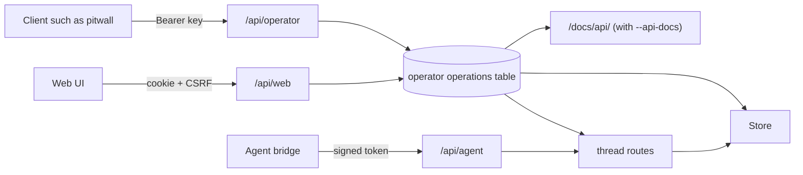

# Operator API: High-Level Architecture

- Requirements: [FRD](frd.md); plan: [plan](plan.md)
- Baseline: the server as of v0.4.0, described in `docs/architecture.md`

## Shape

One table of operator operations, mounted twice and documented from the same table:

This is the operator's option 1 in substance (the API the web UI uses is the general-purpose one)
and option 2 in form (the web UI keeps its own mount, whose credential and unversioned contract fit
a UI the server ships in step). Neither mount has a handler of its own for an operation they share,
so A1's "never implemented twice" holds by construction.

### Why not the alternatives

- **The web mount takes keys too.** It would carry two credentials with different rules (CSRF and
  `Origin` for one, none for the other) on one mount, and its refusal of `Authorization`, which is
  what keeps a token from ever riding a cookie's authority, would go. Separate mounts keep each
  credential's checks whole, as the agent and web mounts already do.
- **A separately designed resource API.** Two implementations of the same operations, which A1 rules
  out, and a second shape for every reader to learn.

## The operations table

`apps/server/src/http/operations.ts` declares each operator operation once: its method and path, a
one-line summary, its query or body schema and its response schema from `packages/api`, and its
handler, which takes the store, the identity and the parsed input. The web mount and the operator
mount both build their routes from it; the docs are built from it too, so D2 holds by construction.
The thread routes the agent mount shares are entries in the same table, and the agent mount builds
them from the table as well, so it keeps one set of handlers.

An operation is on the operator mount unless the table marks it web-only. Web-only: the passkey
ceremonies and passkeys, signing out, Settings and voice, transcription, key management, and every
registrations route (K4). A table entry's method decides what a read key may do: a read key may call
only `GET` operations, and every `GET` operation is free of writes, which a test over the table and
the store confirms.

Response schemas for routes that answer `{}` or a store result without one get a schema in
`packages/api`, since a documented response must have one.

## Keys

- **Table.** Migration 5 adds `api_keys`: an id, the operator's person id, the name, the scope
  (`read` or `read_write`), the SHA-256 of the secret, and the created, expiry, last-used and
  revoked times. Revoking keeps the row, so the list shows it until it expires; expired keys are
  deleted when the table is next written, as browser sessions are.
- **Secret.** 256 random bits, shown as `agention_` followed by their base64url, so secret scanners
  and people can recognize one. Only its hash is stored (K5), as browser sessions and passkey links
  already are.
- **Identity.** `Credential` gains `{ kind: "api_key", id }`. A key's grants are every session, no
  administration, and a new `writes` flag that the browser session and registrations hold as true;
  the operator mount refuses a non-`GET` from a read key before the handler runs. `checkCredential`
  confirms, inside each operation's transaction, that the key is unrevoked and unexpired, so a
  revocation takes effect on the next request (K5). Last used is written at most hourly, as a
  browser session's idle expiry is.
- **Management.** `GET /api/web/keys`, `POST /api/web/keys` (name, scope, expiry; answers the secret
  once) and `POST /api/web/keys/:id/revoke`, on the web mount only, each needing the recent sign-in
  that passkey changes need. At most 20 live keys, checked in the creating transaction.
- **Expiry.** 7, 30, 60 or 90 days, or a date up to 365 days away (K2), validated by the schema and
  stored as a time.

## The operator mount

- `/api/operator/` accepts only `Authorization: Bearer agention_...`, and refuses any request
  carrying a cookie, as the agent mount does, so a browser's ambient credential never reaches it. No
  CSRF token or `Origin` is needed, since a browser never attaches a bearer key on its own.
- **Version.** `operatorApi = { version: 1, oldest: 1 }` and the `Agention-Operator-API` header,
  with exactly the agent mount's rules (a missing header means 1; above the server's or below its
  oldest is `unsupported_version` before authentication). The version-stating middleware is
  generalized from the agent mount's so both share it. Within a version, changes are additive (a new
  operation, a new optional request field, a new response field); a change that would break a client
  keeps the old behavior for the old version or bumps `oldest` by a maintainer's decision (A2). The
  committed OpenAPI document (below) makes every contract change visible in review.
- **Rates.** A key's requests spend a budget of their own, like a registered agent key's, and failed
  key authentication spends a shared `failedKeyAuth` budget, spent only on failure.
- **Errors** are the shared error shape. Every refusal of a key says to create a new one in
  Settings, naming neither whether the key existed nor why it failed beyond "expired or revoked".

## Documentation

- `apps/server/src/http/openapi.ts` builds an OpenAPI 3.1 document from the operations table that
  are on the operator mount, with `z.toJSONSchema` for every schema, the bearer security scheme, the
  version header, and the error shape with its codes and statuses.
- `agention serve --api-docs` serves `GET /docs/api/openapi.json` and `GET /docs/api/`, a page
  rendered on the server from the same document, static HTML with no script, so the content security
  policy holds unchanged. Without the flag both paths answer as the web UI's other unknown paths do.
  Documentation is served without sign-in: it describes the contract, not data.
- The document is also committed at `docs/api/openapi.json`, and a test fails when the generated
  document differs from it byte for byte, so a contract change is a reviewed diff. That file is a
  generated output, listed with the others in `docs/development-context.md`.
- No new dependency: zod 4 generates the JSON Schema, and the page is plain server-rendered HTML.

## Web UI

Settings gains an API keys section beside Passkeys: the list (K3), a create form with name, scope
and expiry, a one-time view of the new secret with a copy control and a warning that it is shown
once, and revoke with confirmation. A stale sign-in leads to the same re-sign-in prompt the passkey
section uses.

## Security

- A key is a bearer credential with the operator's reach within its scope, so it is never logged,
  never sent back after creation, compared only as a hash, and bounded in life (K2).
- The operator mount has no cookie path and the web mount no `Authorization` path, so neither
  credential can borrow the other's authority, and CSRF does not arise on the key mount.
- Keys cannot reach administration, passkeys, keys or Settings, so a leaked key cannot entrench
  itself, approve an agent, or change where audio goes.
- ADR 0003 records that integrations may act for the operator through keys, superseding that clause
  of ADR 0001 "Not doing"; `SECURITY.md` gains the key's threat model, and
  `docs/review-checklist.md` a check that every new operation states its mount and that read keys
  stay read-only.

## Out of scope here

As the FRD says: push and long polling for clients, keys limited to some sessions, OAuth, and anyone
but the operator.
