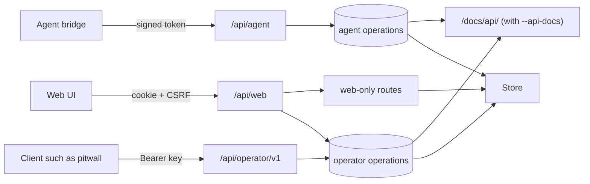

# Operator API: High-Level Architecture

- Requirements: [FRD](frd.md); plan: [plan](plan.md)
- Baseline: the server as of v0.4.0, described in `docs/architecture.md`

## Shape

Each documented mount's routes are declared once, as operations, and both the routes and the
documentation are built from those declarations:

This follows ruling 1: a third, key-only mount serving the web UI's operations with the same code.
The web UI keeps its own mount, whose cookie credential and unversioned contract fit a UI the server
ships in step, and adds the routes no key may call. No operation has a second handler, so A1 holds
by construction.

### Why not the alternatives

- **The web mount takes keys too.** It would carry two credentials with different rules (CSRF and
  `Origin` for one, none for the other) on one mount, and its refusal of `Authorization`, which
  keeps a token from ever riding a cookie's authority, would go. Separate mounts keep each
  credential's checks whole, as the agent and web mounts already do.
- **A separately designed resource API.** Two implementations of the same operations, which A1 rules
  out, and a second shape for every reader to learn.
- **Documentation listed beside the routes, with a test comparing the two.** Hono routes carry no
  schemas, so the list would be a second definition, and the test could only catch drift in the
  route list, never in a field. Declaring the operation once is the simpler way to meet D2.

## Operations

An operation declares its method and path, a one-line summary, its path, query and body schemas and
its response schema from `packages/api`, and its handler, which takes the store, the identity and
the parsed input and returns the response schema's type, so the compiler holds each declared
response to the code. A mount builds Hono routes from its list: parsing every input through its
schema, as `parseBody` and `parseQuery` do now, then calling the handler.

- **Operator operations** (`apps/server/src/http/operator-operations.ts`): every operation a key may
  call, each with the one scope it requires. Being in this list is what puts an operation on the
  operator mount, and its scope is required, so leaving an operation out keeps it off and nothing
  fails open. The web mount builds the same list for the browser session, which holds every scope.
  The thread routes the agent mount shares (`threadRoutes`, today in `thread-routes.ts`) are entries
  of both lists, so they keep one handler each.
- **Agent operations** (`apps/server/src/http/agent-operations.ts`): the agent mount's routes,
  declared the same way so they are documented (ruling 2). Its middleware (the version header, the
  cookie refusal, token authentication, rate spending and marking a session seen) stays as it is,
  and so does every answer (E1). Registration, whose token is checked against the key it carries,
  declares its schemas the same way and keeps its own authentication step.
- **Web-only routes** stay plain Hono routes in `web-api.ts`: the passkey ceremonies and passkeys,
  sign-in and signing out, Settings and voice, transcription, and key management. They use cookies,
  ceremonies or a raw body, which an operation's shape does not need to carry.

One path can name different operations on different mounts: `POST /s/:agent/:session/threads` is an
agent's `createThread` on the agent mount and the operator's `startThread` on the others. Each list
holds its own entry, so this is two declarations, not a mount-dependent handler.

Routes that answer `{}` or an untyped store result get a response schema in `packages/api`, since a
documented response must have one.

## Scopes

A scope is `<resource>:<access>`, with resources `threads` and `sessions` and accesses `read` and
`write`, a write including its resource's read (K4). `packages/api` defines them as one enum, so a
later resource is a new member. Each operator operation names the one scope it requires:

| Scope            | Operations                                                                                                                                               |
| ---------------- | -------------------------------------------------------------------------------------------------------------------------------------------------------- |
| `threads:read`   | thread list, counts, a thread                                                                                                                            |
| `threads:write`  | start a thread, send a message, read, unread, archive, bulk read and archive                                                                             |
| `sessions:read`  | sessions, unread updates, a session's log, groups and tags, registrations                                                                                |
| `sessions:write` | the log's read mark, group create, rename, remove, tag rename, remove, a session's group and tags, an agent's tags, registration approve, reject, revoke |

A test over the list confirms every operation requiring a read scope is a `GET` whose store work
writes nothing but credential bookkeeping (a browser session's idle expiry, a key's last use), so a
read key cannot change anything.

## Keys

- **Table.** Migration 5 adds `api_keys`: an id, the operator's person id, the name, the scopes, the
  SHA-256 of the secret, and the created, expiry (none for a key without one), last-used and revoked
  times. A revoked key keeps its row so the list can show it, and revoked and expired rows are
  deleted when the table is next written, as browser sessions are.
- **Secret.** 256 random bits, written as `agention_` and their base64url, so people and secret
  scanners recognize one. Only its hash is stored (K5), as with browser sessions and passkey links.
- **Identity.** `Credential` gains `{ kind: "api_key", id }`, and `Grants` gains the scopes an
  identity holds. A key's grants are every session and its scopes; a browser session holds every
  scope; an agent's registration holds `threads:write` over its own session only, which is what it
  can do today, so the thread routes check scopes the same way on every mount. The mount refuses an
  operation whose scope the identity lacks as `not_found`, as administration is refused today,
  before the handler runs. `authorizeAdministration` gives way to the scope check, since
  `sessions:write` now covers what administration meant. `checkCredential` confirms, inside each
  operation's transaction, that the key is unrevoked and unexpired, so revocation takes effect on
  the next request (K5). Last used is written at most hourly, as a browser session's idle expiry is.
- **Management.** On the web mount only: `GET /keys`; `POST /keys` with the name, scopes and expiry,
  answering the secret once; and `POST /keys/:id/revoke`. Creating and revoking need the recent
  sign-in that passkey changes need; listing does not, as listing passkeys does not. At most 20 keys
  that are neither revoked nor expired, checked in the creating transaction.
- **Expiry.** 7, 30, 60 or 90 days, a date up to 365 days away, or none (K2).

## The operator mount

- `/api/operator/v1/` accepts only `Authorization: Bearer agention_...`, and refuses any request
  carrying a cookie, as the agent mount does, so a browser's ambient credential never reaches it. It
  needs no CSRF token or `Origin`, since a browser never attaches a bearer key on its own.
- **Version in the path.** `GET /api/operator` answers the versions the server serves,
  `{"versions":[1]}`, and an unknown version is the existing `not_found`. A version changes only
  additively (a new operation, a new optional request field, a new response field); a change that
  would break a client is a new version beside the old, by a maintainer's decision (A2). The agent
  mount's header exists because bridges and servers release apart and the bridge refuses an older
  server; a client of this mount needs only to know a version is served, which the path says.
- **Rates.** A key's requests spend a budget of the key's own, as a registered agent key's do, and
  failed key authentication spends a shared `failedKeyAuth` budget, spent only on failure.
- **Errors** are the shared error shape. A refused key is told to check it or create a new one in
  Settings, with nothing that says whether the key ever existed.

## Documentation

- `apps/server/src/http/openapi.ts` builds one OpenAPI 3.1 document from the operator and agent
  operations: `z.toJSONSchema` for every schema, the bearer scheme for the operator mount and the
  signed token for the agent mount, the agent version header, and the error shape with its codes and
  statuses. Rules a schema enforces only in code (zod refinements) are absent from the generated
  schema, so the document can describe less than the server checks, never more; each such rule is
  stated in its field's description, which zod carries into the document.
- `agention serve --api-docs` serves `GET /docs/api/openapi.json` and `GET /docs/api/`, a page the
  server renders from the same document: each operation's method, path, summary, scope and
  parameters, and its schemas as formatted JSON. It is static HTML with no script, so the content
  security policy is unchanged and no dependency is added. Documentation is served without sign-in,
  since it describes the contract and no data. Without the flag, both paths answer the JSON
  `not_found`, not the web UI's index page, so nothing is served there (D1).
- The document is committed at `docs/api/openapi.json`, and a test fails when the generated document
  differs from it byte for byte (ruling 2). It is a generated output, listed with the others in
  `docs/development-context.md`, and regenerated by a script beside the plugin generator's.

## Web UI

### Settings sections (S1)

Settings becomes a list of sections, declared once in `apps/web/src/views/settings/sections.ts`:
each with a slug, a title, the group it is listed under, and its component. The router reads
`/settings/<slug>`; the navigation and the page are built from the list, so a later section is one
entry and one component. Groups, in order: **Access** (Passkeys, API keys) and **Features** (Voice),
with **Sign out** last, apart from the groups.

- **Wide screens:** a navigation column, the groups with their sections, beside the open section,
  with the current one marked (`aria-current`). `/settings` opens the first section.
- **Narrow screens:** `/settings` shows the navigation alone, as a full-width list; a section's page
  shows a back link to it in place of the column. The breakpoint is the one the app's layout already
  uses, in CSS, so nothing about the layout is decided in script.
- `/passkeys` leads to `/settings/passkeys`, and `/settings` keeps working (S1).
- The recent sign-in offer, which every section that changes a secret needs, moves from the view's
  top into the sections that need it (Passkeys, Voice, API keys), shown once per section. Each
  section loads its own data, so opening one fetches only what it shows.

This is the pattern later settings follow; agention#38's reorganization of voice settings fits
inside its Voice section.

### API keys section

The API keys section, under Access: the list (K3); a create form with name, scopes and expiry,
warning when no expiry is chosen; a one-time view of the new secret with a copy control and a note
that it is shown once; and revoke, with confirmation. A stale sign-in leads to the same re-sign-in
prompt the passkey section uses.

## Security

- A key is a bearer credential with the operator's reach within its scopes, so it is never logged,
  never sent back after creation, kept only as a hash, and bounded in life unless the operator
  chooses otherwise, which Settings warns against.
- The operator mount has no cookie path and the web mount no `Authorization` path, so neither
  credential can borrow the other's authority, and CSRF does not arise on the key mount.
- No key can manage keys, passkeys or Settings, so a leaked key cannot make itself another key, add
  a passkey, or change where audio goes. A `sessions:write` key can approve an agent's registration
  (ruling 1), so the operator guide and the key form say what that scope grants.
- ADR 0003 records that integrations may act for the operator through keys, superseding that clause
  of ADR 0001 "Not doing"; `SECURITY.md` gains the key's threat model; and
  `docs/review-checklist.md` gains a check that every new operation names its scope, and that read
  scopes stay read-only.

## Out of scope here

As the FRD says: push and long polling for clients, keys limited to some sessions, OAuth, and anyone
but the operator.
