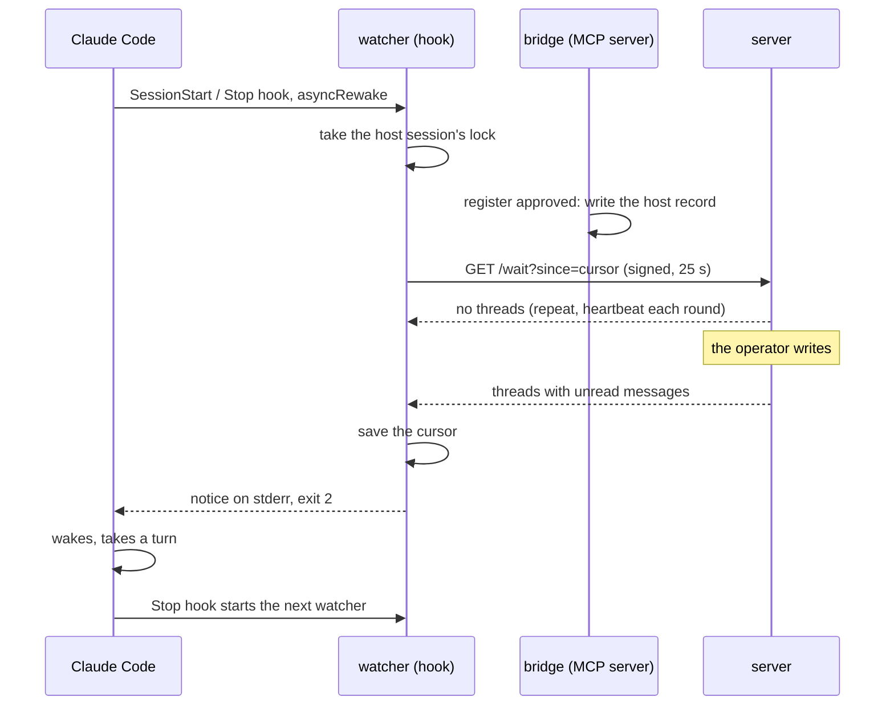

# Agent push: High-Level Architecture

- Requirements: [FRD](frd.md), accepted (ruling 2); research and spike:
  [prior art and host research](prior-art-research.md)
- Date: 2026-11-22
- Ownership: the effort lead

## Shape

Push lives entirely on the agent line: the bridge package and the Claude Code plugin. The server and
the agent API do not change, since the session's long poll,
`GET /api/agent/s/<agent>/<session>/wait`, already answers with the threads holding unread messages
from the operator, wakes when one is written, never reports a thread left unread twice under its
`since` cursor, and ends on revocation. So push ships on the agent line alone (C1), and works
against every server that serves the bridge's agent API version.

On Claude Code, a plugin hook runs a **watcher** in the background for each host session. The
watcher long-polls the session's wait with the session's key, and when the operator writes, prints
the notice and exits 2, which wakes Claude at its prompt (`asyncRewake`). The hook that ends every
turn starts the next watcher. On Codex nothing a plugin can reach wakes an open session (the spike),
so Codex has no push, and its `register` answer says answers reach the agent when it checks.



## Components

### The host record

A host session and the bridge serving it find each other through a **host record**: a private file
at `~/.config/agention/hosts/claude/<host session id>/record.json`, beside the key files the bridge
already keeps under `~/.config/agention/`, written under the same private-file rule. It names the
origin and the session's granted agent and session names, never a secret. The bridge writes it once
a registration is approved, and again whenever the granted names change; the watcher reads it.

The host session's id comes to the watcher in its hook input (`session_id`) and to the bridge in its
environment (`CLAUDE_CODE_SESSION_ID`, which Claude Code sets for the processes it starts, though
its documentation does not name it). Where the bridge finds no id, it writes no record, and the
session has no push: the failure is the safe one, since the `register` answer then says answers
reach the agent when it checks (H3). The directory also holds the watcher's lock, its cursor and its
heartbeat.

A record older than a week whose lock no live process holds is removed whenever a bridge writes one,
so host sessions that ended leave nothing for long.

### The watcher

`agention-mcp watch`, a subcommand of the bridge's own package, so it runs the same code at the same
version as the bridge, with the key file, signing, connection and error handling the bridge already
has.

- **One per host session.** It takes the directory's lock, and exits 0 at once when a live watcher
  holds it, so the `SessionStart` and `Stop` hooks can both start one without the session ever
  holding two waits (C2).
- **Waiting for a record.** Until the bridge writes the record, or while the record's registration
  is not approved, it waits without calling the server, watching the record and retrying slowly
  (P4).
- **The loop.** It long-polls the wait for 25 seconds at a time with the saved cursor, writing its
  heartbeat after every round. A round with threads saves the new cursor, prints the notice to
  stderr and exits 2. The saved cursor is what keeps a message from being pushed twice, even when
  the agent leaves it unread (P3).
- **Failures.** An unreachable server, a restart or a lost connection is retried with backoff, the
  heartbeat still written, so push recovers on its own (H4). A refusal it cannot outlast, an
  `unsupported_version` or a revoked credential, removes the heartbeat and exits 0, so the bridge
  sees push has lapsed.
- **Its life.** The hook's `timeout` is set to the longest a host session plausibly stays open, a
  day, and the spike showed Claude Code honors it past its default. Claude Code ends the watcher
  when the session exits. A watcher that outlives its timeout simply ends; the next turn's `Stop`
  starts another.

### The notice

The plugin's own fixed words, filled with numbers only (P2):

```text
Agention: the operator wrote to you. Unread: thread 4 (2 messages), thread 7 (1 message).
Read them with thread_get, then carry on as the agention skill describes.
```

No message text, title or other content from the server reaches the notice, so nothing the operator
or anyone else wrote is injected; the agent reads the messages with the thread tools, which carry
their author. Claude Code shows the notice as hook feedback.

### The bridge

- **`register`** writes the host record once the registration is approved, then reads the heartbeat:
  a heartbeat newer than a minute, from a watcher holding the lock, means push is live, and the
  answer says answers are pushed to the agent. Otherwise, as today, they reach it when it checks
  (H3). On a first registration the watcher starts its loop only once the record exists, so the
  bridge waits up to a few seconds for the first heartbeat before answering.
- **Lapse.** After an answer that said answers are pushed, every tool answer checks the heartbeat,
  and the first that finds it stale ends with one line saying answers now reach the agent only when
  it checks, as the status reminder's line does (H4). A heartbeat that returns, after a new turn's
  watcher starts, is said once in the same way.
- **Codex**, and any host that sets no host session id, never writes a record, so its answers are as
  today.

### The plugin and the skill

- The plugin definition gains the hook, and the generator writes `hooks/hooks.json` into the Claude
  Code plugin only, running `agention-mcp watch` from the same package spec as the MCP declaration,
  on `SessionStart` and `Stop` with `asyncRewake` and the day-long `timeout`. Hooks inherit Claude
  Code's environment, so `AGENTION_URL`, `AGENTION_CONNECT` and `NODE_EXTRA_CA_CERTS` reach the
  watcher as they reach the bridge.
- The usage skill's "How answers reach you" teaches both answers: pushed, where an agent with
  nothing else to do reports `idle` and ends its turn, with no waiter of its own; and when it
  checks, the loop as today.

## Security

- **The key.** The watcher reads the session's key file for each request, as the bridge does, under
  the private-file rule, and holds it no longer; the host record holds no secret. `SECURITY.md`'s
  section on the agent bridge gains the watcher as a second process signing with the key.
- **Injection.** The notice is the plugin's fixed text with numbers in it, the one exception to
  "Agention never injects text into an agent's conversation" (ruling 2); a new ADR records it, and
  review check A1 names it.
- **Trust.** Claude Code runs hooks only in a trusted folder, not under `--bare`, and not where an
  admin allows managed hooks only. In each case the watcher never runs, no heartbeat appears, and
  the session is told it checks.

## Compatibility

- No agent API change, so the agent line releases push alone, and it works against every server
  serving the bridge's version (C1). A server never sees anything but the bridge's ordinary waits.
- A plugin without the hook runs as today; a bridge with push on Codex runs as today.
- Several host sessions serving one Agention session each have their own record, watcher and cursor,
  so each is pushed (P1).

## Risks and open items

- **The undocumented session id.** If Claude Code stops setting `CLAUDE_CODE_SESSION_ID`, push stops
  and sessions are told they check: safe, but silent until a test catches it. The live check in E2
  covers it, and the process ancestry of the bridge and the watcher, both started by the same Claude
  Code process, is the fallback the build looks at if needed.
- **A session id that changes.** Whether `/clear` or a resumed session gives hooks a new
  `session_id` while the bridge keeps its old environment is to be found in the build; a mismatch
  fails safe, as above.
- **Codex** gains push when it offers a plugin a way to wake an open session, or adopts MCP's events
  extension; the watcher is the piece such a path would reuse.

## Collateral

As E1 lists: a new ADR (push and its notice, superseding ADR 0001's "No push" and amending "No
permissions, no harness control" and "Never holds up"), README, `docs/review-checklist.md` A1,
`SECURITY.md`, `docs/architecture.md` (the bridge, the watcher, the plugin), the operator guide
(push on Claude Code, none on Codex, stranded threads), the usage skill, `docs/live-testing.md` and
the development contract.
