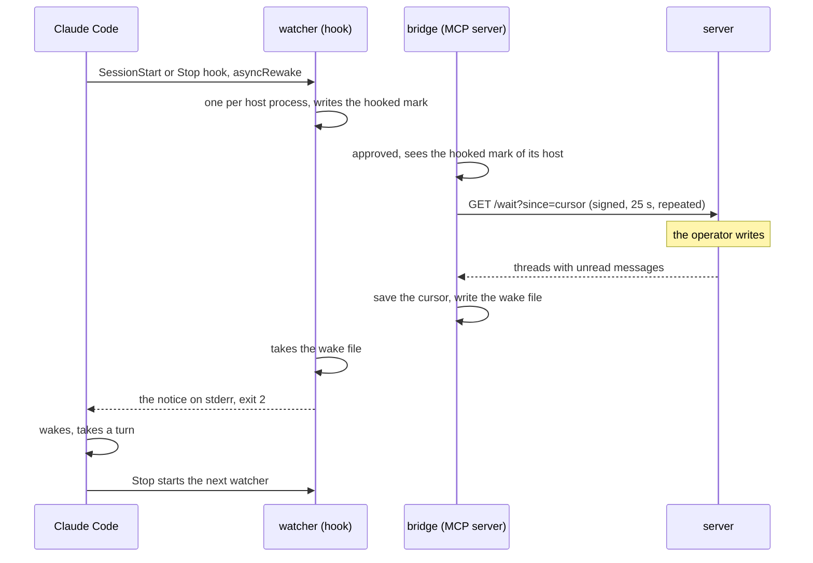

# Agent push: High-Level Architecture

- Requirements: [FRD](frd.md), accepted (ruling 2); research and spike:
  [prior art and host research](prior-art-research.md)
- Date: 2026-11-22
- Ownership: the effort lead

## Shape

Push lives entirely on the agent line: the bridge package and the Claude Code plugin. The server and
the agent API do not change, since the session's long poll,
`GET /api/agent/s/<agent>/<session>/wait`, already answers with the threads holding unread messages
from the operator, wakes when one is written, never reports a thread left unread twice under its
`since` cursor, and ends on revocation. So push ships on the agent line alone, and works against
every server that serves the bridge's agent API version (C1); there is no older-server case to test
beyond the bridge's existing one.

The **bridge**, already running for the host session, already approved, and already holding the key,
the names and the connection, holds the wait in the background. When the wait finds the operator's
messages, it writes a **wake file**. On Claude Code, a plugin hook runs a **watcher**, a small shell
script, which waits for that file, prints the notice in it and exits 2, which wakes Claude at its
prompt (`asyncRewake`). The hook that ends every turn starts the next watcher. On Codex nothing a
plugin can reach wakes an open session (the spike), so Codex has no push and runs as today.



## Components

### The host directory

The bridge and the watcher meet in a **host directory** named for the Claude Code process that runs
both: `~/.config/agention/_hosts/claude/<pid>/`, beside the key files under `~/.config/agention/`
(no server host is named `_hosts`), under the same private-file rule. The watcher learns the pid
from `CLAUDE_PID`, which Claude Code sets for the hooks it runs; the bridge finds it among its own
ancestors, since Claude Code starts it too (through `npx`). Both are undocumented by Claude Code,
and the spike confirmed both on 2.1.330. A host session's id is not used: `/clear` gives hooks a new
`session_id` while the bridge, which Claude Code does not restart, keeps the old one in its
environment (the spike).

The directory holds:

- `watcher`: the running watcher's pid, the lock that keeps one watcher per host process;
- `hooked`: written by the first watcher and kept for the host process's life, which says the
  plugin's hooks run here;
- `wake`: the notice the bridge writes and the watcher takes;
- `cursor`: the wait's position, with the granted names it belongs to.

A directory whose pid is no longer a live process is removed whenever a bridge or watcher starts, so
ended host sessions leave nothing behind.

### The bridge's wait

- **When it runs.** Only where push can work: the MCP client is Claude Code (`clientInfo` in the
  `initialize` request), a host directory exists for an ancestor pid with its `hooked` mark, and the
  session's registration is approved. A program merely started from a Claude Code shell, such as
  Codex, is not Claude Code's client, so it never claims push. Anywhere else nothing runs in the
  background, so Codex costs nothing (C2).
- **Learning of approval.** While the session's registration is pending, the bridge reads its state
  every 15 seconds with the request `register` already makes, which creates nothing for a key the
  server knows, so push starts once the operator approves even if the agent's turn has ended (P4).
  It never submits a key that is absent from disk.
- **The loop.** It long-polls the wait for 25 seconds at a time from the saved cursor, one request
  at a time (C2). A round with threads saves the new cursor first, then writes the wake file, so a
  message is never pushed twice, even if the agent leaves it unread or the bridge restarts (P3). A
  cursor saved under other granted names is discarded, since positions are per session.
- **Failures.** An unreachable server, a restart or a lost connection is retried with backoff, so
  push recovers on its own (H4). The bridge gives up only on what it cannot outlast: the server not
  serving its agent API version, or the registration rejected, revoked or expired; it then goes back
  to reading the registration's state, as while pending, so a new approval starts push again.
- **Presence.** The wait marks the session seen, as an agent's own waiter does today, so a session
  with push is not quiet while its host is open; threads strand as today otherwise (P5).

### The watcher

A POSIX shell script the generator writes into the Claude Code plugin, run by a hook on
`SessionStart` and on `Stop`, with `asyncRewake: true` and a day-long `timeout` (the spike saw it
honored past the 600-second default).

- It exits 0 at once unless `AGENTION_URL` is set and `CLAUDE_PID` is a positive integer, so a
  session that does not use Agention keeps nothing running.
- It takes the `watcher` lock, a pid file checked with `kill -0`, and exits 0 when a live watcher
  holds it; it writes `hooked` if absent.
- It waits, checking every second for the wake file and for its host process. When the host process
  is gone it exits 0, so a killed Claude Code leaves no watcher behind. When the wake file is there,
  it renames it to its own name, prints its contents to stderr, removes it and exits 2. Every other
  outcome exits 0 or 1, so nothing but a taken wake file can wake the agent, and a broken watcher
  cannot loop the session through turns.
- A wake file written while no watcher runs, during a turn, is taken by the watcher the turn's
  `Stop` starts, so it wakes the agent as soon as that turn ends.

A watcher ends at its timeout. A host session left at its prompt for more than a day is then not
pushed until its next turn: a limit the operator guide states.

### The notice

The bridge composes it from fixed words and numbers only (P2):

```text
Agention: the operator wrote to you. Unread: thread 4 (2 messages), thread 7 (1 message).
Read them with thread_get, then carry on as the agention skill describes.
```

It names the threads the wait reported, with their unread counts, each a schema-checked integer. No
message text, title or other content from the server reaches it. Claude Code shows it as hook
feedback.

### Telling the agent

- **`register`** says answers are pushed when the bridge's wait runs or will run once approved: the
  client is Claude Code and its host has the `hooked` mark. Otherwise, as today, answers reach the
  agent when it checks (H3). The mark exists from the first hook, long before the agent registers,
  so there is nothing to wait for.
- **Lapse.** When the wait gives up, the next tool answer ends with one line saying answers now
  reach the agent only when it checks, as the status reminder's line does (H4); a later approved
  `register` says they are pushed again. `toolMeta`'s declared size counts the line.
- **The skill and the tools.** The usage skill's loop, step 5, teaches both answers: pushed, where
  an agent with nothing else to do reports `idle` and ends its turn, with no waiter of its own; and
  when it checks, as today. `register`'s and `message_wait`'s descriptions say the same.

## Security

- **One process signs.** Only the bridge holds the wait, reading the key file for each request as
  today. The watcher touches no key and no server; it prints what the bridge wrote.
- **What is written.** The host directory follows the private-file rule and holds a pid, a mark, a
  cursor, granted names and the notice: no secret. `SECURITY.md` "Files it writes" lists it.
- **Injection.** The notice is the one exception to "Agention never injects text into an agent's
  conversation" (ruling 2): fixed words and integers, composed by the bridge. A new ADR records it,
  superseding ADR 0001's "No push" for agents only, since notifying the operator stays out of scope.
  Review check A1 names it.
- **Trust.** Claude Code runs hooks only in a trusted folder, not under `--bare`, and not where an
  admin allows managed hooks only. In each case no `hooked` mark appears, and the session is told it
  checks, which the operator guide lists as push's needs.

## Risks and open items

- **Undocumented `CLAUDE_PID`.** If Claude Code stops setting it, no mark appears and sessions are
  told they check: safe, and the live run catches it. The watcher's own parent chain is the
  fallback.
- **A notice mid-turn.** A watcher started at `SessionStart`, or after a typed turn, runs while the
  agent works; a message arriving then is shown at the agent's next opportunity. The live run
  records exactly when, and the guide says it.
- **Codex** gains push when it offers a plugin a way to wake an open session, or adopts MCP's events
  extension, which the bridge, already holding the wait, would serve.

## Collateral

As E1 lists: the new ADR, README, `docs/review-checklist.md` A1, `SECURITY.md` ("The agent bridge"
and "Files it writes"), `docs/architecture.md` (the bridge's state and background wait, the watcher,
the plugin), the operator guide (push on Claude Code and what it needs, none on Codex, the day-long
limit, stranded threads), the usage skill and the `register` and `message_wait` descriptions,
`docs/live-testing.md`, and the development contract.
