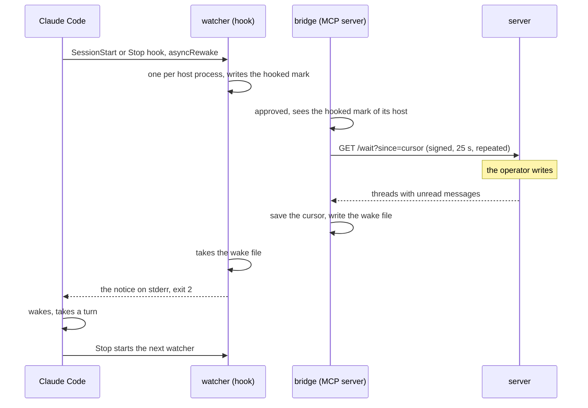

# Agent push: High-Level Architecture

- Requirements: [FRD](frd.md), accepted (ruling 2); research and spike:
  [prior art and host research](prior-art-research.md)
- Date: 2026-11-22
- Ownership: the effort lead

## Shape

Push lives entirely on the agent line: the bridge package and the Claude Code plugin. The server and
the agent API do not change, since the session's long poll,
`GET /api/agent/s/<agent>/<session>/wait`, already answers with the threads holding unread messages
from the operator, wakes when one is written, never reports a thread left unread twice under its
`since` cursor, and ends on revocation. So push ships on the agent line alone, and works against
every server that serves the bridge's agent API version (C1); there is no older-server case to test
beyond the bridge's existing one.

The **bridge**, already running for the host session, already approved, and already holding the key,
the names and the connection, holds the wait in the background. When the wait finds the operator's
messages, it writes a **wake file**. On Claude Code, a plugin hook runs a **watcher**, a small shell
script, which waits for that file, prints the notice in it and exits 2, which wakes Claude at its
prompt (`asyncRewake`). The hook that ends every turn starts the next watcher. On Codex nothing a
plugin can reach wakes an open session (the spike), so Codex has no push and runs as today.



## Components

### The host directory

The bridge and the watcher meet in a **host directory** named for the Claude Code process that runs
both: `~/.config/agention/_hosts/claude/<host name>/<pid>/`, beside the key files under
`~/.config/agention/` (no server host is named `_hosts`), under the same private-file rule. The
watcher learns the pid from `CLAUDE_PID`, which Claude Code sets for the hooks it runs. The bridge
takes its nearest ancestor whose command name is `claude`, and never looks further up, so a Claude
Code started from another's shell, whose own hooks do not run, never borrows the outer one's
directory; with no such ancestor there is no push. The machine's host name keeps two machines or
containers sharing a home directory apart. The bridge reads the host name again each round, so a
rename mid-session moves push to the directory the next watcher marks, with the lapse line while
none has. Both are undocumented by Claude Code, and the spike confirmed both on 2.1.330. A host
session's id is not used: `/clear` gives hooks a new `session_id` while the bridge, which Claude
Code does not restart, keeps the old one in its environment (the spike).

The directory holds:

- `watcher`: the running watcher's pid, the lock that keeps one watcher per host process;
- `hooked`: written by the first watcher and kept for the host process's life, which says the
  plugin's hooks run here;
- `wake-<h>` and `cursor-<h>`: for each Agention session pushed from this host process, the notice
  the bridge writes and the watcher takes, and the wait's position with the origin and granted names
  it belongs to, where `<h>` is a hash of those, so two bridges under one Claude Code never share
  either.

A directory of this host name whose pid is no longer a live process is removed when a Claude Code
session's bridge first looks for its Claude Code process, so ended host sessions leave nothing
behind.

### The bridge's wait

- **When it runs.** Only where push can work: the MCP client is Claude Code (its client name,
  `claude-code`), its host directory has the `hooked` mark, and the session's registration is
  approved. A program merely started from a Claude Code shell, such as Codex, is not Claude Code's
  client, so it never claims push. Anywhere else nothing runs in the background, so Codex costs
  nothing (C2). It starts at `register`, and a restarted bridge resumes at the agent's first
  Agention call that finds the session's credential.
- **Learning of approval.** While the session's registration is pending, the bridge reads its state
  every 15 seconds with the request `register` already makes, only until two minutes, the clock skew
  the agent API tolerates, before the `expires_at` that state gave, so push starts once the operator
  approves even if the agent's turn has ended (P4), and a background read never recreates an expired
  registration. It never submits a key that is absent from disk.
- **The loop.** It long-polls the wait for 25 seconds at a time from the saved cursor, one request
  at a time and never sooner than a second after the last began (C2). A round with threads saves the
  new cursor first, then reads every thread with unread messages from the operator at once and
  writes the notice from that, so a message is never pushed twice, even if the agent leaves it
  unread or the bridge restarts (P3); the notice names the round's threads and every other thread
  unread when it is written, and the fresh read's position is saved too when it is complete, so a
  message arriving between the two is not pushed again. A cursor saved under other granted names, or
  one the server refuses, is discarded.
- **Failures.** An unreachable server, a restart, a lost connection, a host directory that cannot be
  written, or a server that no longer serves the bridge's agent API version is retried with backoff,
  so push recovers on its own (H4). A rejected or revoked registration, or one that expired pending,
  ends the loop, and only `register` starts it again, so a refused key is never read in the
  background; a `register` during a run that is ending starts it again too.
- **Presence.** The wait marks the session seen, as an agent's own waiter does today, so a session
  with push is not quiet while its host is open; threads strand as today otherwise (P5).

### The watcher

A POSIX shell script copied, with the hand-written `hooks.json` that runs it, into the Claude Code
plugin only. It runs on `SessionStart`, `UserPromptSubmit`, `Stop` and `StopFailure`, so every way a
turn ends or begins starts one, with `asyncRewake: true` and a day-long `timeout` (the spike saw it
honored past the 600-second default).

- It exits 0 at once unless `AGENTION_URL` is set, `CLAUDE_PID` is a positive integer and
  `CLAUDE_CODE_ENTRYPOINT` is `cli`, so a session that does not use Agention keeps nothing running,
  and print mode and the SDK, which end when the turn does, are never told answers are pushed.
- It sends its own stderr to nowhere at its start and prints only a notice, through a descriptor it
  kept, so no shell error can reach the agent.
- It checks the host directory and those above it under the private-file rule, writes `hooked` if
  absent, and takes the `watcher` lock: the newest watcher wins, and an older one exits 0 within a
  second, so the day-long timeout counts from the latest turn.
- It waits, checking every second for wake files and for its host process. When the host process is
  gone it exits 0, so a killed Claude Code leaves no watcher behind. When wake files are there, it
  renames each to its own name, prints the notices to stderr, removes them and exits 2; a notice it
  cannot print goes back under its wake name and it exits 1. Every other outcome exits 0 or 1, so
  nothing but a taken wake file can wake the agent, and a broken watcher cannot loop the session
  through turns.
- A wake file written while no watcher runs, during a turn, is taken by the watcher that the turn's
  end starts, so it wakes the agent as soon as that turn ends.

A watcher ends at its timeout. A host session left at its prompt for more than a day is then not
pushed until its next turn: a limit the operator guide states (ruling 3).

### The notice

The bridge composes it from fixed words and numbers only (P2):

```text
Agention: the operator wrote to you. Unread: thread 4 (2 messages), thread 7 (1 message).
Read them with thread_get, then carry on as the agention skill describes.
```

It names every thread with unread messages from the operator, by number, with its unread count, each
a schema-checked integer. No message text, title or other content from the server reaches it. Claude
Code shows it as hook feedback.

### Telling the agent

- **`register`** says answers are pushed when the bridge's wait runs or will run once approved: the
  client is Claude Code and its host has the `hooked` mark. Otherwise, as today, answers reach the
  agent when it checks (H3). The mark exists from the first hook, long before the agent registers,
  so there is nothing to wait for.
- **Lapse.** When the wait fails or ends, the next tool answer ends with one line saying answers now
  reach the agent only when it checks, as the status reminder's line does (H4); a recovered wait, or
  a later approved `register`, makes it pushed again. `toolMeta`'s declared size counts the line.
- **The skill and the tools.** The usage skill's loop, step 5, teaches both answers: pushed, where
  an agent with nothing else to do reports `idle` and ends its turn, with no waiter of its own; and
  when it checks, as today. `register`'s and `message_wait`'s descriptions say the same.

## Security

- **One process signs.** Only the bridge holds the wait, reading the key file for each request as
  today. The watcher touches no key and no server; it prints what the bridge wrote.
- **What is written.** The host directory follows the private-file rule and holds a pid, a mark, a
  cursor, granted names and the notice: no secret. `SECURITY.md` "Files it writes" lists it.
- **Injection.** The notice is the one exception to "Agention never injects text into an agent's
  conversation" (ruling 2): fixed words and integers, composed by the bridge. A new ADR records it,
  superseding ADR 0001's "No push" for agents only, since notifying the operator stays out of scope.
  Review check A1 names it.
- **Trust.** Claude Code runs hooks only in a trusted folder, not under `--bare`, and not where an
  admin allows managed hooks only. In each case no `hooked` mark appears, and the session is told it
  checks, which the operator guide lists as push's needs.

## Risks and open items

- **Undocumented `CLAUDE_PID`.** If Claude Code stops setting it, no mark appears and sessions are
  told they check: safe, and the live run catches it. The same holds for `CLAUDE_CODE_ENTRYPOINT`.
- **The process name.** The bridge finds Claude Code by its command name, `claude`, as 2.1.330 shows
  it; a host that runs under another name gets no push, and the live run checks it.
- **Turn endings.** Whether `StopFailure` and `UserPromptSubmit` start a watcher as `Stop` does is
  for the live run.
- **A notice mid-turn.** A watcher started at `SessionStart`, or after a typed turn, runs while the
  agent works; a message arriving then is shown at the agent's next opportunity. The live run
  records exactly when, and the guide says it.
- **Codex** gains push when it offers a plugin a way to wake an open session, or adopts MCP's events
  extension, which the bridge, already holding the wait, would serve.

## Collateral

As E1 lists: the new ADR, README, `docs/review-checklist.md` A1, `SECURITY.md` ("The agent bridge"
and "Files it writes"), `docs/architecture.md` (the bridge's state and background wait, the watcher,
the plugin), the operator guide (push on Claude Code and what it needs, none on Codex, the day-long
limit, stranded threads), the usage skill and the `register` and `message_wait` descriptions,
`docs/live-testing.md`, and the development contract.
