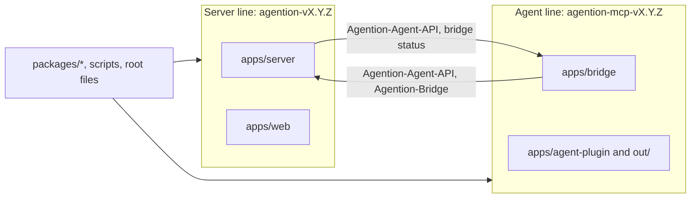

# Separate releases: High-Level Architecture

- Status: Draft, written against the draft FRD before its acceptance
- Date: 2026-11-22
- Ownership: the effort lead
- Inputs: [frd.md](frd.md), [prior-art-research.md](prior-art-research.md) (findings F1 to F11)

## Overview

Three changes, each complete on its own:

1. **Release lines.** Two release-please configurations, one per line, replace the one that stamps
   one version everywhere. Each line has its own tags, changelog, release pull request and publish
   run, and the agent line's publish refuses to run ahead of the server (C2).
2. **A newer bridge against an older server.** The bridge checks the server's agent API version
   before it registers, so it never leaves a pending registration behind (C4), and both sides word a
   version mismatch in terms that hold when the lines' versions differ (C3). A new gate runs the
   bridge at HEAD against every released server (C5).
3. **The plugin-is-behind signal.** The bridge states its release on every request. The server
   records what each session's bridge states, marks a session whose bridge is behind in the sessions
   view and the operator API, and says so in the register answer, which bridges from this effort on
   relay (U2 to U4).

## 1. Release lines

### Membership

| Line   | Component      | Tag                   | Paths it owns                                                            | Publishes                    |
| ------ | -------------- | --------------------- | ------------------------------------------------------------------------ | ---------------------------- |
| Server | `agention`     | `agention-vX.Y.Z`     | `apps/server`, `apps/web`                                                | `@wayfarerlabs/agention`     |
| Agent  | `agention-mcp` | `agention-mcp-vX.Y.Z` | `apps/bridge`, `apps/agent-plugin`, `out/`, the two marketplace catalogs | `@wayfarerlabs/agention-mcp` |

Everything else (`packages/*`, `scripts/`, the lockfile, root files) is shared: a releasing commit
there releases both lines. Every workspace package under `packages/` is used by both the server and
the bridge, so there is nothing to split further.

### Configuration

release-please gives only a root package the commits outside every package's path (F2), so each line
is the root package of its own configuration, excluding the other line's paths (F3):

- `release-please-config.json` and `.release-please-manifest.json`: the server line, release type
  `node`, component `agention`, `exclude-paths` the agent line's paths, the changelog `CHANGELOG.md`
  (which keeps the history through 0.6.0), and `extra-files` for `apps/server/package.json` and its
  lockfile entry. The root `package.json` version, which the `node` type writes, follows the server
  line.
- `release-please-config.agent.json` and `.release-please-manifest.agent.json`: the agent line,
  release type `simple` (so it writes no root `package.json`, F4), component `agention-mcp`,
  `exclude-paths` the server line's paths, the changelog `apps/bridge/CHANGELOG.md`, and
  `extra-files` for every place the agent version appears today: the bridge's `package.json` and
  lockfile entry, the plugin definition, both generated plugin manifests, and the bridge's package
  spec in both generated `.mcp.json` files. It also stamps the server's knowledge of the newest
  bridge (see section 3).

The release-please workflow runs the action twice, once per configuration. Each keeps its own
release pull request. `node-workspace` and `linked-versions` are not used (F5).

Only `feat`, `fix` and `perf` commits and breaking changes release (F7), so a shared change releases
both lines only when it is a feature or fix of shared code; Dependabot's `chore` commits release
neither.

### Publishing

`.github/workflows/release.yml` triggers on `agention-v*` and `agention-mcp-v*` (which the first
does not match) instead of `v*`. The build job reads the line from the tag's prefix, refuses a tag
that is not that line's version everywhere the line stamps it, runs
`scripts/check.sh --packages DIR`, and keeps only that line's tarball; the publish job, which runs
no repository code, publishes it. A version already on npm is skipped, as today.

**Release order (C2).** The agent line's build job refuses to go on until a server release serving
the bridge's agent API version is on npm: it finds the newest server tag (`agention-v*`, or a legacy
`v*`) whose `packages/api` agent API version is at least the bridge's and checks npm has that
version. A refusal names the server release to merge first and says to re-run the failed jobs once
it is published. When a shared change is pending on both lines, the maintainer merges the server's
release pull request first.

The tag ruleset that lets only the release App create `v*` tags, and the npm environment's tag rule,
must cover the new prefixes before the workflow triggers on them, or anyone who can push a tag could
start a publish. Both are repository settings, which the operator changes (see Migration).

### Gates

- **Agent compatibility** keeps its meaning (every released bridge against the agent routes at
  HEAD), and finds released bridges from the legacy `v*` tags and the `agention-mcp-v*` tags.
- **Server compatibility** is new (section 2).
- `scripts/check.sh` otherwise does not change: CI checks both lines on every pull request, since a
  change to shared code affects both.

### Migration

1. 0.6.0 releases under the current configuration (release pull request #58), since switching
   configurations orphans an open release pull request (F6).
2. The operator extends the tag ruleset and the npm environment's tag rule to `agention-v*` and
   `agention-mcp-v*`.
3. The operator creates `agention-v0.6.0` and `agention-mcp-v0.6.0` on the 0.6.0 release commit,
   which starts no run while the workflow still triggers on `v*` only. These seed each line's
   history, so release-please neither walks back 500 commits nor compares the first changelog
   against a tag that does not exist (F6).
4. The release-lines pull request merges, with both manifests at 0.6.0.
5. Before that merge, the two configurations are tried against a fork or with release-please's dry
   run, since the two-configuration pattern rests on reading the source (F3).

## 2. A newer bridge against an older server

### What changes in the bridge

- **A version check before registering.** Before each `register` call reaches the server, the bridge
  makes one request that every released server refuses without doing anything: an unauthenticated
  request to the agent mount, which servers from 0.3.0 answer with their `Agention-Agent-API`
  header, before authentication, and servers before 0.3.0 answer without one, meaning 1. A server
  older than the bridge is refused there, so a new key is never sent and no pending registration is
  recorded (C4). The per-answer check stays, for a server that changes under a running bridge.
- **Wording.** The bridge's refusal names the server's version (or its silence) and the bridge's,
  and the operator's fix in terms of each line's own releases: upgrade the Agention server to its
  newest release, or install an earlier Agention plugin that matches the server, then restart the
  session. It never asks for the server "at the bridge's release", which stops meaning anything once
  the versions differ (C3).

### What changes in the server

The agent mount's `unsupported_version` refusals are reworded the same way: a newer bridge than the
server serves is told to have the operator upgrade the server to its newest release or install an
earlier plugin; an older one than the server's oldest is told to update the plugin to its newest
release. As today, the refusal names agent API versions, never the server's release.

### The server compatibility gate (C5)

A new gate in `scripts/check.sh`, beside agent compatibility and skipped by `--fast`, mirrors it in
the other direction. For each released server (legacy `v*` tags and `agention-v*` tags reachable
from HEAD), it installs `@wayfarerlabs/agention` from npm by exact version with signatures and
provenance checked, starts `agention serve` on loopback with a throwaway TLS certificate and data
directory, and runs the bridge at HEAD against it as an agent host would:

- against a server whose agent API version is older than the bridge's, every tool fails with the
  refusal of C3, and the server's database holds no registration afterwards (C4);
- against a server that serves the bridge's version, register, approval and a basic thread round
  trip work.

Released servers since 0.1.0 accept `--tls-cert` and `--tls-key`, so no proxy is needed. The low
level design fixes how the gate approves a registration and reads the database across releases.

## 3. The plugin-is-behind signal

### What a bridge states

Every request a bridge from this effort on makes carries its release in a new header,
`Agention-Bridge`, beside `Agention-Agent-API`. Earlier bridges send no release; their agent API
version is all the server knows of them (U4).

### What the server knows

- **The newest bridge it knows of** is a constant in `packages/api`, which the agent line's
  release-please configuration stamps on each agent release. A server built at any commit therefore
  knows the newest agent release made by then; a bridge-only release made after the server's own is
  unknown to it, and is flagged once the operator upgrades the server.
- **What each session's bridge states**: the session row records the agent API version and release
  of the last approved call, updated only when they change, on the path that already marks the
  session seen.

### When a session is behind

A session is behind when its bridge's agent API version is below the server's (the server offers
something the bridge cannot use), or its stated release is below the newest bridge the server knows
of (a fix shipped since). A session with no recorded call yet is not marked.

### Where it shows

- **Sessions view**: the session's row carries a notice naming the reason and the fix: update the
  Agention plugin on that agent's host and restart the session. A session that is current shows
  nothing.
- **Operator API**: the sessions read gains a field carrying the same status and reason, which is
  additive and stays in operator API v1.
- **Register answer**: the agent mount's registration answer gains the same status for the calling
  session. This is a change to the agent contract, so it bumps the agent API version to 4. A bridge
  from this effort on adds a sentence to its register answer asking the agent to tell the operator,
  without failing the call (U3).

### Sequencing with the agent API bump

The agent line's first release after the signal speaks agent API 4, so by C2 it ships only after a
server release that serves 4. Until the operator upgrades the server, a plugin updated to that
release is refused with the reworded message of section 2.

## Documentation

- A new ADR 0005, "Separate release lines", supersedes ADR 0001's "One version covers the server,
  the bridge and the plugins", and ADR 0001's status names it.
- `docs/architecture.md`: "Versions", "Generated plugins", "Agent bridge" (the header, the version
  check before register), "HTTP API" (the refusal wording), "Store" (the recorded bridge), "Web UI"
  (the notice).
- `CONTRIBUTING.md`: "Releasing" (two release pull requests, the merge order, the tags), "Checking a
  release", "Checks" (the server compatibility gate), "The agent API".
- `docs/operator-guide.md`: upgrading the server and updating the plugin as separate steps, the one
  rule of U1, the sessions view's notice, and the update steps on each host (F8, F9), correcting the
  claim that the hosts replace a plugin only when its version changes.
- `README.md` "Status", `docs/development-context.md` (gates, release facts), and
  `docs/review-checklist.md` or `docs/live-testing.md` where they name releases or the one version.
- The generated OpenAPI document, for the operator API's new field.

## Risks

- **Undocumented release-please pattern.** Mitigated by the dry run of Migration step 5, and by the
  release workflow's own check that a tag matches its line's versions.
- **Codex follows `main`.** A Codex host refreshes its plugin as soon as an agent release pull
  request merges, before the operator may have upgraded the server (F9). C2 orders the releases but
  cannot order the operator's installs; C3's refusal is what such a host sees. Graceful fallback is
  agention#16's, out of scope here.
- **Two approvals for a shared change.** A shared fix becomes two release pull requests; the release
  order check makes merging them in the wrong order fail loudly rather than publish out of order.
