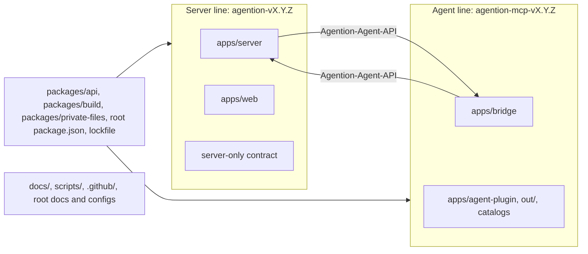

# Separate releases: High-Level Architecture

- Status: Draft, against the FRD as accepted (its ruling 2)
- Date: 2026-11-22
- Ownership: the effort lead
- Inputs: [frd.md](frd.md), [prior-art-research.md](prior-art-research.md) (findings F1 to F11)

## Overview

Three changes, each complete on its own:

1. **Release lines.** Two release-please configurations, one per line, replace the one that stamps
   one version everywhere. Each line has its own tags, changelog, release pull request and publish
   run. A check on the agent line's release pull request keeps it from merging before the server
   release it needs is on npm (C2).
2. **A newer bridge against an older server.** Both sides word a version mismatch in terms that hold
   when the lines' versions differ (C3), and a new gate runs the bridge at HEAD against every
   released server older than it (C5).
3. **The plugin-is-behind signal.** The server records the agent API version each session's bridge
   states and marks a session whose bridge is behind in the sessions view and the operator API (U2);
   a bridge from this effort on sees from the server's own answers that it is behind and says so in
   its register answer (U3). Neither needs a change to the agent contract.

## 1. Release lines

### What each line ships

| Line    | Component      | Tag                   | Paths                                                                                    | Publishes                    |
| ------- | -------------- | --------------------- | ---------------------------------------------------------------------------------------- | ---------------------------- |
| Server  | `agention`     | `agention-vX.Y.Z`     | `apps/server`, `apps/web`, the server-only contract package                              | `@wayfarerlabs/agention`     |
| Agent   | `agention-mcp` | `agention-mcp-vX.Y.Z` | `apps/bridge`, `apps/agent-plugin`, `out/`, `.claude-plugin/`, `.agents/`                | `@wayfarerlabs/agention-mcp` |
| Shared  | both           |                       | `packages/api`, `packages/build`, `packages/private-files`, `package.json`, the lockfile | both                         |
| Neither |                |                       | `docs/`, `scripts/`, `.github/`, the root's Markdown, lint and editor configuration      | nothing                      |

**The server-only contract.** `packages/api` today holds both the contract the bridge and server
share and modules only the server and web UI use (API keys, settings, attention, passkeys, groups
and tags, the operator schemas). The bridge imports the whole package through its index, so a change
to any of those modules changes the bridge's bundle too. Moving them into a package of their own,
which the bridge does not depend on, makes R2 hold and lets the build enforce the boundary: the
bridge cannot import what it does not depend on (FRD ruling 2). The low-level design names the
package and draws the line inside `sessions.ts`, whose operator parts move.

### Configuration

release-please gives only a root package the commits outside every package's path (F2), so each line
is the root package of its own configuration, excluding what it does not ship (F3):

- `release-please-config.json` and `.release-please-manifest.json`: the server line, release type
  `node`, component `agention`, the changelog `CHANGELOG.md` (which keeps the history through
  0.6.0), and `extra-files` for `apps/server/package.json` and its lockfile entry. The root
  `package.json` version, which the `node` type writes, follows the server line.
- `release-please-config.agent.json` and `.release-please-manifest.agent.json`: the agent line,
  release type `simple` (so it writes no root `package.json`, F4), component `agention-mcp`, the
  changelog `apps/bridge/CHANGELOG.md`, its own `label` and `release-label`, and `extra-files` for
  every place the agent version appears today: the bridge's `package.json` and lockfile entry, the
  plugin definition, both generated plugin manifests, and the bridge's package spec in both
  generated `.mcp.json` files.

Each configuration's `exclude-paths` lists the other line's paths and the paths that ship nothing,
so a feature that carries its docs releases only its own line, and a change to shared paths releases
both. release-please drops a commit from a package only when every file it touches is excluded (F2),
so a new top-level path that ships nothing and is missing from the lists releases both lines: the
safe failure. CONTRIBUTING says where to add one.

The agent configuration's labels differ from the server's because release-please stops updating a
release pull request while any merged one still carries its pending label: shared labels would let
one line's untagged release freeze the other's.

The release-please workflow runs the action twice, once per configuration, each with its own release
pull request and outputs. `node-workspace` and `linked-versions` are not used (F5). Only `feat`,
`fix` and `perf` commits and breaking changes release (F7).

### Publishing

`.github/workflows/release.yml` triggers on `agention-v*` and `agention-mcp-v*` (which the first
does not match) instead of `v*`. The build job reads the line from the tag's prefix, refuses a tag
that is not that line's version everywhere the line stamps it, runs
`scripts/check.sh --packages DIR`, and keeps only that line's tarball; the publish job, which runs
no repository code, publishes it. A version already on npm is skipped, as today.

### Release order (C2, U4)

A plugin is in effect released when its release pull request merges, not when its bridge reaches
npm: the marketplace catalogs serve the plugin from `main`, so the merge changes the bridge every
host runs (Codex at its next session start, F9). The order is therefore enforced at that merge.

A new gate in `scripts/check.sh`, "Release order", acts only when HEAD's agent line version has no
tag yet, which is true only on the agent line's release pull request. It reads the agent API version
at HEAD and at the newest server tag reachable from HEAD (`agention-v*`, or a legacy `v*`; versions
only grow, so the newest suffices), and fails unless that server serves HEAD's version and npm has
it, naming the server release to merge and publish first, and asking for the check to be run again.
`ci-success` requires it, so the agent release cannot merge first. The gate needs the network, so
`--fast` skips it, as it does the compatibility gates.

When the agent API changes, CONTRIBUTING has the maintainer merge the agent release pull request as
soon as the server's release is published, so the window in which the sessions view asks for a
plugin that is not yet released lasts minutes (U4).

### Gates

- **Agent compatibility** keeps its meaning (every released bridge against the agent routes at
  HEAD), and finds released bridges from the legacy `v*` tags and the `agention-mcp-v*` tags.
- **Server compatibility** is new (section 2).
- **Release order** is new (above).
- `scripts/check.sh` otherwise does not change: CI checks both lines on every pull request.

### Migration

0.6.0 released under the current configuration on 2026-11-23 (`v0.6.0`).

1. The operator creates `agention-v0.6.0` and `agention-mcp-v0.6.0` on the `v0.6.0` commit, which
   starts no run while the workflow triggers on `v*` only, and while the tag ruleset, whose only
   bypass actor is the release App, does not yet cover them. They seed each line's history, so
   release-please neither walks back 500 commits nor compares the first changelog against a tag that
   does not exist (F6).
2. The operator extends the tag ruleset and the npm environment's tag rule to `agention-v*` and
   `agention-mcp-v*`, so only the release App can create them and only they can publish.
3. The two configurations are tried against a fork or with release-please's dry run, since the
   two-configuration pattern rests on reading the source (F3).
4. The release-lines pull request merges, with both manifests at 0.6.0.

## 2. A newer bridge against an older server

### What the bridge says

The bridge already refuses every answer from a server older than itself (`#requireVersion` in
`apps/bridge/src/agent-api.ts`), errors included, so the server's own refusal of a newer bridge
never reaches an agent through a bridge: the bridge's message is the one C3 governs, and the one its
tests and the gate check. It is reworded to name the server's stated version, or its silence, and
the bridge's, and the operator's fix in terms of the lines' own releases: upgrade the Agention
server to its newest release, which by C2 serves every released bridge, and restart the session. It
no longer names the server "at the bridge's release", which stops meaning anything once the versions
differ.

### What the server says

The agent mount's `unsupported_version` refusals are reworded the same way. The refusal of a bridge
older than the server's oldest version, which bridges relay as the server wrote it, asks for the
plugin's newest release. The refusal of a newer bridge reaches only clients other than Agention's
bridges, and asks for the server's newest release. As today, both name agent API versions, never the
server's release.

### Registration against an older server (C4)

Servers from 0.3.0 check the agent API version before any route, the registration route included, so
a newer bridge's registration is refused before anything is recorded (proved at HEAD by the server's
agent API tests). Servers before 0.3.0 state no version and may record a pending registration first;
it expires unapproved within the hour. No change to the bridge is needed; the operator guide's
statement that any older server leaves a registration waiting is narrowed to servers before 0.3.0.

### The server compatibility gate (C5)

A new gate in `scripts/check.sh`, beside agent compatibility and skipped by `--fast`, mirrors it in
the other direction. For each released server (legacy `v*` tags and `agention-v*` tags reachable
from HEAD) whose agent API version is older than the bridge's at HEAD, it installs
`@wayfarerlabs/agention` from npm by exact version with signatures and provenance checked, starts
`agention serve` on loopback with a throwaway TLS certificate and data directory (every release
accepts `--tls-cert` and `--tls-key`), and runs the bridge at HEAD against it as an agent host
would. Every tool call fails with C3's refusal, and for servers from 0.3.0 the database holds no
registration afterwards. A server that serves the bridge's version is skipped: the agent
compatibility gate already covers bridges against the server at HEAD, and a server at the same
version serves the same contract.

## 3. The plugin-is-behind signal

### What the server records

The session row gains the agent API version stated on its last approved call (1 when the header is
missing), written on the path that already marks the session seen, and only when it changes. A
column rather than a value in memory, so the mark appears right after a server upgrade, before the
session calls again. The store adds it with an append-only migration.

### When a session is behind

A session is behind when its recorded version is below the server's own. A session with no recorded
call yet is not marked. Every released bridge states its version or, before 0.3.0, none, which reads
as 1, so this covers them all (U2).

### Where it shows

- **Sessions view**: the session's row carries a notice saying the server offers features its plugin
  cannot use, and the fix: update the Agention plugin on that agent's host to its newest release and
  restart the session. A current session shows nothing.
- **Operator API**: the sessions read gains a field carrying the same status, which is additive and
  stays in operator API v1, and the generated OpenAPI document shows it.
- **Register answer**: every answer already states the server's agent API version, so a bridge from
  this effort on that sees a newer server than itself adds a sentence to its register answer asking
  the agent to tell the operator, without failing the call (U3). The agent contract does not change,
  so the agent API version does not move.

### Bridge-only fixes

Marking a plugin behind because a newer bridge release fixed something is out of scope (FRD ruling
2). Should it come back, it needs the bridge to state its release on every request (the standard
`User-Agent`, `agention-mcp/X.Y.Z`, rather than a header of Agention's own) and the server a source
for the newest release: its own build (`apps/bridge/package.json` at the server's commit, which
knows only bridges released before the server), the newest release any session reports, or npm.

## Alternatives considered

- **One configuration with `linked-versions` or `node-workspace`** (F5): neither routes a change to
  shared code to both lines, and `node-workspace` would release the bridge on every server release.
- **Checking the release order when the bridge publishes**: too late, since the merge already
  changed the plugin every host runs; holding the publish only turns C3's refusal into a failed
  `npx` install.
- **Serving the plugin from a release tag** (F10): catalog entries with a `ref` would keep hosts off
  unreleased plugin changes on `main`, but the tag still exists before the bridge is on npm, and the
  catalog's ref becomes one more thing each release stamps. Not needed for this effort's
  requirements; a later change can adopt it.
- **A version check before register**: it would spare only servers before 0.3.0 a pending
  registration that expires within the hour, at the cost of a request on every registration.
- **A separate plugin version**: the FRD excludes it.

## Documentation

- A new ADR 0005, "Separate release lines", supersedes ADR 0001's "One version covers the server,
  the bridge and the plugins", and ADR 0001's status names it.
- `docs/architecture.md`: "Source and packages" (the server-only contract), "Versions", "Generated
  plugins", "Agent bridge" (the refusal), "HTTP API" (the refusal wording), "Store" (the recorded
  version), "Web UI" (the notice).
- `CONTRIBUTING.md`: "Releasing" (two release pull requests, their merge order, the tags, where a
  new path that ships nothing is listed), "Checking a release", "Checks" (the server compatibility
  and release order gates), "The agent API".
- `docs/operator-guide.md`: upgrading the server and updating the plugin as separate steps, the one
  rule of U1, the sessions view's notice, the update steps on each host (F8, F9), and corrections to
  the claims that the hosts replace a plugin only when its version changes and that any older server
  leaves a registration waiting.
- `SECURITY.md` "Supported versions", which says only the latest release is supported: the latest of
  each line.
- `README.md` "Status", `docs/development-context.md` (gates, release facts), and
  `docs/review-checklist.md` or `docs/live-testing.md` where they name releases or the one version.
- The comments in `.github/workflows/release-please.yml` and `release.yml` that name `v*`.
- The generated OpenAPI document, for the operator API's new field.

## Risks

- **Undocumented release-please pattern.** Mitigated by the dry run of Migration step 3, and by the
  release workflow's own check that a tag matches its line's versions.
- **Codex follows `main`.** A Codex host refreshes its plugin as soon as an agent release pull
  request merges, before the operator may have upgraded the server (F9). C2 orders the releases but
  cannot order the operator's installs; C3's refusal is what such a host sees. Graceful fallback is
  agention#16's, out of scope here.
- **Two approvals for a shared change.** A shared fix becomes two release pull requests; the release
  order gate keeps the agent one from merging first.
- **Exclusion lists drift.** A path that ships nothing but is missing from both lists releases both
  lines; over-releasing is the safe failure, and review catches the list.
