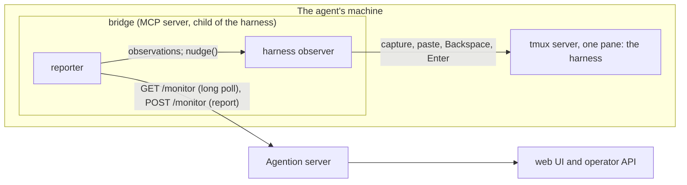

# Session monitoring and nudge: High-Level Architecture

- Requirements: [FRD](frd.md); research and spikes:
  [prior art and host research](prior-art-research.md)
- Date: 2026-11-25
- Status: Draft, the lead's response to the FRD the operator accepted on 2026-11-27 (ruling 10)
- Ownership: the effort lead

## Shape

Three pieces, each built on the one before:

1. **The harness observer**, a workspace package that knows terminals and harnesses and nothing of
   Agention (M10). Given one terminal pane, it reports the harness's condition, and it can carry out
   a nudge with every check of N4 and N5 inside it.
2. **Monitoring**, in the bridge and the server. The bridge's **reporter** holds the session's
   background connection to the server and reports what the observer finds; the server keeps the
   latest report and works out what the operator sees.
3. **The nudge**, in the bridge and the server. The server tells the reporter when a nudge is due;
   the reporter asks the observer to nudge, and reports the outcome.



Two deliveries, as the FRD's definition of done: monitoring (the observer's reading side, the
reporter, the server and both operator surfaces), then the nudge (the observer's writing side, the
nudge's server rules and the agent's guidance). Each ships complete on its own.

## The harness observer

A new workspace package, `packages/harness-observer`, private like `packages/private-files` and
bundled into the bridge. It imports nothing from Agention, so it can move to a package of its own
later (ruling 4). It reads Linux's `/proc` for the terminal's foreground process; where that is
missing, every reading is unknown and no nudge is possible.

### Interfaces

```ts
// One terminal pane. The tmux adapter implements it; tests use a real tmux server or captured
// screens. Delivery 2 adds paste(line) and key("Backspace" | "Enter").
interface Pane {
  snapshot(): Promise<Snapshot>; // rejects with PaneUnusable, or a tmux error, when unreadable
}

interface Snapshot {
  readonly lines: readonly string[]; // the visible screen, top to bottom
  readonly width: number; // columns, since a capture trims trailing spaces
  readonly cursor: { readonly x: number; readonly y: number; readonly visible: boolean };
  readonly hostHasTerminal: boolean; // the foreground process group is the pane's first process
  readonly onePane: boolean; // the server holds exactly one pane
  readonly at: number; // when it was taken, ms
  // Delivery 2 adds keysBlocked (copy mode) and lastTyped (the latest key from any client).
}

// Why a pane cannot be used at all: no /proc, a tmux older than 3.3, or a pane whose first
// process is not an ancestor of the process that asked (TmuxPane's requireAncestorOf option).
class PaneUnusable extends Error {
  readonly reason: "no-proc" | "old-tmux" | "not-ancestor";
}

// What one screen of a harness means. A pure function of one snapshot, tested against captures.
interface Profile {
  readonly name: string;
  screen(snapshot: Snapshot): Screen;
}

interface Screen {
  readonly kind: "permission_prompt" | "other_prompt" | "input" | "other";
  readonly stoppedBy?: StoppedBy;
  // Delivery 2 adds the input line's text and room, for the nudge.
}

type StoppedBy =
  | { readonly reason: "usage_limit"; readonly resetsAt?: Date }
  | { readonly reason: "block" }
  | { readonly reason: "error" };

// The profiles of one harness, by version: each entry applies from its version until the next.
interface HarnessProfiles {
  readonly harness: string; // the name the configuration uses, such as "codex"
  readonly client: string; // as the MCP client names itself, such as "codex-mcp-client"
  forVersion(version: string): Profile | undefined; // undefined below the oldest entry
}

// The registry: every profile's name, and the choice by name or by the MCP client.
declare const profileNames: readonly string[];
declare function selectProfile(name: string, client: HarnessClient | undefined): Profile;

// Two questions and a reason (M3, ruling 5): is the host running, and what does its screen hold?
interface Observation {
  readonly activity: "running" | "at_rest" | "unknown";
  readonly screen?: Screen["kind"]; // at rest only: "input" is its prompt, "other" is waiting
  readonly stoppedBy?: StoppedBy; // at rest only: why it stopped, beside any prompt on screen
  readonly since: Date; // when activity or screen last changed
}

interface Observer {
  observations(signal: AbortSignal): AsyncIterable<Observation>; // yields on change
  // Delivery 2 adds nudge({ warning, message }, { begin, signal }): Promise<NudgeOutcome>.
}
```

`Pane` is the seam to the terminal and `Profile` the seam to the harness: supporting a harness, or a
version whose screens changed, adds a `HarnessProfiles` entry and its captures and touches nothing
else (M5). The agent API keeps its own spelling of the same facts, one condition (`unknown`,
`running`, `at_prompt`, `permission_prompt`, `other_prompt`, `waiting`) beside `stopped_by`, and the
bridge maps an observation onto it: a stopped-by reason beside a prompt reads as stopped for that
reason with the prompt beside it, and a prompt with no reason as stopped on the prompt.

### Reading

- **Sampling.** One snapshot a second: one tmux client call, `capture-pane -p` chained with
  `display-message -p` for the cursor and pane formats and `list-panes -a` for the pane count, and
  `/proc/<pane_pid>/stat` for the foreground process group. The observer keeps a few seconds of
  snapshots, and `observations` yields only when the activity, the screen or the stopped-by reason
  changes (C2).
- **The observation, in M3's order**, which the observer applies once for every profile: **unknown**
  when the snapshot fails, the server holds more than one pane or the host lacks the terminal; at
  rest with the profile's **permission prompt** or **other prompt**, from one screen; **running**
  when the screen changed within the last two seconds; otherwise at rest, with the profile's screen:
  its **input** line, or **other**. Dialogs come before stillness, so a dialog's animation (Claude
  Code's blinking bullet) never reads as running. The stopped-by reason comes from the profile's
  screen and shows only at rest.
- **Harness profiles** tell what their captures show: the permission dialogs (cursor hidden, the
  dialog's text), other prompts (trust, sign-in), and the input line (cursor visible after the
  marker: Claude Code's `❯` and a no-break space, never its `!` shell mode; Codex's `›` and a
  space). No footer is read: Claude Code's vim normal mode looks the same as the normal editor's
  prompt.
- **Generic profiles** never name a prompt kind or a stopped-by reason. The strict one finds the
  input line only when the cursor is visible with nothing after it on its row; the lenient one
  whenever the cursor is visible.
- **Choosing.** `auto` takes the harness name and version from the MCP client's `initialize`
  `clientInfo` (Claude Code names itself `claude-code`, Codex `codex-mcp-client`), validated as
  outside input, and asks the registry; an unknown harness, or a version below the oldest entry,
  gets the strict generic profile. Codex's `clientInfo` is captured when its profile is built.

### Writing: `nudge()`

The whole of N4 and N5 lives in `nudge()`, so no caller can press a key outside them, and the
package's tests cover the sequence:

1. **Ready?** The latest observation is at its prompt, with no stopped-by usage limit still before
   its reset; the host holds the terminal; keys are not blocked; no key from any client for the last
   ten seconds; the profile knows its prompt marker; the input line is empty and has room for the
   warning and the message; and the caller's `begin` agrees, which is where the bridge claims the
   nudge from the server. Otherwise the nudge is deferred, nothing sent; where the line holds nudge
   text, as the caller's `isNudgeText` says (N2's marker), the deferral says so, so the bridge can
   report why the nudge is held off.
2. **Warning.** Paste it through a buffer of the observer's own, loaded from standard input
   (`load-buffer -b ... -`, then `paste-buffer -p -d -b ...`), so the operator's paste buffer is
   untouched and no text is read as tmux command syntax; confirm the input line holds exactly it,
   cursor at its end; wait five seconds; confirm again.
3. **Clear.** Send one Backspace per character, each right after a reading that shows the line one
   character shorter than the last, until the line is empty.
4. **Message.** Paste it and confirm it as in step 2.
5. **Submit.** Confirm, send Enter, and within five seconds see the line clear and the screen
   change.

Each nudge ends in one outcome (N6), which `nudge()` returns with the step it ended at, for the log:

- **Deferred**: nothing was pasted; or, at a confirmation, the line held exactly the nudge's own
  text but the rest of the screen had changed, and the nudge took that text back, one confirmed
  Backspace at a time; or the line had come empty with no key typed, the harness having taken or
  cleared it. Only the line and the cursor are compared for the warning and the message themselves;
  a change elsewhere is what takes the text back, never what fails the nudge.
- **Stopped**: a key was typed since the nudge began, or the line held something other than the
  nudge's text, or its text altered.
- **Failed**: the pane could not be read or written; a Backspace did not shorten the line by one;
  the message did not show exactly; or the host did not take it after Enter.
- **Sent**: the host took the message.

Only Backspace and Enter are ever sent, never an ordinary character or Escape (the spike), and each
only right after a confirmation, and none once the caller's `signal` aborts. A nudge that does not
go on removes its own message where a fresh reading shows the line holding exactly it, and leaves
anything else. Every confirmation also requires one pane, the host holding the terminal and keys not
blocked. `paste` refuses control characters, so no text can end the bracketed paste early, and
`nudge()` throws for a text that is empty or not printable ASCII, whose width it could never
confirm: a caller's mistake, not a moment to wait out.

### Captures

Captured screens live beside each profile as text files with their snapshot fields, named for the
harness version and what they show, and its tests read them. They come from clean scratch sessions
(a fresh home, default settings, no account details on screen) or are scrubbed, and review checks
each one (M5). The spike's screens were not kept, so building each profile starts by capturing them
again: the prompt, a running turn, the permission and trust dialogs, Claude Code's vim and shell
modes. Usage limits come from screens the operator captures at a limit one of their Claude Code
sessions reached on its own and from Codex samples the operator provides, each scrubbed (rulings 5
and 6, pull request 1c); block and error wait for a capture.

## Monitoring

### The reporter

The reporter runs in the bridge beside the agent's own tools, which work as today.

- **Starting.** At bridge start when the default session (the one `AGENTWORKS_AGENT` and
  `AGENTWORKS_SESSION` name) has a key on disk, as a restarted bridge under Agentworks does, which
  fixes the bridge to that session; on `register`; and on the first tool call that finds the
  session's credential, as any other restarted bridge does. While the registration is pending it
  reads its state every 15 seconds with the request `register` already makes, marked as background
  (below), until two minutes before it expires; on approval it starts monitoring without the agent
  calling a tool (M9). A refused, revoked or expired registration stops it until the next
  `register`.
- **The background connection.** It long-polls `GET /api/agent/s/<agent>/<session>/monitor` with an
  id it drew at start, 25 seconds at a time, one request at a time, at least a second apart, backing
  off from 1 to 60 seconds while the server is unreachable. Each request keeps the session connected
  (M1).
- **This session's pane.** The bridge acts on a socket only when the pane's first process is one of
  its own ancestors, so a socket set for another session, or for every session at once, reads as
  unknown and is logged once.
- **One bridge acts (M7).** The server keeps, in memory, the id of the latest bridge to claim a
  session: a bridge claims on its first poll after its reporter starts, and again after being
  replaced. A claim from another bridge ends the holder's open poll with `replaced`, and the server
  answers `replaced` to that bridge's unclaimed polls and refuses its reports; the replaced bridge
  stops its reporter until it next handles a tool call, since the bridge the host is using is the
  one that should report. No file and no lock: every bridge already talks to the server.
- **The report.** On start, on taking over, and whenever an observation changes, it sends
  `POST /api/agent/s/<agent>/<session>/monitor` with the whole report.

This keeps from agention#67's `push.ts` its loop and pacing (`#run`, `#registration`, `#round`,
`#pause`: the 15-second pending read, the expiry margin, the floor and the backoff) and their tests
for starting on approval, recovery and the floor. Its host directory, wake file, notice, lapse line,
saved cursor and `claude-code` gate do not carry over.

### The agent API, version 8

Main took version 5 for notes beside an answer, and versions 6 and 7 for pull request and branch
links, so monitoring is version 8 and the nudge 9, each bumping by one as CONTRIBUTING.md "The agent
API" says.

- **`GET .../monitor`**, a long poll reusing the wait's machinery: it answers after 25 seconds, or
  at once with `replaced`. It never marks the session checked in.
- **`POST .../monitor`**, numbered by the bridge so a late report never replaces a newer one:
  whether a pane is monitored, the profile's name, the condition and since when, and the stopped-by
  reason with its reset time. Every field is a schema-checked enumeration, boolean, time or the
  profile's name; there is no free text (M8). A report replaces the last.
- **`POST /registrations`** gains a `background` flag; the reporter's reads set it, so approval
  marks the session connected, never checked in, and a background read never creates a registration:
  a key the server does not know is refused, so a restarted bridge never puts an approval in front
  of the operator that no agent asked for.
- **Every other approved request is the agent checking in** (M2), as today's last seen is.

### The server

- **Stored**: on the session, the agent's last check-in, with the agent API version of that request,
  and the time of the latest background request; in a table of its own, the latest report, which a
  claim by another bridge deletes and which a report numbered no higher than the last accepted one
  never replaces. A check-in is stamped to the minute, as today, and also whenever the stamp is
  older than a nudge's claim, the latest nudge (delivery 2), or the latest message someone else
  wrote in one of the session's threads, so a check-in's order against each message and attempt is
  exact: a reply to a nudge always shows, and a call after a message always counts as checking in
  since it. Background requests are stamped on each one, every 25 seconds at most. A migration adds
  the columns.
- **Derived in queries**, never stored (review checklist A8): **connected**, a background request
  within the last 60 seconds; **quiet**, no check-in within `--quiet-minutes`; **stranded**, by M6;
  and the condition, shown only while connected, so a dead bridge's last report is never shown as
  current.
- **Older bridges (C1).** While no background request is fresh and the latest check-in came from a
  version below 8, the session follows today's presence and stranded rule, never shown disconnected.
  So a plugin pinned back to an older release reads as it always did.
- **Shown.** The operator API's session reads carry connection, last check-in, condition with since,
  stopped-by and the profile's name (delivery 1a); the sessions view shows them, flags the sessions
  at a prompt or stopped by something with a filter listing them (M4), and names the condition in a
  stranded thread's reason, for which thread presence carries the same condition while the bridge is
  connected, on the operator API's thread reads too (delivery 1b). No agent-facing answer carries
  any of it (M8).

## The nudge

Delivery 2 bumps the agent API to version 9:

- **Due.** `GET .../monitor` also answers `nudge`, whether a nudge is due: the latest report says
  the session can be nudged and is at its prompt, not stopped by a usage limit before its reset; the
  session has a thread with a message the agent has not read, written by someone else after the
  agent's last check-in; and no nudge has been claimed since that check-in (N1, N3, N4). The answer
  is level-triggered: a bridge that already knows one is due says so, and its poll is held until
  that changes, so a nudge waiting for a still prompt costs no requests (C2). A report that finds
  the session at its prompt, able to be nudged, and a message wake the poll, since those make a
  nudge due; what ends one wakes nothing, because a claim checks again that one is due; working it
  out writes nothing, and a replaced bridge is never told. The server works this out from the
  session's own rows, so it holds across bridge restarts, takeovers and Codex's several bridges, and
  the bridge learns only that one is due, never why: nothing about threads or presence reaches the
  agent through it.
- **The claim and the outcome.** `POST .../monitor/nudge` starts a nudge, in one transaction: the
  server checks that the bridge acts for the session and that one is due, records the claim with the
  attempt's id (N2) at its own clock, and answers whether to go. The bridge types nothing until it
  does, and retries the claim inside `begin`; a claim whose answer was lost and is then refused is
  released, so a nudge never typed never reads as one. The same route takes the outcome, filling
  only the claim it names: **sent**, **stopped** or **failed** settle the claim as the session's
  latest nudge, which then counts (N3); **deferred** releases it, leaving the latest nudge as it
  was, so the nudge is due again. A claim whose outcome has not arrived is **under way**, never
  sent: the server records which bridge made it, and the operator sees the nudge under way. When
  another bridge comes to act for the session while a claim is under way, as after a restart or a
  takeover, nothing proves the claim's text reached the pane, so the server settles it: as deferred,
  releasing it, the first time since the agent last checked in, so the wake it was for comes; and as
  failed if an earlier claim was settled that way since that check-in, so a bridge that keeps
  stopping mid-nudge raises a problem rather than warning the agent again and again. A message
  submitted just before its bridge died wakes the agent, whose check-in ends the nudge being due, so
  this never doubles a nudge the agent answered. The claim and the latest nudge are columns of their
  own on the session, so a release needs nothing remembered. The check-in stamp moves whenever it is
  older than the claim or the latest nudge, so an agent that checks in while the nudge is under way
  counts as answering it. The server shows "not responding to the nudge" while a nudge it recorded
  has no check-in after it (N6), and applies M6's nudge branches, which strand the thread once the
  quiet time passes, or mark it ignored where the agent checked in since without reading it (ruling
  8), one ordered decision in the thread read so a thread is never both. A nudge that failed or was
  stopped at the terminal strands the thread at once, with that reason; one that failed reads as a
  problem, one stopped as the choice of whoever was at the terminal.
- **Reasons on the session (CF4).** The report gains whether the session can be nudged and, where it
  cannot be monitored or nudged, one reason from a fixed list, with since when: `nudge_off`,
  `unknown_nudge_type`, `no_socket`, `pane_unreachable`, `not_one_pane`, `unknown_profile`,
  `generic_profile`, `nudge_text_left` and `claims_refused`. The bridge reports a reason as it
  arises, as it reports a condition, so trouble that starts after `register` reaches the operator
  without the agent (ruling 9). The operator API's session reads carry it and the sessions view
  shows it; no agent-facing answer does (M8).

On a due answer, the reporter calls `observer.nudge()` with the warning and the message, each fixed
words plus the nudge marker and the attempt's id, drawn from a cryptographic random source (N2), the
claim as `begin`, and a signal it aborts when it is replaced or stops. A deferral before any claim
is retried about once a second from the pane alone until the observer is ready or a poll says the
nudge lapsed; one held off by nudge text at the prompt is also reported as `nudge_text_left` until
the line clears. Every claimed attempt's outcome is sent, a deferred one releasing the claim. The
bridge's log names each attempt's id, outcome and step, never pane text. A bridge whose claim or
outcome the server refuses as invalid stops nudging until it restarts, and reports that the session
cannot be nudged, so it cannot loop. A session whose profile is generic cannot be nudged: a generic
profile cannot tell a draft on the input line from its prompt, and N2 and N5 allow nothing on the
line but the nudge's own text. T1's `register` answer carries how answers reach the agent
(`answers`: `nudge` or `check`), so the usage skill can point at it; it and the skill come with this
delivery.

## Configuration

| Option              | Variable                   | Values                                                                        |
| ------------------- | -------------------------- | ----------------------------------------------------------------------------- |
| `--tmux-socket`     | `AGENTION_TMUX_SOCKET`     | the tmux server's socket path                                                 |
| `--harness-profile` | `AGENTION_HARNESS_PROFILE` | `auto` (default), `claude-code`, `codex`, `generic-strict`, `generic-lenient` |
| `--nudge`           | `AGENTION_NUDGE`           | `tmux`; absent means off                                                      |

An option wins over its variable. The bridge never reads `TMUX` or `TMUX_PANE`. The plugin
definition forwards the three variables on both hosts (CF3), and the execution platform running the
session sets them. They are named for what they configure, never for a platform; Agentworks, the
first platform, sets them through its templating once it exposes the socket path, and until then
they are set by hand.

What goes wrong, and where it shows (CF4):

| Case                                           | Log                  | `register` answer           | Condition | Reason on the session |
| ---------------------------------------------- | -------------------- | --------------------------- | --------- | --------------------- |
| No nudge type                                  | nothing              | answers arrive when checked | as read   | `nudge_off`           |
| No socket                                      | nothing              | answers arrive when checked | none      | `no_socket`           |
| Socket unreachable, path too long, or no tmux  | the error, once      | answers arrive when checked | unknown   | `pane_unreachable`    |
| More than one pane, or the host lacks the pane | once                 | answers arrive when checked | unknown   | `not_one_pane`        |
| Unknown profile name                           | once; strict generic | answers arrive when checked | as read   | `unknown_profile`     |
| A generic profile                              | nothing              | answers arrive when checked | as read   | `generic_profile`     |
| Unknown nudge type                             | once; nudge off      | answers arrive when checked | as read   | `unknown_nudge_type`  |
| Nudge text left at the prompt                  | once, with the id    | (arises later)              | as read   | `nudge_text_left`     |
| A claim or outcome refused as invalid          | once; nudge off      | (arises later)              | as read   | `claims_refused`      |

Every case that arises after the bridge starts, a pane becoming unreachable among them, shows on the
session as it arises; the agent is not told (ruling 9). The tools work as without monitoring in
every case.

## Security

- **What leaves the machine**: enumerations, booleans, times and the profile's name. Snapshots stay
  in the bridge's memory, and its log names steps and conditions, never screen text (M8).
- **Trust.** A report is the bridge's observation, trusted as the agent's host is under ADR 0001's
  honor system. The screen can imitate a condition, so a report is never authority for anything but
  what the operator sees; only `nudge()`'s own checks, at the moment of each key, let one be
  pressed.
- **The nudge's texts** are constants in the bridge plus the marker and a random attempt id; nothing
  from the server or the screen reaches them (N2). The due answer carries no thread, message or
  presence.
- **Rights.** The bridge runs as the account that owns the tmux server; it gains no access it
  lacked.

## Testing

- **The observer**: each profile against its captures; the condition order, sampling and `nudge()`'s
  steps against a real tmux server running a small scripted harness, a Node script that draws a
  prompt, a running turn, a dialog that answers to keys, and an input line, so every guard and every
  abandoned step is exercised.
- **The bridge and server**: the reporter against the bridge's test server (`test-harness.ts`), for
  starting on approval, takeover, recovery and older-bridge rules; the derivations in the store's
  tests.
- **tmux in CI and locally**: the tests need `tmux` 3.3 or later; CI installs the distribution's
  package, and CONTRIBUTING's prerequisites list it.

## Deliveries

1. **Monitoring.**
   - **1a**: the observer package's reading side with the Claude Code, Codex and generic profiles
     and their captures; the reporter; agent API version 8, the migration and the derivations; the
     operator API's session reads and `docs/api/openapi.json`; the configuration and plugin
     forwarding; the web UI's "not connected" stranded reason, which 1a's new stranded cause needs;
     the monitoring ADR; and the collateral E1 names for monitoring outside the sessions view.
   - **1b**: the sessions view, its flag and filter, the condition in stranded reasons, and the
     operator guide's account of them.
   - **1c**: usage limits in the Claude Code and Codex profiles, from the captures and samples of
     ruling 5.
2. **The nudge**: `nudge()`, agent API version 9, the due answer and outcome, M6's nudge branches,
   T1 and the usage skill, the ADR and the rest of E1.

## Risks and open items

- **Harness releases** change screens often. A changed screen reads as waiting or unknown, and
  `nudge()`'s checks hold regardless; refreshed captures make the change visible.
- **Usage limits** wait on a limit one of the operator's Claude Code sessions reaches on its own,
  and on the operator's Codex samples, so 1c runs whenever they arrive; **block and error** need
  captures before any profile claims them.
- **Several bridges on Codex**: the takeover rule is checked live (FRD definition of done).
- **Generic profiles cannot be nudged**, since they cannot tell a draft from a prompt marker. A
  harness gains the nudge with its own profile; until then its sessions are monitored only.
- **Claude Code's vim normal mode** looks the same on screen as the normal editor's prompt at an
  empty input, and there Backspace moves the cursor rather than deleting. Accepted: the clear step
  then finds the line not shortened and abandons at `cleared` (or at `warning`, where the cursor
  sits on the text's last character) and reports not sent, so the warning stays in the input, where
  the operator sees it and nothing submits it. Learning the mode another way waits until it proves
  common.
- **Hint text** in an empty input (Claude Code's `Try "..."`, Codex's "Ask Codex to do anything") is
  told from typed text only by the captured patterns, since captures carry no color; an unknown hint
  leaves the nudge not ready, which is safe. Reading text attributes waits until a hint is missed.
- **Bracketed paste** cannot be detected: tmux has no format saying whether the program asked for
  it. Claude Code and Codex both do, and only their profiles nudge; a profile added for a harness
  that does not must be checked for it, since that harness would receive each text as typed keys.
- **Keys go to tmux's default target**, as reads do. Each key follows a reading that found one pane,
  and the platform's sessions hold one pane, as Agentworks's do, so only a pane created in the
  milliseconds between could receive it.
- **A restarted bridge whose platform names no default session** starts reporting only at the
  agent's next tool call, since it learns its session's names then; until then the session shows
  disconnected.
