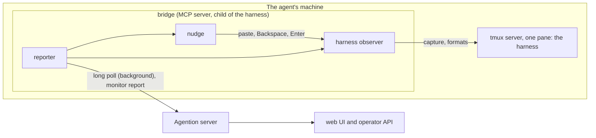

# Session monitoring and nudge: High-Level Architecture

- Requirements: [FRD](frd.md); research and spikes:
  [prior art and host research](prior-art-research.md)
- Date: 2026-11-25
- Status: Draft, written while the FRD awaits acceptance
- Ownership: the effort lead

## Shape

Three pieces, each built on the one before:

1. **The harness observer**, a workspace package that knows terminals and harnesses and nothing of
   Agention (M10). Given a way to read and write one terminal pane, it reports the harness's
   condition, and it can place, check and clear text at the harness's input line.
2. **Monitoring**, in the bridge and the server. The bridge's **reporter** holds the session's
   background connection to the server and reports what the observer finds; the server keeps the
   latest report and works out what the operator sees from it.
3. **The nudge**, in the bridge. When the reporter learns the operator wrote, and the session can be
   nudged, it runs the warn, clear and send sequence through the observer.



Monitoring ships first (delivery 1) and is complete without the nudge; the nudge (delivery 2) adds
the observer's writing side and the bridge's sequence, and nothing on the server beyond what
monitoring already reports.

## The harness observer

A new workspace package, `packages/harness-observer`, private like `packages/private-files` and
bundled into the bridge. It imports nothing from Agention, so it can move to a package of its own
later (ruling 4).

### Interfaces

```ts
// One terminal pane, as the observer reads and writes it. The tmux adapter implements it; a test
// double replays captured screens.
interface Pane {
  snapshot(): Promise<Snapshot>;
  paste(text: string): Promise<void>; // bracketed paste of one line
  key(key: "Backspace" | "Enter"): Promise<void>; // the only keys there are
}

interface Snapshot {
  readonly lines: readonly string[]; // the visible screen
  readonly width: number;
  readonly height: number;
  readonly cursor: { readonly x: number; readonly y: number; readonly visible: boolean };
  readonly hostHasTerminal: boolean; // the foreground process group is the pane's first process
  readonly inMode: boolean; // tmux copy mode or another mode that keeps keys from the host
  readonly lastTyped: number | undefined; // when an attached client last sent a key, ms
  readonly at: number; // when it was taken, ms
}

// What one harness's screens mean. Pure functions of snapshots, so profiles are data plus a little
// matching code, tested against captured screens.
interface Profile {
  readonly name: string; // "claude-code", "codex", "generic-strict", "generic-lenient"
  // The condition the latest snapshots show; recent holds the last few seconds, oldest first.
  read(recent: readonly Snapshot[]): Reading;
  // Where the input line is and what it holds, when the snapshot shows the prompt.
  input(snapshot: Snapshot): InputLine | undefined;
}

type Condition =
  "unknown" | "permission-prompt" | "other-prompt" | "running" | "at-prompt" | "waiting";

interface Reading {
  readonly condition: Condition;
  readonly stoppedBy?: StoppedBy; // only at rest
}

type StoppedBy =
  | { readonly reason: "usage-limit"; readonly resetsAt?: Date }
  | { readonly reason: "block" }
  | { readonly reason: "error" };

interface InputLine {
  readonly text: string; // what follows the prompt marker on the cursor's row
  readonly cursorAtEnd: boolean;
}

// Watches one pane with one profile and yields an observation whenever the reading changes.
interface Observer {
  observations(signal: AbortSignal): AsyncIterable<Observation>;
  // The nudge's writing side: each call checks the screen before and after, and fails closed.
  place(text: string): Promise<Placed>; // paste, then confirm it sits alone on the input line
  remove(placed: Placed): Promise<boolean>; // Backspaces, only while the text is still exactly there
  submit(placed: Placed): Promise<boolean>; // Enter, only while the text is still exactly there
}

interface Observation extends Reading {
  readonly since: Date;
}
```

`Pane` is the seam: the tmux adapter is one implementation, and another terminal or a test double is
another. `Profile` is the second seam: adding a harness, or a version whose screens changed, adds or
edits a profile and its fixtures, and touches nothing else (M5).

### Reading a pane

- **Sampling.** The observer takes a snapshot every second, and every quarter second for a few
  seconds after a change, keeping the last few seconds. Each snapshot is a handful of tmux client
  calls: `capture-pane -p` and one `display-message -p` of the formats (`cursor_x`, `cursor_y`,
  `cursor_flag`, `pane_in_mode`, `pane_pid`, `client_activity`), and `/proc/<pane_pid>/stat` for the
  foreground process group. Only `observations` sends anything onward, and only on change (C2).
- **Generic rules every profile starts from**, from the spike: unknown when the pane cannot be read,
  the server holds more than one pane, or the host no longer has the terminal; running when the
  screen changed within the last two seconds; and at rest otherwise.
- **Harness profiles** add what they can tell from captured screens: Claude Code's and Codex's
  permission dialogs (hidden cursor and their dialog text; Claude Code's blinking bullet masked from
  the stillness test), other prompts (trust, sign-in), the prompt (cursor visible on the input row
  after `❯` or `›` and a space; for Claude Code, `-- INSERT --` when vim mode is on and no `!` shell
  mode), and a stopped-by reason once a captured screen shows it.
- **Generic profiles.** Strict: at its prompt only when the cursor is visible, the cursor's row
  holds nothing after it, and the pane is still; otherwise waiting. Lenient: at its prompt whenever
  the cursor is visible and the pane is still. Neither reports a prompt kind or a stopped-by reason.
- **Choosing a profile.** `auto` picks by the harness the bridge runs under, from the MCP client's
  `initialize` `clientInfo` (name and version), validated as outside input; an unknown harness gets
  the strict generic profile. A profile records the versions where its screens changed and applies
  to every later version until a capture shows otherwise; a harness version older than the profile
  knows gets the strict generic one.

### Writing to a pane

The observer owns the checks around every write, so no caller can press a key without them:

- `place` pastes one line as a bracketed paste, waits for the screen, and succeeds only if the
  profile's `input` finds exactly that text, alone, with the cursor visible right after it.
- `remove` and `submit` re-check the same before sending a key: `remove` sends one Backspace per
  character and then confirms the line is empty; `submit` sends Enter.
- Nothing else is sent: never an ordinary character, never Escape (the spike's findings).

### Fixtures

Captured screens live beside each profile as text files with their snapshot fields, named for the
harness version and the condition they show. They come from clean scratch sessions like the spike's,
or are scrubbed; review checks each one (M5). The spike's captures for running, the prompt, the
permission dialogs and the trust dialogs are the first; usage limit, block and error wait for a
capture, as the operator decides.

## Monitoring

### The bridge's reporter

The reporter replaces nothing the agent does: its own `message_wait` and tools work as today. It
runs only with an approved registration, and starts on approval (M9).

- **Approval.** While the registration is pending, the reporter reads its state every 15 seconds
  with the request `register` already makes, until two minutes before it expires, as agention#67's
  bridge did; a refused, revoked or expired registration ends it, and only `register` restarts it.
- **The background connection.** It long-polls `GET /api/agent/s/<agent>/<session>/wait` from its
  own cursor, 25 seconds at a time, marked as the bridge's own (below), which keeps the session
  **connected** (M1) and tells it when the operator wrote (N1). This is agention#67's loop, carried
  forward with its tests: one request at a time, a floor between requests, backoff on an unreachable
  server, and a cursor the server refuses dropped.
- **The monitor report.** When the observer's reading changes, or the nudge's outcome does, the
  reporter sends `PUT /api/agent/s/<agent>/<session>/monitor` with the whole current report.
- **One bridge acts (M7).** Bridges of one session share its key file. The first to start its
  reporter takes a lock file beside the key file, holding its pid, under the private-file rule; a
  newer bridge takes it over when that pid is gone or is an older bridge, and a bridge whose lock is
  taken stops its reporter. Where a pane is configured, the bridge also records its pid in a tmux
  server option, so two bridges with different keys never drive one pane.

### The agent API, version 5

Monitoring bumps the agent API to version 5 (C1):

- **Background requests.** A request carrying `Agention-Background: 1` comes from the bridge itself:
  it marks the session connected, never checked in. Every other approved request is the agent
  checking in (M2). Under ADR 0001's honor system the bridge is trusted to mark only its own.
- **`PUT .../monitor`.** The report: whether a pane is monitored, whether the session can be nudged,
  the profile's name, the condition and since when, the stopped-by reason with its reset time, and
  the latest nudge's time and whether it was sent. Every field is a schema-checked enumeration,
  boolean or time; there is no free text (M8). A report replaces the last.
- **Older bridges.** A session whose bridge speaks a version below 5 sends no background marker, so
  every call it makes is a check-in and it is never shown connected or disconnected: today's
  presence and stranded rule applies to it unchanged.

### The server

- **Stored**, on the session: when the agent last checked in, when the bridge's background request
  last arrived, the version that sent it, and the latest monitor report. Nothing derived is stored
  (review checklist A8).
- **Derived in queries**: connected (a background request within about a minute), quiet (no check-in
  within `--quiet-minutes`), "not responding to the nudge" (a nudge sent and no check-in since), and
  stranded by M6's rule, with its reason.
- **Shown**: the sessions view gains each session's connection, last check-in, condition and
  stopped-by note, a flag on the sessions that need the operator with a filter listing them (M4),
  and stranded reasons that name the condition; the operator API's session reads carry the same. No
  agent-facing route returns any of it (M8).

## The nudge

When the reporter's long poll returns threads with operator messages, the agent has not checked in
since, the session can be nudged, and no nudge was tried since the agent last checked in (N3), the
bridge waits for the observer to report the session at its prompt, not stopped by a usage limit that
has yet to reset, still, the host holding the terminal and no one having typed for a while (N4).
Then:

1. `place` the warning: fixed words and a random token; wait a few seconds;
2. confirm the warning is still exactly there, then `remove` it;
3. `place` the message, the same fixed words every time;
4. `submit` it, and watch for the line to clear and a turn to start.

Any failed check abandons the nudge where it stands, removing only the bridge's own text while it is
still exactly there, and records "not sent"; the log says which step, without pane text.

## Configuration

| Option              | Variable                   | Values                                                                        |
| ------------------- | -------------------------- | ----------------------------------------------------------------------------- |
| `--tmux-socket`     | `AGENTION_TMUX_SOCKET`     | the tmux server's socket path                                                 |
| `--harness-profile` | `AGENTION_HARNESS_PROFILE` | `auto` (default), `claude-code`, `codex`, `generic-strict`, `generic-lenient` |
| `--nudge`           | `AGENTION_NUDGE`           | `tmux`; absent means off                                                      |

The plugin definition forwards the three variables on both hosts (CF3), and Agentworks sets them
through its templating once it exposes the socket path; until then, by hand.

## Security

- **What leaves the machine**: enumerations, booleans and times. The observer's snapshots stay in
  the bridge's memory, and its log names steps and conditions, never screen text (M8).
- **Trust.** A monitor report is the bridge's observation, trusted as the agent's host is under ADR
  0001's honor system. Screen text the harness prints can imitate a condition, so a report is never
  authority for anything but what the operator sees; only the observer's own checks, at the moment
  of each write, let a key be pressed.
- **The nudge's texts** are constants in the bridge, plus a token from a cryptographic random
  source; nothing from the server or the screen reaches them (N2).
- **Rights.** The bridge runs as the account that owns the tmux server; it gains no access it
  lacked.

## Deliveries

1. **The harness observer**: the package, the tmux adapter, the four profiles, the fixtures from the
   spike and their tests. It ships no behavior on its own, so it rides with delivery 2a's pull
   request unless review wants it separate.
2. **Monitoring**: (a) the observer and the reporter in the bridge, agent API version 5 and the
   server's storage and derivations; (b) the web UI and operator API; with the collateral E1 names
   for monitoring.
3. **The nudge**: the observer's writing side, the bridge's sequence, T1 and the usage skill, and
   the rest of E1.

## Risks and open items

- **Harness releases** change screens often (11 Claude Code releases in two weeks). A changed screen
  degrades to waiting or unknown, and the nudge's checks hold regardless; the fixtures make the
  change visible when a capture is refreshed.
- **Usage limit, block and error** need captures before any profile claims them; how one is obtained
  is open with the operator.
- **The blinking bullet** in Claude Code's permission dialog defeats a plain stillness test; its
  profile masks it.
- **Several bridges on Codex**: the lock's takeover rule is checked live (FRD definition of done).
